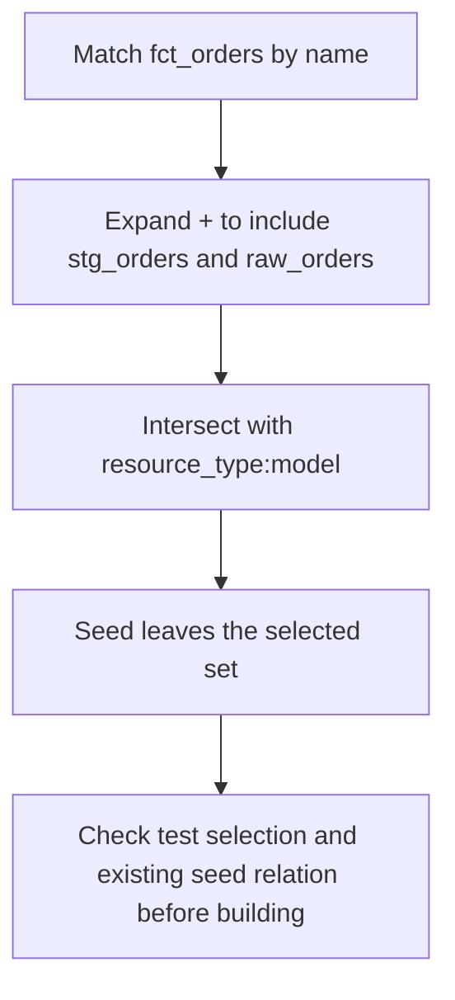

# Selectors, graph operators and named selections

Running an entire dbt project on every edit or job wastes compute and slows feedback. **Node selection** scopes commands to the exact slice of the DAG you need. dbt evaluates selector syntax in order: match resources by method, expand graph operators, then apply set unions, intersections, and exclusions. [Selection syntax](https://docs.getdbt.com/reference/node-selection/syntax)

## Selector methods and graph operators

| Selector method | Example and meaning |
| --- | --- |
| Model name / `fqn:` | `fct_orders` matches by resource name or fully qualified name. |
| `tag:` | `tag:daily` matches resources tagged `daily` in config or YAML. |
| `path:` | `path:models/staging` matches files inside that directory tree. |
| `config:` | `config.materialized:incremental` matches resources with that config. |
| `resource_type:` | `resource_type:model` restricts to models (or `seed`, `snapshot`, `test`, `source`). |
| `source:` / `exposure:` | `source:shop+` or `+exposure:orders_dashboard` selects from non-model endpoints. |
| `result:` (with `--state`) | `result:error` or `result:fail` matches nodes that errored or failed in a saved `run_results.json`. |

Combine methods with graph operators and set logic:

| Expression | What it selects |
| --- | --- |
| `+fct_orders` | The fact and all its ancestors. `1+fct_orders` stops after 1 upstream edge (`1+fct_orders+1` bounds both sides). |
| `fct_orders+` | The fact and all its descendants. |
| `@stg_orders` | `stg_orders`, all its descendants, **and any other ancestors needed by those descendants**. For example, if `int_reportable_orders` joins `stg_orders` and `order_statuses`, `@stg_orders` includes `order_statuses` so the downstream build has all its parents, whereas `stg_orders+` omits `order_statuses`. |
| `"stg_orders fct_orders"` | Union (space-separated): matches either resource. |
| `"+fct_orders,resource_type:model"` | Intersection (comma-separated): keeps only nodes matching every condition. |
| `--select "+fct_orders" --exclude "resource_type:seed"` | Exclusion: drops seeds from the selected set. Verify the seed table already exists before building. |

Remember that the command controls which resource types execute: `dbt build` runs models, seeds, snapshots, and tests together, while `dbt run` builds models only and assumes upstream seeds already exist.

## Indirect test selection and YAML selectors



Selecting a model automatically pulls in attached data tests via **indirect selection**:

- **`eager` (default)** includes a multi-parent test (like a `relationships` or cross-model singular test) if **any** parent is selected.
- **`cautious`** includes a multi-parent test only when **all** of its parents are selected.
- **`buildable`** includes a test if all of its parents are either selected or ancestors of selected nodes.
- **`empty`** skips indirect test selection unless a test is named explicitly. [Graph operators](https://docs.getdbt.com/reference/node-selection/graph-operators) · [Test selection](https://docs.getdbt.com/reference/node-selection/test-selection-examples)

!!! note "YAML selectors in v1 and v2"
    Store reusable job criteria in root `selectors.yml` and invoke them with `--selector orders_build`. In dbt v1.12+ and v2, use `--select "selector:orders_build,resource_type:model"` to compose a YAML selector with extra filters. The standalone `--selector` flag cannot combine with `--select` or `--exclude`. [YAML selectors](https://docs.getdbt.com/reference/node-selection/yaml-selectors) · [Selector methods](https://docs.getdbt.com/reference/node-selection/methods)

Read `+fct_orders,resource_type:model` in two passes. Expand the fact and its ancestors first, including the seed. Intersect that set with models second, which removes the seed. Replacing the comma with a space requests a union and can include unrelated models. Preview the names before using the selector for a build.

## Practice

### What you need

Work in [shop_lab](0004-adapters-profiles-and-the-local-shop-lab.md) with [`fct_orders`](0006-models-refs-and-project-configuration.md).

### Steps

1. Predict what each `dbt ls` command prints before running it:

```bash
dbt ls --profiles-dir . --select "fct_orders" --resource-type model --output name
dbt ls --profiles-dir . --select "+fct_orders" --resource-type model seed --output name
dbt ls --profiles-dir . --select "+fct_orders,resource_type:model" --resource-type model --output name
```

**Expected result.** First `fct_orders` alone; second `raw_orders`, `stg_orders`, and `fct_orders`; third `stg_orders` and `fct_orders` (order may vary).

2. Create `selectors.yml` in the root of `shop_lab`:

```yaml
selectors:
  - name: orders_build
    description: Build the order fact with its upstream inputs.
    definition: "+fct_orders"
```

3. Preview and execute the named selector:

```bash
dbt ls --profiles-dir . --selector orders_build --resource-type model seed --output name
dbt build --profiles-dir . --selector orders_build
```

If a selector returns an empty list, inspect `--select` without exclusions and check tags, paths, or `enabled: false` configs. [dbt ls](https://docs.getdbt.com/reference/commands/list)

4. Test indirect selection with a temporary multi-parent test `tests/orders_missing_from_staging.sql`:

```sql
select fact.order_id
from {{ ref('fct_orders') }} as fact
left join {{ ref('stg_orders') }} as staging on fact.order_id = staging.order_id
where staging.order_id is null
```

```bash
dbt ls --profiles-dir . --select "fct_orders" --resource-type test --output name --indirect-selection eager
dbt ls --profiles-dir . --select "fct_orders" --resource-type test --output name --indirect-selection cautious
```

**Expected result.** `orders_missing_from_staging` appears under `eager` (because one parent, `fct_orders`, is selected) and disappears under `cautious` (because `stg_orders` is unselected).

5. **Cleanup.** Delete `tests/orders_missing_from_staging.sql` when done.

## Recall

1. How do you select `fct_orders` and its immediate staging parent (`stg_orders`) while excluding `raw_orders`?
2. Why can an `eager` test fail in a PR schema even though the model you selected built cleanly?
3. When would you use `@stg_orders` instead of `stg_orders+` in a CI or deployment command?

??? note "Answer guidance"
    1. Use `1+fct_orders` (or `+fct_orders,resource_type:model` / `--exclude raw_orders`). Make sure `raw_orders` already exists in the target schema before building.
    2. `eager` includes a multi-parent test when only one parent is selected; if the second parent was never built or deferred properly in that schema, the test fails or queries missing/stale data. Switch to `buildable` or `cautious`, or defer the missing parent.
    3. Use `@stg_orders` when downstream models join additional upstream branches (such as a seed or second staging table) that must also exist or rebuild before those descendants run.

| Previous | Curriculum | Next |
| --- | --- | --- |
| [Previous lesson](0015-analyses-hooks-and-user-defined-functions.md) | [All lessons](index.md) | [Next lesson](0017-artifacts-and-run-evidence.md) |
