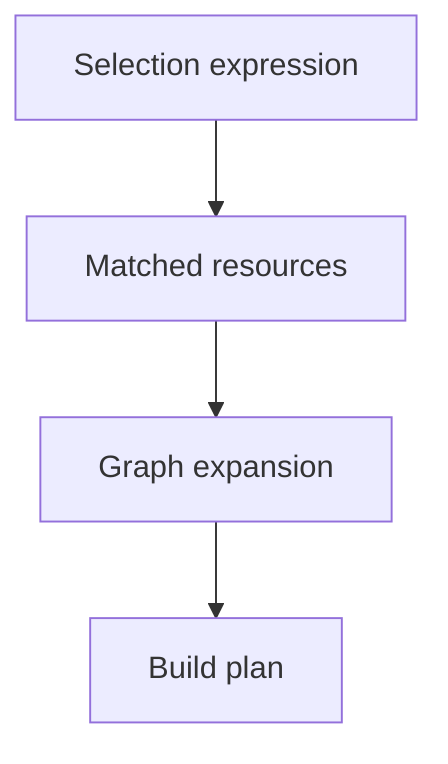

# Selectors, graph operators and named selections

Select by name, tag, path, resource type, or state. A leading plus includes ancestors and a trailing plus includes descendants. Spaces union expressions. Commas intersect them. Named selectors in `selectors.yml` make recurring policy reviewable. Test selection also depends on how indirect selection is configured.

Preview the selection with `dbt ls` before expensive or destructive work. Read both the intended targets and their prerequisites. A narrow selector can still pull in tests that depend on a second relation.

## Practice

Compare `dbt ls --select fct_orders`, `dbt ls --select +fct_orders`, and `dbt ls --select fct_orders+`. Add a tag to the fact and try an intersection with `resource_type:model`.

## Recall

How would you select the order fact and its ancestors without also selecting its descendants?

[Selection syntax](https://docs.getdbt.com/reference/node-selection/syntax)

| Previous | Curriculum | Next |
| --- | --- | --- |
| [← Previous lesson](0015-analyses-hooks-and-user-defined-functions.md) | [All lessons](index.md) | [Next lesson →](0017-artifacts-and-run-evidence.md) |
