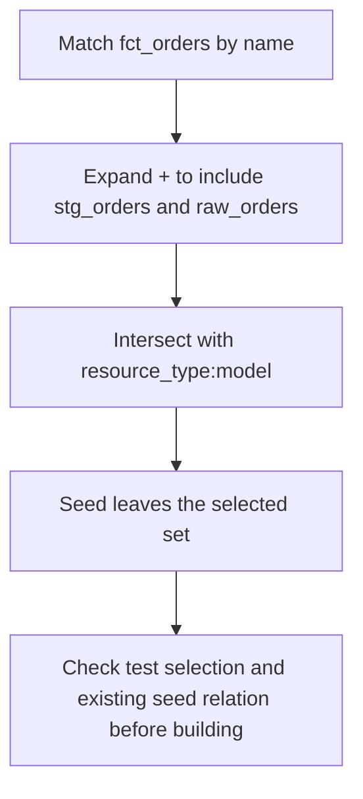

# Selectors, graph operators and named selections

A selector starts with a matching rule such as a model name, `tag:nightly`, `path:models/staging`, or `resource_type:model`. dbt matches resources, expands graph operators, then applies set operations. The command determines what can execute. A seed in the selection can load under `dbt build`. Under `dbt run`, its table must already exist for any selected model that reads it. [Selection syntax](https://docs.getdbt.com/reference/node-selection/syntax)

| Expression | What it selects |
| --- | --- |
| `+fct_orders` | The fact and all its ancestors. `1+fct_orders` stops after one upstream edge. |
| `fct_orders+` | The fact and its descendants. |
| `@stg_orders` | Staging, its descendants, and the ancestors needed by those descendants. A downstream join can bring in another branch. |
| `"stg_orders fct_orders"` | Union. Either match qualifies. |
| `"+fct_orders,resource_type:model"` | Intersection. Keeps only models in the expanded set. |
| `--select "+fct_orders" --exclude "resource_type:seed"` | Removes seeds from the selection. Check that their relations already exist before building. |

A selected model can also pull in data tests indirectly. For a test with two parents, `eager` (the default) includes it if either parent is selected. `cautious` requires both parents to be selected, and `buildable` allows parents that are selected or are ancestors of selected nodes. `empty` disables indirect selection. A graph operator can still select a test directly. [Graph operators](https://docs.getdbt.com/reference/node-selection/graph-operators) · [Test selection](https://docs.getdbt.com/reference/node-selection/test-selection-examples)



!!! note "v1 and v2"
    `--selector orders_build` calls a named YAML selector in both engines. Use `--select "selector:orders_build,resource_type:model"` to compose the name with other criteria in v1.12 and later and in v2. When using the legacy `--selector` flag, supply the full selection in YAML because it takes precedence over `--select` and `--exclude`. [YAML selectors](https://docs.getdbt.com/reference/node-selection/yaml-selectors) · [Selector methods](https://docs.getdbt.com/reference/node-selection/methods)

## Practice

From `shop_lab` with [the seed and staging model](0004-adapters-profiles-and-the-local-shop-lab.md) and [the fact model](0006-models-refs-and-project-configuration.md), predict which resources each command lists.

```bash
dbt ls --profiles-dir . --select "fct_orders" --resource-type model --output name
dbt ls --profiles-dir . --select "+fct_orders" --resource-type model seed --output name
dbt ls --profiles-dir . --select "+fct_orders,resource_type:model" --resource-type model --output name
```

Expect `fct_orders` alone, then `raw_orders`, `stg_orders`, and `fct_orders`, then the two models only. Compare sets regardless of display order.

Add this entry to the root `selectors.yml` in the sandbox. The name makes the policy reviewable and reusable in a job.

```yaml
selectors:
  - name: orders_build
    description: Build the order fact with its upstream inputs.
    definition: "+fct_orders"
```

```bash
dbt ls --profiles-dir . --selector orders_build --resource-type model seed --output name
dbt build --profiles-dir . --selector orders_build
```

Confirm the named selection matches the second list and the build succeeds. If a required input was excluded, list again without the exclusion. An empty list can also mean the path, tag, or name missed, or the resource is disabled. [dbt ls](https://docs.getdbt.com/reference/commands/list)

Try indirect selection with a temporary `tests/orders_missing_from_staging.sql`.

```sql
select fact.order_id
from {{ ref('fct_orders') }} as fact
left join {{ ref('stg_orders') }} as staging on fact.order_id = staging.order_id
where staging.order_id is null
```

```bash
dbt ls --profiles-dir . --select "fct_orders" --resource-type test --output name --indirect-selection eager
dbt ls --profiles-dir . --select "fct_orders" --resource-type test --output name --indirect-selection cautious
```

Expect `orders_missing_from_staging` in the eager list only. When an unexpected test appears in a job, list the test resources with the same selection, then inspect the test's dependencies to see which relations it needs. Remove the temporary test when finished.

## Recall

1. How do you select the order fact and its immediate parent while leaving the seed outside the build?
2. Why can an eager test attempt to query an unselected relation?

??? success "Answer guidance"
    1. Use `1+fct_orders`. The staging model is one edge away and the seed is two. Verify the seed table exists before running the build.
    2. Selecting one parent can bring in a test that reads two. Check both relation names in the compiled test, then build the missing parent or choose a test-selection mode that matches the job's intent.

| Previous | Curriculum | Next |
| --- | --- | --- |
| [Previous lesson](0015-analyses-hooks-and-user-defined-functions.md) | [All lessons](index.md) | [Next lesson](0017-artifacts-and-run-evidence.md) |
