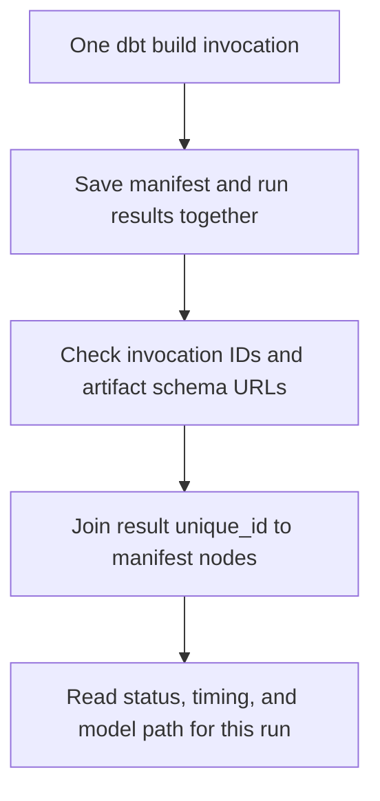

# Artifacts and run evidence

When a scheduled build fails or runs slowly, terminal scrollback is rarely enough. dbt writes structured JSON **artifacts** to `target/` and detailed logs to `logs/dbt.log` on every invocation. Pairing those files lets you audit what dbt parsed, what it executed, how long each node took, and which warehouse relation held the data. [dbt artifacts](https://docs.getdbt.com/reference/artifacts/dbt-artifacts)

## What each artifact captures

| File in `target/` | Question it answers | Key fields to inspect |
| --- | --- | --- |
| **`manifest.json`** | What did dbt know about the project graph and config? | `nodes`, `sources`, `exposures`, `parent_map`, and `child_map` keyed by `unique_id`. Rewritten by nearly every dbt command (`parse`, `ls`, `compile`, `build`, `run`). |
| **`run_results.json`** | What did this specific invocation build or test? | `results[]` entries with `unique_id`, `status`, `execution_time`, `failures` (violating row count on failed tests), `message`, and `timing`. |
| **`catalog.json`** | What tables, views, and column types exist in the warehouse? | `nodes` and `sources` column schemas and table stats (coverage depends on scope and permissions). |
| **`sources.json`** | When was each checked source last loaded? | `results[]` entries comparing `max_loaded_at`, `snapshotted_at`, and `status`. Written by freshness checks. |
| **`freshness.json`** | (dbt v2) Freshness status across checked models and sources. | Emitted by `dbt freshness` (which also emits `sources.json` for checked sources). |
| **`semantic_manifest.json`** | What semantic models, entities, and metrics exist? | Consumed by MetricFlow and Semantic Layer validation tools. |

- **v1 metadata collection.** `dbt docs generate` queries warehouse metadata for `catalog.json` (and can overwrite `run_results.json`), while `dbt source freshness` produces `sources.json`. [v1 docs commands](https://docs.getdbt.com/reference/commands/cmd-docs?version=1)
- **v2 metadata collection.** Pass `--write-catalog` to `dbt build` to emit `catalog.json` alongside build results, and run `dbt freshness` for `freshness.json` and `sources.json`. [v2 docs commands](https://docs.getdbt.com/reference/commands/cmd-docs?version=2) · [Freshness](https://docs.getdbt.com/reference/commands/freshness)

## Archiving and joining artifacts safely



Follow three safeguards before parsing or storing artifacts:

1. **Copy artifacts immediately after the build step.** Commands like `dbt docs generate`, `dbt compile`, or `dbt run-operation` overwrite files in `target/`, mixing evidence from different invocations. Archive `manifest.json`, `run_results.json`, and `logs/dbt.log` together alongside the Git SHA, target, and engine version, even on failures.
2. **Identify the run and the file format.** Confirm `metadata.invocation_id` matches between `manifest.json` and `run_results.json` before joining on `unique_id`, and check `metadata.dbt_schema_version` for each artifact separately. A manifest and a results file have different schemas even when the same invocation wrote both.
3. **Restrict archive permissions.** `manifest.json` contains raw and compiled SQL, which can expose business logic or hardcoded literals. [Manifest JSON](https://docs.getdbt.com/reference/artifacts/manifest-json) · [Run results JSON](https://docs.getdbt.com/reference/artifacts/run-results-json)

## Practice

### What you need

Work in [shop_lab](0004-adapters-profiles-and-the-local-shop-lab.md) with [`fct_orders`](0006-models-refs-and-project-configuration.md) and `jq` installed.

### Steps

1. Build the fact graph and immediately archive the matching manifest and run results:

```bash
dbt build --profiles-dir . --select "+fct_orders"
mkdir -p evidence/orders-build
cp target/manifest.json target/run_results.json evidence/orders-build/
```

2. Join the two files on `unique_id` and verify both `invocation_id` values match:

```bash
jq -s '
  .[0] as $manifest | .[1] as $run
  | {
      same_invocation: ($manifest.metadata.invocation_id == $run.metadata.invocation_id),
      schemas: [$manifest.metadata.dbt_schema_version, $run.metadata.dbt_schema_version],
      fact: [
        $run.results[] | select(.unique_id == "model.shop_lab.fct_orders")
        | {unique_id, status, execution_time,
           file: $manifest.nodes[.unique_id].original_file_path}
      ]
    }
' evidence/orders-build/manifest.json evidence/orders-build/run_results.json
```

**Expected result.** `same_invocation` is `true`, and `fact` reports `model.shop_lab.fct_orders` with `status: "success"` and `file: "models/fct_orders.sql"`. If `fact` is empty, inspect the selection and build log (a parse or connection failure stops execution before writing new node results).

3. Generate catalog metadata (`dbt build --profiles-dir . --select "+fct_orders" --write-catalog` on v2, or `dbt docs generate --profiles-dir .` on v1) and read the physical column type:

```bash
jq -r '.nodes["model.shop_lab.fct_orders"].columns.order_id.type' target/catalog.json
```

**Expected result.** `jq` prints a concrete DuckDB integer type for `order_id` (such as `BIGINT`). If missing, confirm the catalog ran against the right target where `fct_orders` already exists.

## Recall

1. Why might a model exist in `manifest.json` yet have no entry in `run_results.json`?
2. Which artifact tells you the physical column type in the warehouse, and which field tells you how many rows violated a failed data test?
3. You run `dbt build` and then `dbt run-operation count_paid_orders` before copying `target/`. Why can joining `target/manifest.json` and `target/run_results.json` mislead an incident report?

??? note "Answer guidance"
    1. `manifest.json` describes the full project graph, whereas `run_results.json` lists only the nodes selected and reached during that single invocation (or nothing if parsing/connecting failed early).
    2. `catalog.json` stores warehouse column types. `run_results.json` stores `results[].failures` alongside `status` and `message` for test executions (paired with `manifest.json` for file path and SQL).
    3. `dbt run-operation` overwrites `target/run_results.json` (and updates `manifest.json`) with the operation's result, replacing the build evidence you wanted to inspect.

| Previous | Curriculum | Next |
| --- | --- | --- |
| [Previous lesson](0016-selectors-graph-operators-and-named-selections.md) | [All lessons](index.md) | [Next lesson](0018-state-comparison-and-deferral.md) |
