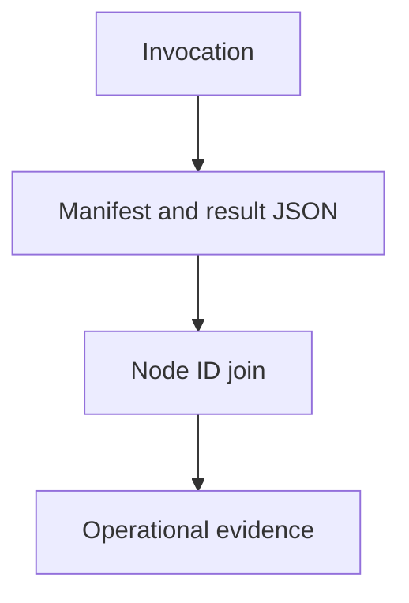

# Artifacts and run evidence

The manifest describes project resources and dependencies. Run results describe the selected invocation's status, timing, and adapter response. Catalog JSON records warehouse metadata when generated. Source freshness creates a separate artifact. These files answer different questions and may be produced by different commands.

Join results to resources using `unique_id`, track artifact schema versions, and retain run and Git identifiers. Collect files after the relevant step before later commands overwrite them. Access to artifacts should reflect the metadata and compiled code they contain.

## Practice

Run `dbt build --select +fct_orders` and inspect `target/run_results.json`. Match a model's result to its entry in `target/manifest.json`. In v2, add `--write-catalog` to the build command to produce `catalog.json`. The separate `dbt docs generate` command exports a documentation site backed by the dbt Information Schema. In v1, `dbt docs generate` produces `catalog.json`.

## Recall

Why can a node be present in a manifest but absent from a particular run result?

[Artifacts](https://docs.getdbt.com/reference/artifacts/dbt-artifacts) · [Documentation commands](https://docs.getdbt.com/reference/commands/cmd-docs)

| Previous | Curriculum | Next |
| --- | --- | --- |
| [← Previous lesson](0016-selectors-graph-operators-and-named-selections.md) | [All lessons](index.md) | [Next lesson →](0018-state-comparison-and-deferral.md) |
