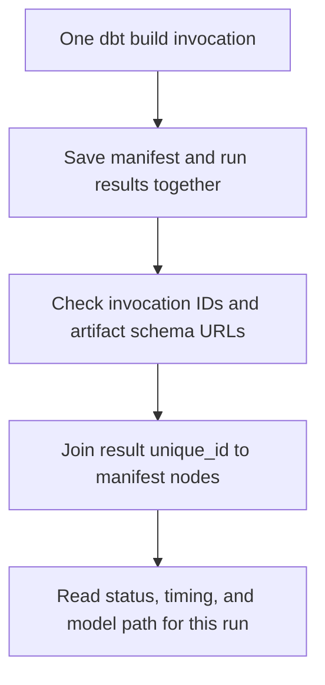

# Artifacts and run evidence

dbt writes JSON artifacts to `target/` by default. Identify the command and invocation that produced each file before drawing conclusions from it. [dbt artifacts](https://docs.getdbt.com/reference/artifacts/dbt-artifacts)

| File | Question it answers | Where to look |
| --- | --- | --- |
| `manifest.json` | What did dbt know about the project? | `nodes`, `sources`, `exposures`, and the `parent_map` and `child_map` keyed by `unique_id`. Commands that parse the project can write it. |
| `run_results.json` | What did this invocation report for the resources it processed? | `results[]` entries include `unique_id`, `status`, `timing`, `message`, and adapter-specific details. `dbt build` writes this file. |
| `catalog.json` | Which warehouse relations and column types did dbt inspect? | Look up a model in `nodes` or a source in `sources`. Metadata coverage depends on command scope and permissions. |
| `sources.json` | When was a checked source last loaded and how did it compare with its thresholds? | Compare `max_loaded_at`, `snapshotted_at`, and `status` in `results[]`. Run a freshness command for this evidence. |

**v1.** `dbt docs generate` writes the catalog and can replace the build's run results. Use `dbt source freshness` for `sources.json`. [v1 docs commands](https://docs.getdbt.com/reference/commands/cmd-docs?version=1)

**v2.** Add `--write-catalog` to a local build to collect warehouse metadata. Local dbt Docs v2 exports a site backed by the dbt Information Schema. `dbt freshness` writes `freshness.json` for checked sources and models, and emits `sources.json` for checked sources for compatibility. [v2 docs commands](https://docs.getdbt.com/reference/commands/cmd-docs?version=2) · [Freshness](https://docs.getdbt.com/reference/commands/freshness)



Archive the artifacts and logs after each relevant step, including failures. Record the Git SHA, job step, target, and engine version alongside them. Check `metadata.dbt_schema_version` per file before feeding it to a parser. The artifact schema version has its own numbering. Limit access to the archive because metadata and compiled SQL can contain sensitive identifiers or literal values. [Manifest JSON](https://docs.getdbt.com/reference/artifacts/manifest-json) · [Run results JSON](https://docs.getdbt.com/reference/artifacts/run-results-json)

## Practice

From [shop_lab](0004-adapters-profiles-and-the-local-shop-lab.md) with [`fct_orders`](0006-models-refs-and-project-configuration.md) in place, build the fact and its inputs. The inspection uses `jq`.

```bash
dbt build --profiles-dir . --select "+fct_orders"
mkdir -p evidence/orders-build
cp target/manifest.json target/run_results.json evidence/orders-build/
```

```bash
jq -s '
  .[0] as $manifest | .[1] as $run
  | {
      same_invocation: ($manifest.metadata.invocation_id == $run.metadata.invocation_id),
      schemas: [$manifest.metadata.dbt_schema_version, $run.metadata.dbt_schema_version],
      fact: [
        $run.results[] | select(.unique_id == "model.shop_lab.fct_orders")
        | {unique_id, status, execution_time,
           file: $manifest.nodes[.unique_id].original_file_path}
      ]
    }
' evidence/orders-build/manifest.json evidence/orders-build/run_results.json
```

Expect matching invocation IDs and a successful fact result pointing to `models/fct_orders.sql`. If the IDs differ, retrieve the two files for the same build step before interpreting the join. If `fact` is empty, check the selected nodes and the build log. A parse or connection failure can occur before any new node results are written.

Now run `dbt docs generate --profiles-dir .` on v1 or `dbt build --profiles-dir . --select "+fct_orders" --write-catalog` on v2. Check that the catalog reports the fact's physical `order_id` column.

```bash
jq -r '.nodes["model.shop_lab.fct_orders"].columns.order_id.type' target/catalog.json
```

Expect a concrete warehouse type. If the fact is missing, check that the catalog is from the intended target, the relation exists there, and the command succeeded in reading its metadata.

## Recall

1. Why might a model in the manifest have no entry in the build's results?
2. Where would you look for the fact column's warehouse type and the cause of a failed test?

??? success "Answer guidance"
    1. The manifest describes the project. The build reports on its selected work. Check the selection and whether execution got far enough to write results.
    2. Inspect the catalog for the type. Match the failed test's `unique_id` in run results to the manifest and use its message and command log to diagnose the failure.

| Previous | Curriculum | Next |
| --- | --- | --- |
| [← Previous lesson](0016-selectors-graph-operators-and-named-selections.md) | [All lessons](index.md) | [Next lesson →](0018-state-comparison-and-deferral.md) |
