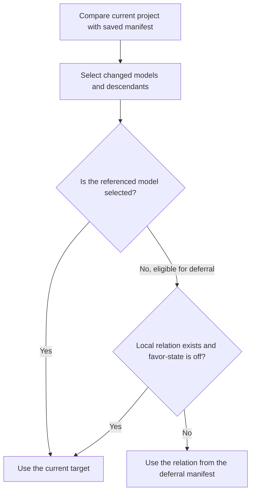

# State comparison and deferral

Rebuilding an entire warehouse on every pull request does not scale. **State comparison** compares your current project against a saved baseline `manifest.json` to select only what changed and its downstream dependents. **Deferral** lets that slim build read untouched upstream relations from the baseline environment instead of rebuilding every parent in your sandbox.

## State selection and sub-selectors

Pass `--state baseline` pointing to a directory containing a saved `manifest.json`:

- **`state:new`** matches resources whose `unique_id` does not exist in the baseline manifest.
- **`state:modified`** matches new resources plus resources whose SQL body, configs, upstream macros, contracts, or tracked attributes changed (`state:modified+` adds downstream dependents).
- **Sub-selectors.** Narrow the comparison when needed: `state:modified.body` (SQL/code body), `state:modified.configs`, `state:modified.persisted_descriptions`, `state:modified.relation`, `state:modified.macros`, and `state:modified.contract`. Use `state:unmodified` for unchanged nodes. Use `state:old` for all nodes whose IDs already existed, including edited models.
- **`result:` selectors.** Combine `--state` with `result:error+` or `result:fail+` to inspect or rerun nodes that failed in a prior `run_results.json`. [Selector methods](https://docs.getdbt.com/reference/node-selection/methods)

New rows loaded into an external warehouse table do **not** trigger `state:modified` because manifest comparison checks project code and metadata, not warehouse row data (small versioned seed CSVs are hashed and can trigger `state:modified`). [State comparison caveats](https://docs.getdbt.com/reference/node-selection/state-comparison-caveats)

## How deferral resolves unselected parents



With `--defer`, any unselected `ref()` resolves to the location recorded in the `--state` manifest when missing from the current target:

- **`--favor-state`.** Always prefer the baseline relation for unselected refs, even if an older table with the same name happens to exist in your dev/CI schema.
- **`--defer-state`** supplies a separate manifest directory for relation resolution when the logical comparison manifest (for example, latest merged code) differs from the deployed warehouse environment you want to read.
- **Ephemeral models and local precedence.** Models selected in the current invocation always resolve in the current target, and ephemeral models always compile inline as CTEs. [Deferral](https://docs.getdbt.com/reference/node-selection/defer)

Watch for four common caveats: differences in `env_var()` or `var()` values between baseline and runner can trigger false `state:modified` matches, editing a widely used macro marks every downstream caller modified, comparing manifests across incompatible dbt versions fails or misbehaves, and deferring to a `dbt parse`-only manifest fails if those relations were never actually built.

!!! note "v1 and v2"
    Manual `--state` and `--defer` work identically in Core v1 and dbt v2 (both share manifest schema v12 on current releases). The separately enabled [dbt State](0037-dbt-state-and-freshness-aware-orchestration.md) capability extends this by factoring warehouse freshness and execution state into reuse decisions. [v2 upgrade guide](https://docs.getdbt.com/docs/dbt-versions/dbt-upgrade/upgrading-to-v2)

## Practice

### What you need

Work in [`shop_lab`](0004-adapters-profiles-and-the-local-shop-lab.md) with [`fct_orders`](0006-models-refs-and-project-configuration.md) on the default `dev` target (schema `main`).

### Steps

1. Build the baseline in `dev` and copy its manifest outside `target/` so later commands do not overwrite it:

```bash
dbt build --profiles-dir . --select "+fct_orders"
mkdir -p baseline/orders
cp target/manifest.json baseline/orders/
```

2. Temporarily add `where status = 'paid'` to the end of `models/fct_orders.sql` and compare selections:

```bash
dbt ls --profiles-dir . --state baseline/orders --select "state:modified+" --resource-type model --output name
dbt ls --profiles-dir . --state baseline/orders --select "state:modified.body" --resource-type model --output name
```

**Expected result.** Both list the edited `fct_orders`. Only `state:modified+` also selects its downstream models. If you kept `order_amounts` from lesson 0014, look for it in the first list. Its own SQL body did not change.

3. Add a sibling target `module4_ci` under `shop_lab.outputs` in `profiles.yml` (sharing `./shop.duckdb` so both schemas are readable):

```yaml
    module4_ci:
      type: duckdb
      path: ./shop.duckdb
      schema: module4_ci
      threads: 2
```

4. Build only `fct_orders` in `module4_ci` using deferral, then check the compiled SQL and stored count:

```bash
dbt run --profiles-dir . --target module4_ci --state baseline/orders --defer --select "fct_orders"
dbt show --profiles-dir . --target module4_ci --inline "select count(*) as orders from module4_ci.fct_orders"
```

**Expected result.** `target/compiled/shop_lab/models/fct_orders.sql` reads `main.stg_orders` via deferral, and `module4_ci.fct_orders` holds **2** paid orders.

5. Now build a local `stg_orders` inside `module4_ci` and compare `--defer` with and without `--favor-state`:

```bash
dbt build --profiles-dir . --target module4_ci --select "+stg_orders"
dbt compile --profiles-dir . --target module4_ci --state baseline/orders --defer --select "fct_orders"
dbt compile --profiles-dir . --target module4_ci --state baseline/orders --defer --favor-state --select "fct_orders"
```

**Expected result.** Open `target/compiled/shop_lab/models/fct_orders.sql` after each compile: the first reads `module4_ci.stg_orders` (local schema wins), and the second reads `main.stg_orders` (`--favor-state` forces baseline preference).

6. **Cleanup.** Remove `where status = 'paid'` from `models/fct_orders.sql` and rebuild `dev` with `dbt build --profiles-dir . --select "+fct_orders"`.

If a deferred relation raises a missing or unauthorized error in a real warehouse, check `relation_name` in the baseline `manifest.json`, confirm the baseline job actually materialized it, and verify read grants for the CI identity.

## Recall

1. Will newly loaded rows in an upstream warehouse source cause `state:modified+` to rebuild `stg_orders`?
2. An unselected parent `stg_orders` exists in both your dev schema and the baseline manifest. Where does `ref('stg_orders')` point when you run with `--defer --favor-state`?
3. After updating a shared `cents_to_dollars` macro, why does `state:modified+` suddenly select dozens of downstream models, and which sub-selector checks only model SQL changes?

??? note "Answer guidance"
    1. No. `state:modified` compares manifest definitions (code, configs, macros), not warehouse row data. Use source freshness or dbt State to respond to data arrivals.
    2. It points to the baseline manifest's `stg_orders` (`main.stg_orders`) because `--favor-state` overrides local relation precedence for unselected nodes.
    3. Changing a macro alters the compiled behavior of every model that invokes it, marking all callers and their descendants modified. `state:modified.body` isolates changes to resource SQL bodies alone (excluding config or description changes).

| Previous | Curriculum | Next |
| --- | --- | --- |
| [Previous lesson](0017-artifacts-and-run-evidence.md) | [All lessons](index.md) | [Next lesson](0019-model-documentation-exposures-and-ownership.md) |
