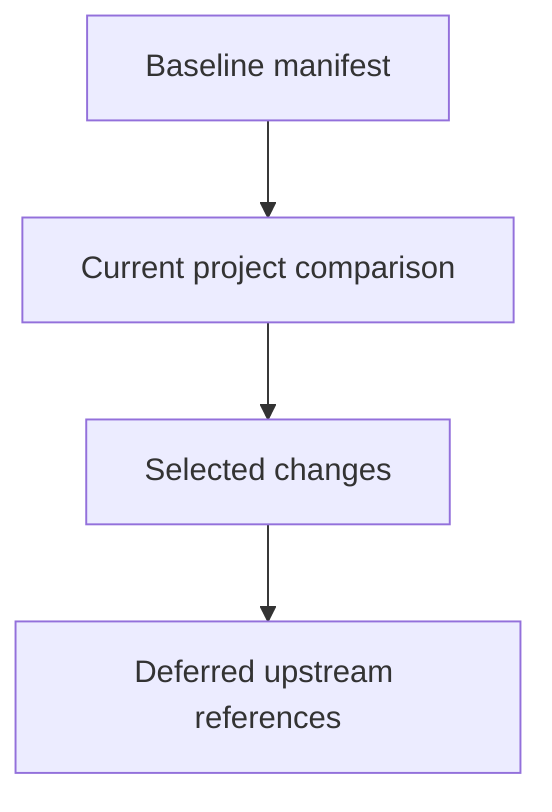

# State comparison and deferral

State comparison determines which project nodes changed relative to a prior manifest. Deferral changes where eligible unselected upstream references resolve. Use `--state` with a directory containing a baseline manifest. For separate comparison and reference baselines, consult `--defer-state`. By default, an existing local relation can take precedence over a deferred relation. Inspect compiled SQL before trusting results from mixed environments.

Place the baseline outside the active target directory so a new parse cannot overwrite it. Grant only the production reads needed for CI, and document whether cross-environment relationship tests are meaningful.

## Practice

Build the lab fact, copy `target/manifest.json` into `baseline/`, and make a model SQL change. Run `dbt ls --select state:modified+ --state baseline`. Reseed changed input rows without changing code and repeat the comparison.

## Recall

Which flag chooses the comparison artifacts, and which flag can change how a reference resolves?

[Defer reference](https://docs.getdbt.com/reference/node-selection/defer) · [State comparison](https://docs.getdbt.com/reference/node-selection/methods)

| Previous | Curriculum | Next |
| --- | --- | --- |
| [← Previous lesson](0017-artifacts-and-run-evidence.md) | [All lessons](index.md) | [Next lesson →](0019-model-documentation-exposures-and-ownership.md) |
