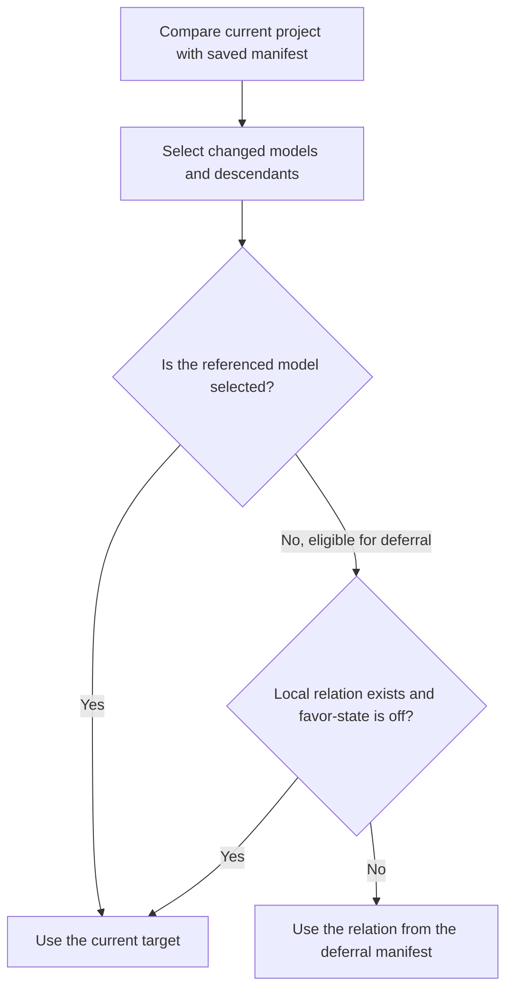

# State comparison and deferral

**State comparison selects work.** `--state baseline` points to a directory containing a saved `manifest.json`. `state:new` matches nodes whose `unique_id` is absent from the baseline. `state:modified` includes new nodes and detects changes such as model SQL, materialization config, and upstream macros. Add `+` to include downstream nodes that may need rebuilding. A new row loaded into a warehouse table is invisible to a manifest comparison. A change to a small, versioned seed CSV can count because its file content is hashed. [Selector methods](https://docs.getdbt.com/reference/node-selection/methods) · [State comparison caveats](https://docs.getdbt.com/reference/node-selection/state-comparison-caveats)

**Deferral resolves references.** With `--defer`, an eligible unselected `ref()` can use the relation named in the saved manifest. dbt normally prefers an existing relation in the current target. Add `--favor-state` to prefer the saved location for unselected refs. Selected models still resolve in the current target, and ephemeral models are compiled into their consumers. `--defer-state` supplies a separate manifest directory for relation lookup when the logical comparison baseline differs from the deployed environment you want to read. [Deferral](https://docs.getdbt.com/reference/node-selection/defer)



!!! note "v1 and v2"
    Both support manual manifest comparison and deferral. Current v1 and v2 share manifest schema v12. Check artifact compatibility when older v1 releases are involved. The separately configured product [dbt State](0037-dbt-state-and-freshness-aware-orchestration.md) can use execution history and freshness signals to decide what to rebuild. This lesson uses local manifests. [v2 upgrade guide](https://docs.getdbt.com/docs/dbt-versions/dbt-upgrade/upgrading-to-v2)

## Practice

Run from [`shop_lab`](0004-adapters-profiles-and-the-local-shop-lab.md) with the [standard order fact](0006-models-refs-and-project-configuration.md). Use the default `dev` target in schema `main`. Build a baseline, then save the manifest outside `target/` so subsequent commands cannot replace it.

```bash
dbt build --profiles-dir . --select "+fct_orders"
mkdir -p baseline/orders
cp target/manifest.json baseline/orders/
```

Temporarily add `where status = 'paid'` to the end of `models/fct_orders.sql`. Check the model selection.

```bash
dbt ls --profiles-dir . --state baseline/orders --select "state:modified+" --resource-type model --output name
```

Expect `fct_orders` and any downstream models you added. The seed and staging model are upstream and unchanged. For a second comparison, select `state:modified.body` to isolate changes in resource bodies.

Add a target named `module4_ci` under `shop_lab.outputs` in `profiles.yml`. Use a fresh schema name if this one already contains lab relations. Keep the same database file so both schemas are reachable through one connection.

```yaml
    module4_ci:
      type: duckdb
      path: ./shop.duckdb
      schema: module4_ci
      threads: 2
```

```bash
dbt run --profiles-dir . --target module4_ci --state baseline/orders --defer --select "fct_orders"
dbt show --profiles-dir . --target module4_ci --inline "select count(*) as orders from module4_ci.fct_orders"
```

Confirm the run writes the fact to `module4_ci`, its compiled query under `target/compiled/` reads `main.stg_orders`, and the physical fact has two rows. Now build a local copy of staging and check which schema each compile prints for the ref.

```bash
dbt build --profiles-dir . --target module4_ci --select "+stg_orders"
dbt compile --profiles-dir . --target module4_ci --state baseline/orders --defer --select "fct_orders"
dbt compile --profiles-dir . --target module4_ci --state baseline/orders --defer --favor-state --select "fct_orders"
```

Expect the first compile to reference `module4_ci.stg_orders` and the second to reference `main.stg_orders`. Restore the original fact SQL afterward.

If selection is empty after a code change, check that `--state` contains the older manifest, that it differs from the active target directory, and that the current project still has the expected node ID. If a deferred relation is missing or inaccessible, inspect its `relation_name` in the saved manifest and check the CI identity's read access. Choose a baseline from a successful deployment that built the required relations. When a relationship test reads two environments, verify that the datasets cover the same keys before interpreting failures.

## Recall

1. Will new rows in the upstream warehouse table trigger `state:modified` by themselves?
2. Where does an unselected `ref('stg_orders')` resolve if both targets contain it and you pass `--defer --favor-state`?

??? success "Answer guidance"
    1. The selector compares project state. Use a separate data freshness or ingestion signal to trigger builds for new rows.
    2. It resolves to the saved manifest's staging relation. If staging is also selected, it resolves in the current target.

| Previous | Curriculum | Next |
| --- | --- | --- |
| [← Previous lesson](0017-artifacts-and-run-evidence.md) | [All lessons](index.md) | [Next lesson →](0019-model-documentation-exposures-and-ownership.md) |
