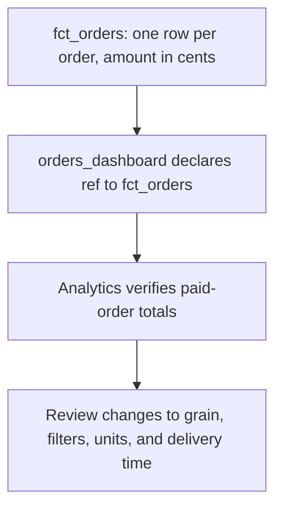

# Model documentation, exposures and ownership

A model description should state the grain, inclusion rules, and units. Put details where the consumer will look for them. For `fct_orders`, describe one row per order, including pending orders, with totals in cents. In the model's existing YAML properties, describe `order_id` as the grain key and `total_cents` as the integer amount. Use `unique` and `not_null` tests to verify the grain key. [Model properties](https://docs.getdbt.com/reference/model-properties)

An exposure declares an external consumer in the DAG. Its `depends_on` list connects the consumer to the resources it reads, using `ref()`, `source()`, or `metric()` as appropriate. Its owner should be able to confirm impact and coordinate recovery. A dashboard URL helps the responder find the consumer. A manual exposure adds lineage and ownership metadata without executing or refreshing the dashboard. [Exposures](https://docs.getdbt.com/docs/build/exposures)



**v1.** Local `dbt docs generate` generates the legacy docs site from JSON artifacts. **v2.** Local `dbt docs generate` exports a docs site backed by the dbt Information Schema. The manifest can still be inspected for manually declared exposures in both versions. In the dbt platform, use Catalog for lineage. Automatic exposure discovery depends on the connected BI integration. [Documentation commands](https://docs.getdbt.com/reference/commands/cmd-docs) · [Catalog](https://docs.getdbt.com/docs/explore/explore-projects)

## Practice

In [`shop_lab`](0004-adapters-profiles-and-the-local-shop-lab.md), add these properties for [`fct_orders`](0006-models-refs-and-project-configuration.md) in `models/fct_orders.yml`. If the model already has a properties entry, merge the descriptions into it and keep its existing tests.

```yaml
models:
  - name: fct_orders
    description: One row per order, including pending orders.
    columns:
      - name: order_id
        description: Order key that identifies one fact row.
        data_tests: [unique, not_null]
      - name: total_cents
        description: Order amount in whole cents.
```

Add `models/exposures.yml` with this entry.

```yaml
exposures:
  - name: orders_dashboard
    type: dashboard
    description: Counts paid orders and reports their total in cents.
    depends_on:
      - ref('fct_orders')
    owner:
      name: Analytics
      email: analytics@example.org
```

```bash
dbt parse --profiles-dir .
jq -e '.exposures["exposure.shop_lab.orders_dashboard"] | {owner, upstream: .depends_on.nodes}' target/manifest.json
dbt ls --profiles-dir . --select "+exposure:orders_dashboard" --resource-type model --output name
```

Expect the Analytics owner and `model.shop_lab.fct_orders` as the direct dependency. The selector should list the fact and staging models. If parsing fails, check the dependency name and that the YAML is under a model path. If the manifest is correct but the consumer is missing from managed Catalog, check the environment and run that supplied Catalog metadata.

Build the fact and check the dashboard's expected numbers against the original fixture.

```bash
dbt build --profiles-dir . --select "+fct_orders"
dbt show --profiles-dir . --inline "select count(*) as paid_orders, sum(total_cents) as paid_cents from {{ ref('fct_orders') }} where status = 'paid'"
```

Expect two paid orders and 3,000 cents. Write one impact note for Analytics about a proposed change that would alter those numbers, such as a join that duplicates orders or a unit change from cents to dollars.

## Recall

1. Which parts of this setup describe the expected grain, verify it, and identify who owns the dashboard?
2. Why might a successful dbt build still leave this dashboard stale?

??? success "Answer guidance"
    1. The model description states the grain. Tests on `order_id` verify the key. The exposure names the dashboard owner.
    2. A manually declared exposure records lineage. Check whether the BI tool refreshed its extract or cache after the build.

| Previous | Curriculum | Next |
| --- | --- | --- |
| [← Previous lesson](0018-state-comparison-and-deferral.md) | [All lessons](index.md) | [Next lesson →](0020-production-safety-profiling-and-recovery.md) |
