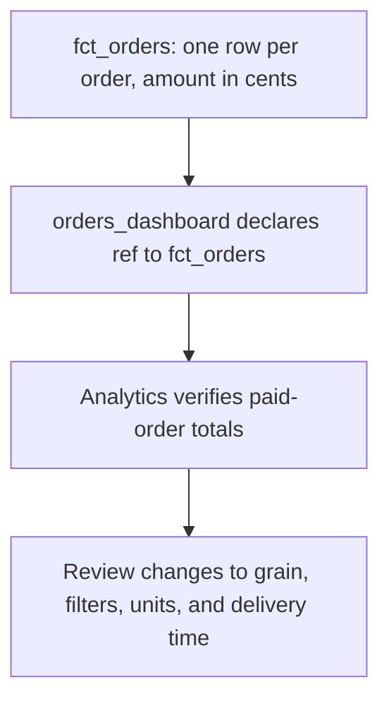

# Model documentation, exposures and ownership

Clear documentation turns a model from an opaque SQL table into a trusted contract. Write descriptions where analysts and on-call engineers read them: state the **grain**, **inclusion filters**, and **units** on the model and its key columns, then enforce the grain key with `unique` and `not_null` tests. [Model properties](https://docs.getdbt.com/reference/model-properties)

## Documentation blocks and `persist_docs`

- **YAML descriptions vs doc blocks.** Keep short summaries inline under `description:` in `models/*.yml`. For shared domain definitions or long explanations (such as status meanings reused across models), define a Markdown **doc block** in `models/docs.md` and reference it with `description: '{{ doc("order_grain") }}'`:

```markdown

One row per `order_id`, including both paid and pending orders.
Amounts are stored in integer cents (`total_cents`).

```

- **Warehouse comments (`persist_docs`).** Configuring `+persist_docs: {relation: true, columns: true}` in `dbt_project.yml` writes dbt descriptions directly into database table and column comments on supported adapters so warehouse query tools display the same docs.

## Declaring exposures and ownership



An **exposure** registers an external consumer (a BI dashboard, ML feature table, or reverse-ETL sync) in the dbt DAG using `depends_on` (`ref()`, `source()`, or `metric()`). Give each exposure a `type`, an `owner` (`name` and `email`), `maturity` (`high`, `medium`, `low`), and a `url` so responders know whom to notify before breaking a column or shipping a unit change. Note that a manually declared exposure documents lineage without refreshing the dashboard itself. [Exposures](https://docs.getdbt.com/docs/build/exposures)

**Viewing docs.** In Core v1, `dbt docs generate` and `dbt docs serve` build and preview the static docs site from JSON artifacts. In dbt v2, `dbt docs generate` exports a site backed by the dbt Information Schema. On the managed platform, Catalog serves cross-environment lineage and supports automatic BI exposure discovery for connected tools. [Documentation commands](https://docs.getdbt.com/reference/commands/cmd-docs) · [Catalog](https://docs.getdbt.com/docs/explore/explore-projects)

Try writing the dashboard owner's impact notice before opening the YAML. If order 1 changes from `1250` cents to `12.50` dollars and the dashboard still divides by 100, it displays about $0.13 for a $12.50 order. A column description explains the units and an exposure identifies the person who can verify the display.

## Practice

### What you need

Work in [`shop_lab`](0004-adapters-profiles-and-the-local-shop-lab.md) with [`fct_orders`](0006-models-refs-and-project-configuration.md).

### Steps

1. Merge these grain, unit, and column descriptions into `models/fct_orders.yml` (preserving any existing tests):

```yaml
models:
  - name: fct_orders
    description: One row per order, including pending orders.
    columns:
      - name: order_id
        description: Order key that identifies one fact row.
        data_tests: [unique, not_null]
      - name: total_cents
        description: Order amount in whole cents.
```

2. Create `models/exposures.yml`:

```yaml
exposures:
  - name: orders_dashboard
    type: dashboard
    description: Counts paid orders and reports their total in cents.
    depends_on:
      - ref('fct_orders')
    owner:
      name: Analytics
      email: analytics@example.org
```

3. Parse the project, inspect the exposure entry in `manifest.json`, and list its upstream models:

```bash
dbt parse --profiles-dir .
jq -e '.exposures["exposure.shop_lab.orders_dashboard"] | {owner, upstream: .depends_on.nodes}' target/manifest.json
dbt ls --profiles-dir . --select "+exposure:orders_dashboard" --resource-type model --output name
```

**Expected result.** `jq` prints the Analytics owner and `model.shop_lab.fct_orders`, and `dbt ls` lists `stg_orders` and `fct_orders`. If parsing fails, verify YAML lives under `models/` (a configured `model-paths` entry) and `ref('fct_orders')` spells the model name cleanly.

4. Build the fact and verify the numbers the dashboard expects from the starter fixture:

```bash
dbt build --profiles-dir . --select "+fct_orders"
dbt show --profiles-dir . --inline "select count(*) as paid_orders, sum(total_cents) as paid_cents from {{ ref('fct_orders') }} where status = 'paid'"
```

**Expected result.** `paid_orders` is **2** and `paid_cents` is **3,000**. Write a brief one-paragraph impact notice to `Analytics` describing what would break on `orders_dashboard` if a PR changed `total_cents` to dollars or introduced a fanout join. Keep `models/exposures.yml` for later lessons.

## Recall

1. In this setup, which part *describes* the grain, which part *verifies* it, and which part identifies *who to notify* before changing it?
2. Why can `orders_dashboard` show stale numbers even right after `dbt build --select +fct_orders` completes cleanly?
3. How do `` doc blocks and `persist_docs` solve two different documentation maintenance problems?

??? note "Answer guidance"
    1. Model and column `description` fields explain the grain and units; `unique` and `not_null` tests on `order_id` verify the grain; the `orders_dashboard` exposure identifies the Analytics owner.
    2. Exposures declare dependencies without triggering external BI extract refreshes. Check whether the BI tool's cache or scheduled extract ran after dbt finished.
    3. `` blocks eliminate copy-pasting long Markdown definitions across YAML files, while `persist_docs` automatically syncs those dbt descriptions into warehouse table and column comments for SQL clients.

| Previous | Curriculum | Next |
| --- | --- | --- |
| [Previous lesson](0018-state-comparison-and-deferral.md) | [All lessons](index.md) | [Next lesson](0020-production-safety-profiling-and-recovery.md) |
