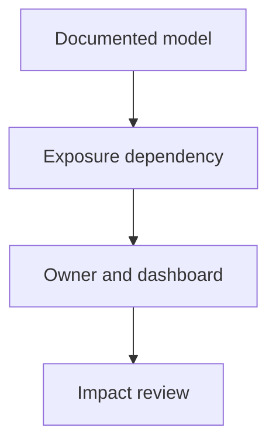

# Model documentation, exposures and ownership

Add descriptions and grain to SQL models and columns through YAML properties. Exposures describe downstream dependencies such as dashboards, notebooks, or ML applications and give them an owner. An exposure is metadata. For supported connected BI tools, platform capabilities can discover exposures or use them for orchestration.

Document what a consumer expects to stay stable, including timing and model grain. Review downstream exposures when changing schemas or definitions.



## Practice

Add `models/exposures.yml` and run `dbt docs generate`.

```yaml
exposures:
  - name: orders_dashboard
    type: dashboard
    description: Tracks paid orders and revenue.
    depends_on:
      - ref('fct_orders')
    owner:
      name: Analytics
      email: analytics@example.org
```

Find the exposure in the manifest and identify the model change that would invalidate the dashboard's totals.

## Recall

Why is a good exposure owner more valuable during an incident than a dashboard URL alone?

[Exposures](https://docs.getdbt.com/docs/build/exposures)

| Previous | Curriculum | Next |
| --- | --- | --- |
| [← Previous lesson](0018-state-comparison-and-deferral.md) | [All lessons](index.md) | [Next lesson →](0020-production-safety-profiling-and-recovery.md) |
