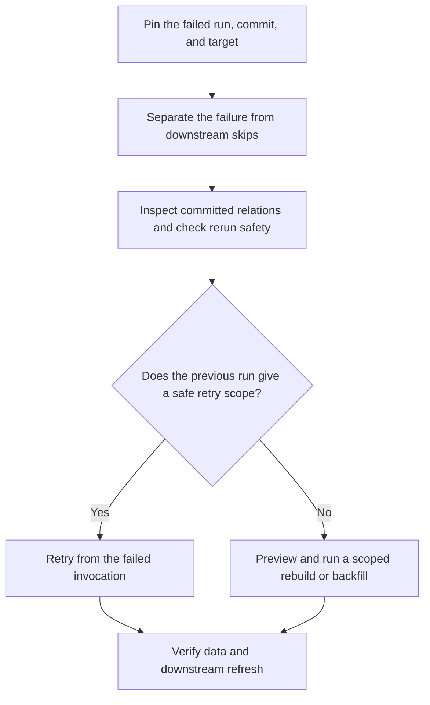

# Production safety, profiling and recovery

A failed `dbt build` can leave upstream relations committed and downstream relations skipped. A skipped model may still have a relation from an earlier run. Start from the invocation and target, then verify what the warehouse actually contains before choosing the recovery scope. [dbt build](https://docs.getdbt.com/reference/commands/build)

| Symptom | First diagnostic |
| --- | --- |
| Failure before any warehouse query | Read the first parse, compilation, profile, or connection error in the command log. Check whether the result artifact is from this invocation. |
| Model reports an error | Match the result's `unique_id` to the source file and inspect the compiled SQL, target relation, and adapter error. Use warehouse query history to check what ran and committed. |
| Data test fails and a downstream model is skipped | Identify the failing rows using the test query and trace the model's parents. Decide whether data, transformation logic, or the expectation needs correction. |
| The job is slow | Compare scheduler wait with build and node timing. For a slow node, match the SQL to warehouse query history and separate queue or lock time from execution. On DuckDB, run `EXPLAIN ANALYZE` on the read-only model select to see actual operator timing and row counts. |

[Run visibility](https://docs.getdbt.com/docs/deploy/run-visibility) · [DuckDB profiling](https://duckdb.org/docs/stable/guides/meta/explain_analyze.html)



**v1 (1.6+).** `dbt retry` uses the previous `run_results.json` and inherits the original selection. **v2.** Retry can also override selection with `--select`, `--exclude`, or `--selector`. In either engine, preserve the failed result before any command can overwrite it. If there's no usable failed invocation, run the intended build with explicit scope after fixing the cause. [dbt retry](https://docs.getdbt.com/reference/commands/retry)

Check rerun safety before restarting a failed production job. An append-only incremental or a hook that inserts audit rows may duplicate work. Reconcile the committed keys and time range, then use a bounded backfill if possible. Before a full refresh, verify retained input history, consumer impact, and whether the target is shared. After any repair, reconcile the affected window against the source, rerun relevant tests, and confirm downstream consumers refreshed.

## Practice

In a sandbox copy of [`shop_lab`](0004-adapters-profiles-and-the-local-shop-lab.md) with the [standard order fact](0006-models-refs-and-project-configuration.md), create `tests/ops_staging_order_check.sql`. This deliberately flags one valid fixture row so the test fails after the staging view builds.

```sql
select order_id
from {{ ref('stg_orders') }}
where order_id = 1
```

Run the build and expect a nonzero exit. Run the evidence commands afterward even though the build failed.

```bash
dbt build --profiles-dir . --select "+fct_orders"
```

```bash
mkdir -p evidence/orders-failure
cp target/manifest.json target/run_results.json evidence/orders-failure/
jq -r '.results[] | [.unique_id, .status, .message] | @tsv' evidence/orders-failure/run_results.json
```

Confirm the staging model succeeded, the test flagged one row, and the fact was skipped. Change the predicate to `where order_id is null` so it expresses a real invariant. Retry in the same sandbox before issuing any new build, compile, or preview command.

```bash
dbt retry --profiles-dir .
jq -r '.results[] | [.unique_id, .status] | @tsv' target/run_results.json
dbt show --profiles-dir . --inline "select count(*) as orders, count(distinct order_id) as order_ids from main.fct_orders"
```

Expect the test to pass, the fact to build, and both counts to equal three. If retry has no usable results, confirm the failed step and target, then repeat the original scoped build. Remove the temporary test after the exercise.

With a DuckDB client connected to `shop.duckdb`, profile the paid-orders query on the recovered fact.

```sql
explain analyze
select sum(total_cents)
from main.fct_orders
where status = 'paid';
```

Find the status filter and the two rows it passes to the aggregate. Operator row counts show where work happens. Use representative data to investigate production runtimes.

## Recall

1. Why can a table exist even though the result for its model shows it was skipped?
2. A node took ten minutes in dbt. What evidence would distinguish warehouse queuing from a slow scan?

??? success "Answer guidance"
    1. An earlier invocation may have created it. Check warehouse history and compare the affected data window with the expected source arrivals.
    2. Match the node's invocation, SQL, and timestamp to its warehouse query. Compare queue and execution durations, then inspect the plan for rows scanned and expensive operators.

| Previous | Curriculum | Next |
| --- | --- | --- |
| [← Previous lesson](0019-model-documentation-exposures-and-ownership.md) | [All lessons](index.md) | [Next lesson →](0021-studio-ide-git-and-environment-roles.md) |
