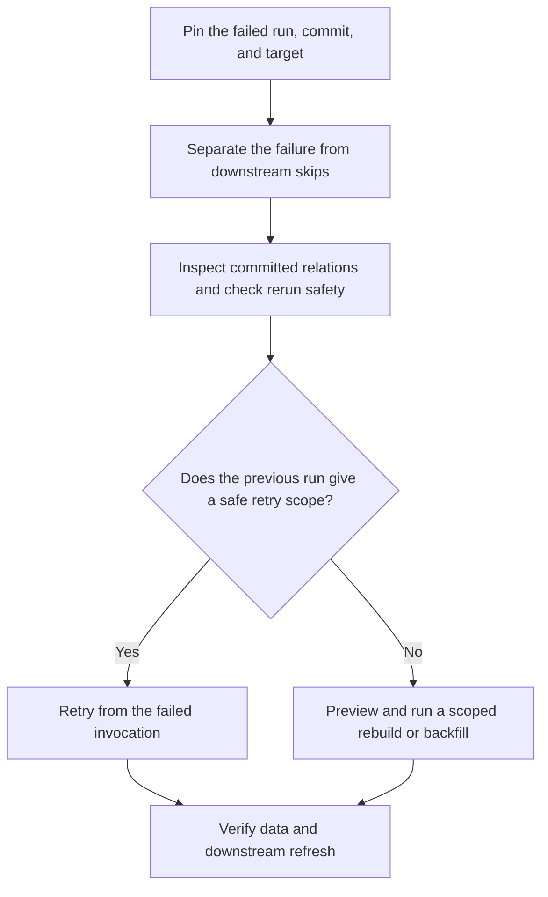

# Production safety, profiling and recovery

A failing `dbt build` can leave upstream relations updated in the warehouse while downstream models are marked skipped. A skipped downstream table does not disappear; it keeps stale rows from an earlier run. Safe incident recovery starts by identifying the exact invocation, target, and committed warehouse state before deciding what to retry or backfill. [dbt build](https://docs.getdbt.com/reference/commands/build)

## Understanding partial commits and safety flags

- **Table replacement vs test-after-write.** dbt builds `table` models atomically on most adapters (building a temporary relation and swapping, or `CREATE OR REPLACE`), so a SQL runtime crash leaves yesterday's table intact. However, a `dbt build` data test runs **after** the model commits its new table, meaning bad rows stay live in that table even when its test fails and skips downstream models. That is why staging and intermediate tests matter before mart writes.
- **Safety flags for faster, stricter checks:**
  - `--empty` (v1.8+ / v2): executes the DAG with `LIMIT 0` to verify SQL compilation, schema contracts, and warehouse permissions without scanning production data.
  - `--fail-fast`: stops launching remaining independent branches immediately upon the first error.
  - `--warn-error` (or `--warn-error-options`): promotes selected warnings (such as missing config or deprecations) into hard CI failures.

## Diagnosing symptoms and recovering safely

| Symptom | First diagnostic |
| --- | --- |
| Failure before any warehouse query | Check the earliest parse, compile, or `profiles.yml` error in `logs/dbt.log` or terminal output. Verify whether `target/run_results.json` belongs to this run. |
| Model execution error | Match the `unique_id` in `run_results.json` to the file path, inspect `target/compiled/` SQL, and check warehouse query history for permissions or SQL errors. |
| Data test fails and downstream skips | Query the failing rows using the test SQL (`dbt show --select <test>`) and trace upstream parents to distinguish bad ingestion data from broken logic. |
| Slow production build | Separate scheduler queue/prep duration from node SQL duration. Match slow nodes to warehouse query history, or run `EXPLAIN ANALYZE` in DuckDB to inspect operator row counts and scans. |

[Run visibility](https://docs.getdbt.com/docs/deploy/run-visibility) · [DuckDB profiling](https://duckdb.org/docs/stable/guides/meta/explain_analyze.html)



**Retrying safely (`dbt retry`).** Core v1.6+ and dbt v2 provide `dbt retry`, which reads `target/run_results.json` from the failed invocation and resumes from the point of failure (dbt v2 also lets you override `--select`, `--exclude`, or `--selector` during retry). Always back up failed artifacts before another command overwrites `target/`. Before retrying an incremental `append` model or non-idempotent hook, verify no partial batch will be duplicated; reconcile keys and totals afterward. [dbt retry](https://docs.getdbt.com/reference/commands/retry)

## Practice

### What you need

Work in a sandbox copy of [`shop_lab`](0004-adapters-profiles-and-the-local-shop-lab.md) with [`fct_orders`](0006-models-refs-and-project-configuration.md).

### Steps

1. Create `tests/ops_staging_order_check.sql` that deliberately flags valid row 1 so the build fails immediately after `stg_orders`:

```sql
select order_id
from {{ ref('stg_orders') }}
where order_id = 1
```

2. Run the build (expect a nonzero exit code) and archive the failed artifacts before running any other dbt command:

```bash
dbt build --profiles-dir . --select "+fct_orders"
```

```bash
mkdir -p evidence/orders-failure
cp target/manifest.json target/run_results.json evidence/orders-failure/
jq -r '.results[] | [.unique_id, .status, .message] | @tsv' evidence/orders-failure/run_results.json
```

**Expected result.** `stg_orders` succeeded, `ops_staging_order_check` failed on 1 row, and `fct_orders` was marked `skipped`.

3. Fix `tests/ops_staging_order_check.sql` to check a true invariant (`where order_id is null`), then resume immediately with `dbt retry` (do not run `compile` or `show` before retrying or you will overwrite `run_results.json`):

```bash
dbt retry --profiles-dir .
jq -r '.results[] | [.unique_id, .status] | @tsv' target/run_results.json
dbt show --profiles-dir . --inline "select count(*) as orders, count(distinct order_id) as order_ids from main.fct_orders"
```

**Expected result.** The retried test passes, `fct_orders` builds, and both counts equal **3**.

4. Profile the paid-orders query directly against `shop.duckdb` using the DuckDB CLI (or Python `duckdb` if the CLI is not installed):

```sql
explain analyze
select sum(total_cents)
from main.fct_orders
where status = 'paid';
```

(In Python without the DuckDB binary: `python3 -c "import duckdb; print(duckdb.connect('shop.duckdb').sql(\"explain analyze select sum(total_cents) from main.fct_orders where status = 'paid'\").fetchall()[0][1])"`.) Inspect the `FILTER` node showing 2 rows flowing into the aggregate.

5. **Cleanup.** Delete `tests/ops_staging_order_check.sql` when finished.

## Recall

1. Why can a table exist and return stale numbers in the warehouse even though `run_results.json` shows `status: "skipped"` for that model?
2. A model took ten minutes during last night's job. What evidence distinguishes warehouse queuing from an expensive join or scan?
3. Why does a failing data test in `dbt build` protect downstream models yet still require attention on the model that just ran?

??? note "Answer guidance"
    1. An earlier successful invocation already materialized that table; skipping it in the current failed run leaves those older rows untouched in the warehouse.
    2. Compare the dbt invocation timestamps and node duration against warehouse query history to separate queue/lock wait time from actual SQL execution time, then inspect the query plan (`EXPLAIN ANALYZE`) for scanned rows and joins.
    3. `dbt build` executes tests **after** materializing the model's relation, so downstream models are skipped, while the model under test already committed the violating rows to its target table.

| Previous | Curriculum | Next |
| --- | --- | --- |
| [Previous lesson](0019-model-documentation-exposures-and-ownership.md) | [All lessons](index.md) | [Next lesson](0021-studio-ide-git-and-environment-roles.md) |
