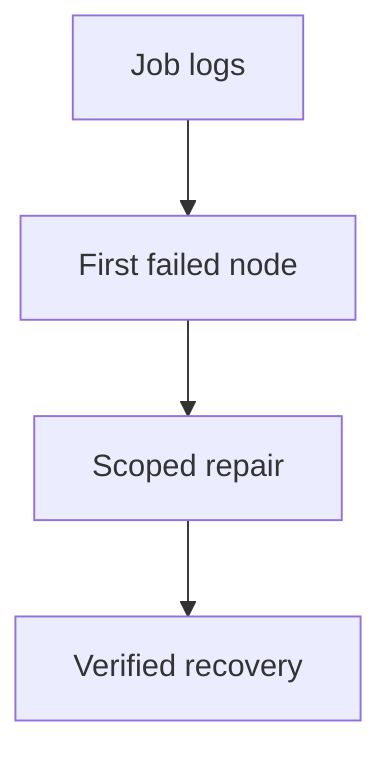

# Production safety, profiling and recovery

A build can leave successful upstream relations in place after a downstream failure. Find the first actual failure, distinguish it from skipped dependents, and verify what was committed in the warehouse. Use warehouse query history to distinguish long scans, warehouse queuing, and locking from dbt parsing or scheduling time.

Retries are safest when models and hooks can be rerun without duplicating work. Use a bounded backfill for missing data when possible. Coordinate on a full refresh or destructive rebuild if it can affect other users.

## Practice

Introduce a sandbox model failure with a bad cast. Inspect the results, correct the SQL, check the current relation state, and use `dbt retry` if supported by your engine and applicable to the failed invocation. Verify row counts and restore the original lab fixture.

## Recall

Why can rerunning only the observed failure leave a dashboard stale?

[Run visibility](https://docs.getdbt.com/docs/deploy/run-visibility) · [Command reference](https://docs.getdbt.com/reference/dbt-commands)

| Previous | Curriculum | Next |
| --- | --- | --- |
| [← Previous lesson](0019-model-documentation-exposures-and-ownership.md) | [All lessons](index.md) | [Next lesson →](0021-studio-ide-git-and-environment-roles.md) |
