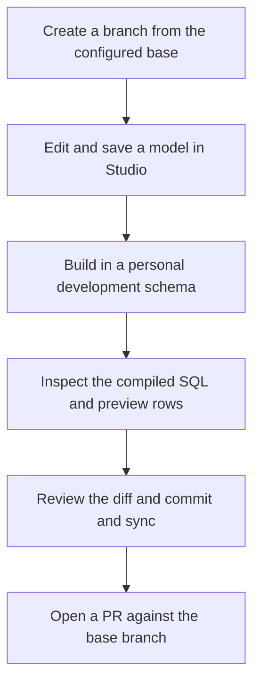

# Studio IDE, Git and environment roles

In a team setting, analysts and engineers cannot overwrite the same production tables while testing half-finished SQL. The dbt platform separates work across **environments** (Development, CI, Staging, Production), each pairing a Git branch, a dbt **release track** (such as `Latest`, `Compatible`, `Extended`, or a pinned Core v1 track), environment variables, and scoped warehouse credentials. [dbt environments](https://docs.getdbt.com/docs/dbt-platform-environments) · [Deployment environments](https://docs.getdbt.com/docs/deploy/deploy-environments)

## Studio IDE and Git workflow

**Studio IDE** (formerly Cloud IDE) runs inside your browser against your project's single **Development** environment. Saving a file updates only your personal Studio workspace. Running **Commit and sync** pushes commits to your remote feature branch and pulls upstream base-branch changes so you can resolve merge conflicts before opening a pull request. [Studio IDE guide](https://docs.getdbt.com/docs/platform/studio-ide/develop-in-studio)

| Execution context | Code and credentials | Write boundary |
| --- | --- | --- |
| **Studio** | Working branch (including unsaved/uncommitted edits) and personal warehouse credentials. | Personal developer schema such as `dbt_alice`. |
| **CI** | Pull request commit SHA and a scoped CI deployment identity. | Temporary PR schema in a dedicated CI environment. |
| **Production job** | Configured release branch (`main`) and a dedicated service identity. | Published schema such as `analytics`. |

Enforce these boundaries with warehouse grants: give personal dev users write access only to their own dev schemas, and restrict production schemas (`analytics`) to the production service identity. Environment variables follow a strict override order: Project default < Environment value < Job override < Personal dev override.

## Compile, preview, and build in Studio



- **Compile** resolves Jinja and `ref()` targets so you verify schema routing without modifying data.
- **Preview** executes the query (with a row limit) using your personal dev role. Passing a tiny preview does not prove the whole dataset passes tests.
- **Build** runs selected models and tests into your personal schema. Verify the target schema and release track before comparing Studio results with a production run. [IDE user interface](https://docs.getdbt.com/docs/platform/studio-ide/ide-user-interface) · [dbt show](https://docs.getdbt.com/reference/commands/show)

## Practice

### What you need

Use [shop_lab](0004-adapters-profiles-and-the-local-shop-lab.md) with [`fct_orders`](0006-models-refs-and-project-configuration.md) and the original three rows. On a scratch branch, format `models/fct_orders.sql` with each column on its own line while preserving the columns, `table` materialization, and `ref('stg_orders')`.

### Steps

- **With Studio access.** Verify your personal credentials and schema (`dbt_<username>`), create a new branch, save the formatted edit, and run `dbt build --select +fct_orders` in the Studio command bar. Inspect compiled SQL and preview rows, review the Git diff, and run **Commit and sync** if using a training repository.
- **Without a platform account (local Git simulation).** Create a branch in a Git copy of `shop_lab`, apply the same edit, and run:

```bash
git switch -c lab/studio-orders
# Edit models/fct_orders.sql to put each column on its own line
dbt build --profiles-dir . --select +fct_orders
dbt compile --profiles-dir . --select fct_orders
dbt show --profiles-dir . --select fct_orders
git diff -- models/fct_orders.sql
```

**Expected result.** `target/compiled/shop_lab/models/fct_orders.sql` reads the dev `stg_orders`, `dbt show` returns order IDs 1, 2, and 3, and `git diff` touches formatting only. Record the branch name, target schema, and commit SHA (noting that uncommitted Studio edits run in your workspace without appearing in that SHA).

## Recall

1. A model preview succeeds in Studio IDE, yet the production deploy job fails on the same model. Which differences would you inspect first?
2. What must happen in Studio before a pull request CI job can test your latest edit?
3. Why should the Development environment and Production environment use separate warehouse credentials and schemas instead of sharing one `analytics` write role?

??? note "Answer guidance"
    1. Compare the Studio working tree against the production job's checked-out Git SHA, then compare the environment release tracks (dbt versions), resolved target relation names, and warehouse identity grants.
    2. Run **Commit and sync** in Studio to push the commit to your remote Git branch, then open or update the pull request targeting the base branch.
    3. Separate roles and schemas isolate unreviewed developer experiments so broken SQL or bad test inputs cannot corrupt published tables queried by downstream dashboards.

| Previous | Curriculum | Next |
| --- | --- | --- |
| [Previous lesson](0020-production-safety-profiling-and-recovery.md) | [All lessons](index.md) | [Next lesson](0022-deploy-jobs-triggers-and-scheduling.md) |
