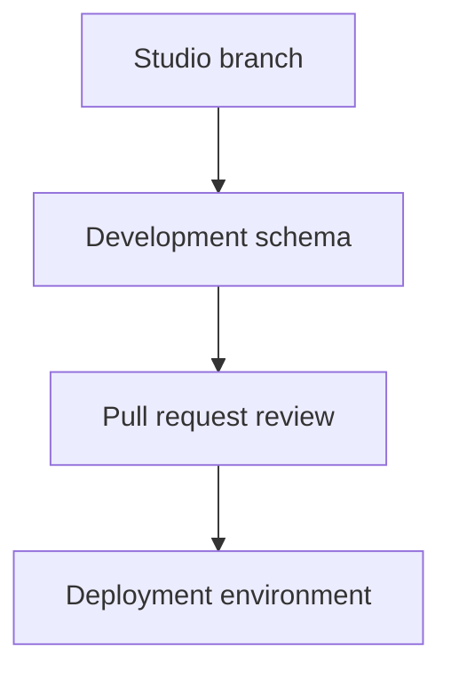

# Studio IDE, Git and environment roles

Studio IDE is the browser-based development environment formerly called Cloud IDE. Use it to edit files, compile and preview SQL, run builds, inspect lineage, and commit or branch through the linked Git repository. It executes database work using development credentials and the project's connection.

A deployment environment defines code, engine track, credentials and target for automated jobs. Use individual development schemas and scoped service credentials for shared environments. Browser previews can issue real queries, so check the active target and the volume of data read.

## Practice

In Studio, branch from the base branch, preview a model, build it in development, and examine the Git diff. Without access, do the same edits locally and map each CLI action to its Studio counterpart.

## Recall

How would you tell whether a Studio build and a deploy job ran the same commit and used the same role?

[Studio IDE](https://docs.getdbt.com/docs/platform/studio-ide/develop-in-studio) · [Deployment environments](https://docs.getdbt.com/docs/deploy/deploy-environments)

| Previous | Curriculum | Next |
| --- | --- | --- |
| [← Previous lesson](0020-production-safety-profiling-and-recovery.md) | [All lessons](index.md) | [Next lesson →](0022-deploy-jobs-triggers-and-scheduling.md) |
