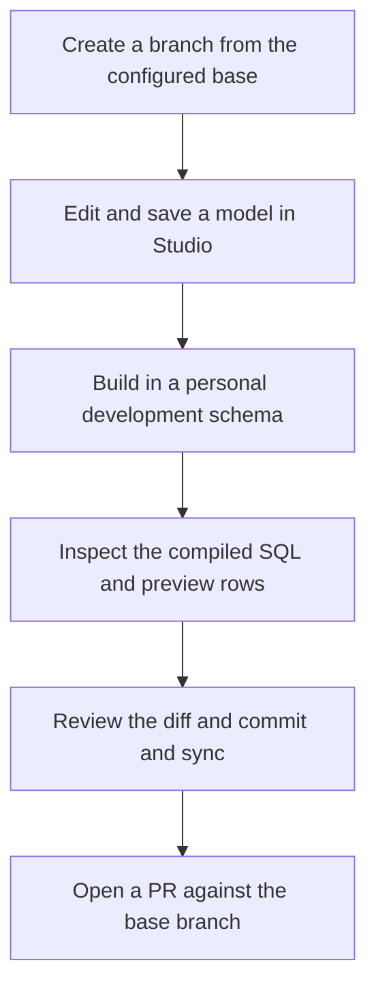

# Studio IDE, Git and environment roles

Studio IDE is the browser-based dbt editor formerly called Cloud IDE. It opens a branch of the project's linked Git repository and runs commands through the project's development environment. Saving a file updates your Studio workspace. **Commit and sync** sends the change to your Git branch so reviewers and jobs can fetch it. The configured base branch is where developers branch from and typically open pull requests. [Studio IDE guide](https://docs.getdbt.com/docs/platform/studio-ide/develop-in-studio)

An environment supplies the code branch, dbt release track, and warehouse settings. A project has one development environment and can have multiple deployment environments, including one designated Production environment. Use warehouse grants to enforce the write boundaries below. [dbt environments](https://docs.getdbt.com/docs/dbt-platform-environments) · [Deployment environments](https://docs.getdbt.com/docs/deploy/deploy-environments)

| Execution context | Code and credentials | Write boundary |
| --- | --- | --- |
| Studio | Working branch and personal warehouse credentials | Developer schema such as `dbt_alice` |
| CI | Pull request revision and a scoped deployment identity | Temporary PR schema in a separate CI environment |
| Production job | Configured deployment branch and a dedicated service identity | Published schema such as `analytics` |

**Compile** resolves Jinja and references so you can inspect the resulting SQL. **Preview** executes a query with development credentials. **Build** writes selected relations and runs their selected tests. A small preview shows sample values, while a build can test the whole relation. Check the target and the release track before comparing Studio with a job. [IDE user interface](https://docs.getdbt.com/docs/platform/studio-ide/ide-user-interface) · [dbt show](https://docs.getdbt.com/reference/commands/show)



## Practice

Use the [shop lab](0004-adapters-profiles-and-the-local-shop-lab.md) with the [order fact](0006-models-refs-and-project-configuration.md) and its original three orders. On a scratch branch, put each selected column of `fct_orders.sql` on its own line. Keep the same columns, materialization and `ref('stg_orders')`.

- **In Studio.** Confirm your personal credentials and schema, create a branch, save the edit, and run `dbt build --select +fct_orders` in the command bar. Open the fact's compiled SQL and preview. Inspect the diff, then use **Commit and sync** if you're using a training repository.
- **Without an account.** In a local Git checkout of the lab, create a scratch branch with `git switch -c lab/studio-orders` and make the same edit. Use the local editor to save, then run the commands below. The DuckDB profile simulates a personal target. Compare the branch and target you used with the production settings in the table above.

```bash
dbt build --profiles-dir . --select +fct_orders
dbt compile --profiles-dir . --select fct_orders
dbt show --profiles-dir . --select fct_orders
git diff -- models/fct_orders.sql
```

Check the SQL in `target/compiled/shop_lab/models/fct_orders.sql` after compiling locally. You succeed when the compiled SQL reads the development copy of `stg_orders`, the preview contains order IDs 1, 2 and 3, and the diff changes only formatting. Record the branch, target schema, and commit SHA if committed. An uncommitted edit is part of the Studio run's working copy and won't be in that SHA.

## Recall

1. A preview succeeds in Studio and a production job fails. Which settings and run evidence would you compare?
2. What must happen before CI can see a Studio edit?

??? question "Answer guidance"

    1. Compare the working tree and commit with the job's fetched SHA. Then compare the release track or exact dbt version, fully qualified relation names, and the warehouse identity and grants.
    2. Commit and sync the edit to the branch and open or update the pull request that triggers the CI job.

| Previous | Curriculum | Next |
| --- | --- | --- |
| [Previous lesson](0020-production-safety-profiling-and-recovery.md) | [All lessons](index.md) | [Next lesson](0022-deploy-jobs-triggers-and-scheduling.md) |
