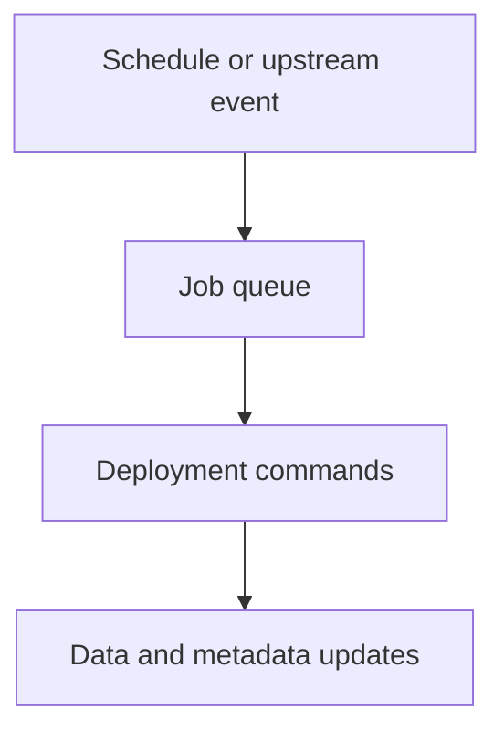

# Deploy jobs, triggers and scheduling

A deploy job runs configured dbt commands in a deployment environment. It can start on a schedule, via the Administrative API, manually, or after an upstream job completes when applicable. A run has a specific commit and target, timestamps, artifacts and a final status. Jobs can wait for available capacity.

Design recurring production jobs for new source data. A manifest-based `state:modified+` selector alone can skip the entire job when the code is unchanged, even after ingestion. Evaluate dbt State separately where supported. Establish whether upstream freshness is a requirement that blocks transformations or an alert managed elsewhere.

## Practice

Design a daily orders deploy job that starts after ingestion. Specify the job command order, target schema and credentials, expected artifacts, failure notification, and behavior on retries or overlapping runs.

## Recall

Which change can require a fact rebuild even if the Git commit and manifest have stayed the same?

[Deploy jobs](https://docs.getdbt.com/docs/deploy/deploy-jobs) · [Scheduler](https://docs.getdbt.com/docs/deploy/job-scheduler)

| Previous | Curriculum | Next |
| --- | --- | --- |
| [← Previous lesson](0021-studio-ide-git-and-environment-roles.md) | [All lessons](index.md) | [Next lesson →](0023-ci-jobs-temporary-schemas-and-slim-ci.md) |
