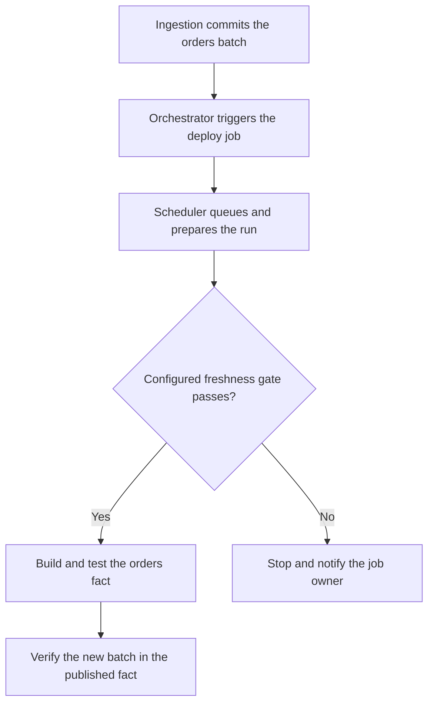

# Deploy jobs, triggers and scheduling

A deploy job is a reusable configuration in a deployment environment. It defines commands and triggers. A run is one execution of that configuration with a run ID, Git SHA, target, timestamps, step logs and artifacts. In **Orchestration → Jobs**, create a Deploy job, select its environment, enter the commands in order, and configure the trigger. Use **Run now** for a sandbox smoke test. [Deploy jobs](https://docs.getdbt.com/docs/deploy/deploy-jobs)

| Trigger | Use it when |
| --- | --- |
| Schedule | You need a predictable cadence. For example, `30 2 * * *` enqueues a run daily at 02:30 UTC. |
| Job completion | Another dbt deploy job owns the prerequisite. Select the upstream job and the status that should enqueue the next run, such as success. Check plan availability. |
| Administrative API | The ingestion orchestrator can trigger dbt after the load commits. Record the upstream batch ID alongside the resulting dbt run ID. |
| Run now | An operator is testing or recovering a job and has confirmed the target and input data. |

A trigger enqueues work. Start time depends on run-slot capacity, whether the same job is already running, and setup time. The scheduler serializes runs of the same deploy job. Coordinate separate jobs that write the same relations yourself. Compare queue wait, prep time, and command duration when investigating a missed update. Job threads control work within a run, while run slots control concurrent jobs. [dbt scheduler](https://docs.getdbt.com/docs/deploy/job-scheduler)

For a hard freshness gate, put `dbt source freshness` first in the command list and configure a source with an error threshold. An error stops subsequent steps. The **Run source freshness** checkbox records freshness before the build and lets later steps run even on failure. Use a reliable load timestamp for the gate. Schedule an orders build with a selector that runs even when only data changes. `state:modified+` compares project manifests and can succeed with zero models built after a new load. The separate, account-dependent dbt State feature can take inputs' freshness into account. [Source freshness](https://docs.getdbt.com/docs/deploy/source-freshness) · [Deploy jobs](https://docs.getdbt.com/docs/deploy/deploy-jobs) · [Enable dbt State](https://docs.getdbt.com/docs/deploy/dbt-state-enable-env-jobs)



## Practice

Design a daily `Orders refresh` job. Assume ingestion aims to finish at 02:15 UTC and the new data should be queryable by 03:00 UTC. Choose an API trigger on successful load or a 02:30 UTC schedule with a blocking freshness gate. For example, a two-hour error threshold would reject yesterday's load at 02:30 UTC. Use a service identity that can read the inputs and write the orders schema, and specify who receives error and late-data alerts.

**With platform access.** Try the command `dbt build --select +fct_orders` in a sandbox deployment environment that contains the [shop lab](0004-adapters-profiles-and-the-local-shop-lab.md) and the [order fact](0006-models-refs-and-project-configuration.md). Use **Run now**, then record the run ID, SHA, wait and execution times, fact result, and target. The lab rebuilds its fixture seed. A warehouse project should point its staging model at the ingestion-owned source.

**Without an account.** Use a disposable copy of the same lab with the original three orders. Run these commands from the lab directory:

```bash
dbt build --profiles-dir . --select +fct_orders
# Inspect the build log or target/run_results.json before previewing.
dbt show --profiles-dir . --inline "select count(*) as order_count from {{ ref('fct_orders') }}"
```

Append the following row to the copy of `seeds/raw_orders.csv` to simulate the next ingestion batch. Run the two commands again.

```csv
4,103,paid,2000,2026-01-04 10:00:00
```

Expect a successful fact build and a stored count that grows from three rows to four, then stays at four on a retry with the same input. Discard the copy after the exercise. In your job design, show what happens if ingestion fails and what an operator checks before retrying a failed build. A partially failed build may already have written some relations.

## Recall

1. Ingestion landed new rows, but the scheduled job succeeded without building a model. What configuration would you check first?
2. How can a freshness failure and a successful final job status coexist?

??? question "Answer guidance"

    1. Check for a manifest-based selector such as `state:modified+`. Compare the selected nodes in the logs and use a recurring selector that covers the orders fact on every intended refresh.
    2. The freshness checkbox runs a check that allows later steps to proceed. Put `dbt source freshness` first in the command list when a stale source should block publication.

| Previous | Curriculum | Next |
| --- | --- | --- |
| [Previous lesson](0021-studio-ide-git-and-environment-roles.md) | [All lessons](index.md) | [Next lesson](0023-ci-jobs-temporary-schemas-and-slim-ci.md) |
