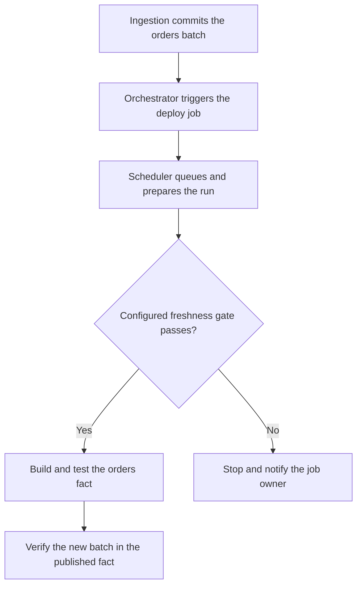

# Deploy jobs, triggers and scheduling

Once code merges into your release branch, a **deploy job** runs dbt in a deployment environment (such as Staging or Production) to keep warehouse tables current. Each execution produces a run record with a unique run ID, checked-out Git SHA, target profile, step logs, and archived JSON artifacts. Under **Jobs** in **Orchestration**, configure the environment, ordered commands, triggers, timeout, and failure notifications (Slack, email, or webhook). [Deploy jobs](https://docs.getdbt.com/docs/deploy/deploy-jobs)

## Triggers, concurrency, and run slots

| Trigger | When to use it |
| --- | --- |
| **Schedule** | Predictable cadence (for example, `30 2 * * *` runs daily at 02:30 UTC). Some teams also run a separate weekly `--full-refresh` schedule for incremental tables. |
| **Job completion** | Chaining when another dbt deploy job owns upstream tables (pick the parent job and required status such as success, subject to plan support). |
| **Administrative API** | Event-driven triggering immediately after your ELT loader finishes committing raw data. Log the upstream batch ID alongside the dbt run ID. |
| **Run now** | Manual operator triggers for smoke tests, deployments, or incident recovery after verifying target and inputs. |

A trigger **enqueues** a run rather than guaranteeing instant start. Actual start depends on account **run slots** (concurrent jobs allowed across your plan) and queue serialization: the scheduler runs only one active execution of the same deploy job at a time. Note the distinction: `threads` controls parallel nodes *within* a single run, whereas run slots limit parallel *jobs*. Coordinate separate deploy jobs that write to the same schemas so they cannot collide. [dbt scheduler](https://docs.getdbt.com/docs/deploy/job-scheduler)

## Freshness gates vs data-refresh selectors



Two common scheduling traps cause silent stale dashboards:

- **Hard freshness gate vs checkbox.** Putting `dbt source freshness` as step 1 in the command list halts the job before `dbt build` if any source exceeds `error_after`. Ticking the **Run source freshness** job checkbox runs freshness metadata before building, yet still lets `dbt build` proceed even when freshness errors! [Source freshness](https://docs.getdbt.com/docs/deploy/source-freshness)
- **Do not use `state:modified+` as your daily data-refresh selector.** `state:modified+` compares code manifests. When new rows land overnight with zero SQL edits, `state:modified+` succeeds with zero models built! Use an explicit data-refresh selector (such as `dbt build --select +fct_orders` or `tag:daily`), or configure the separate [dbt State](0037-dbt-state-and-freshness-aware-orchestration.md) capability. [Enable dbt State](https://docs.getdbt.com/docs/deploy/dbt-state-enable-env-jobs)

**Choose a start condition.** A 02:30 schedule fires while the 02:15 orders batch is still loading. The newest row could already have today's timestamp. If the dashboard needs the complete batch, wait for the loader's completion record for that batch ID, then run dbt and check the served count before releasing the extract.

## Practice

### Scenario

Design a daily `Orders refresh` deploy job. Ingestion normally completes by 02:15 UTC, and dashboards must show fresh numbers by 03:00 UTC. Choose either an API trigger from the loader or a 02:30 UTC cron schedule gated by `dbt source freshness` as command 1 (for example, a 2-hour `error_after` rejects yesterday's stale batch). Assign a service identity that reads `raw` and writes `analytics`, plus alert owners for failed builds and late ingestion.

### Steps

- **With platform access.** Create a sandbox deploy job running `dbt build --select +fct_orders` against a sandbox deployment environment holding [shop_lab](0004-adapters-profiles-and-the-local-shop-lab.md) and [`fct_orders`](0006-models-refs-and-project-configuration.md). Click **Run now** and record the run ID, Git SHA, queue/prep vs SQL execution time, and fact status.
- **Without an account (local batch simulation).** Work in a disposable copy of `shop_lab` with the original 3 orders:

```bash
dbt build --profiles-dir . --select +fct_orders
dbt show --profiles-dir . --inline "select count(*) as order_count from {{ ref('fct_orders') }}"
```

Append one new ingestion batch row to the copy's `seeds/raw_orders.csv`, then rerun both commands:

```csv
4,103,paid,2000,2026-01-04 10:00:00
```

**Expected result.** `fct_orders` builds cleanly and `order_count` increases from **3** to **4**, remaining **4** if you rerun the build on the same CSV. Document in your job design how operators handle an ingestion outage vs a failed dbt build step (noting partial upstream commits). Discard the disposable copy afterward.

## Recall

1. Ingestion loaded 10,000 new orders last night, and the scheduled deploy job succeeded in 3 seconds, yet `fct_orders` still holds yesterday's rows. Which job command configuration should you check first?
2. How can a source freshness failure and a green `Succeeded` deploy job status appear on the same run?
3. What is the difference between setting `threads: 8` on a job and having 4 account run slots?

??? note "Answer guidance"
    1. Check if the job uses `state:modified+` without data-aware dbt State. Because no SQL changed, manifest comparison selected zero models. Switch to an explicit data-refresh selector like `+fct_orders` or `tag:daily`.
    2. The **Run source freshness** checkbox records freshness errors without halting subsequent build commands. Put `dbt source freshness` explicitly as the first command step when stale data must block downstream publication.
    3. `threads: 8` lets one dbt run execute up to 8 independent DAG nodes concurrently. Run slots cap how many separate dbt jobs can execute simultaneously across the account.

| Previous | Curriculum | Next |
| --- | --- | --- |
| [Previous lesson](0021-studio-ide-git-and-environment-roles.md) | [All lessons](index.md) | [Next lesson](0023-ci-jobs-temporary-schemas-and-slim-ci.md) |
