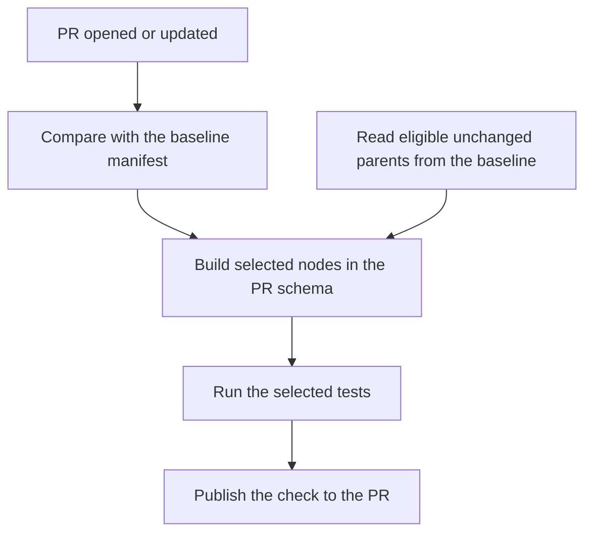

# CI jobs, temporary schemas and slim CI

A continuous integration (CI) job checks a proposed change when a pull request opens or receives a new commit. With a native Git integration, dbt posts the result back to the PR. Configure the Git provider to require that check for merging. dbt normally builds into a schema named `dbt_cloud_pr_<job_id>_<pr_id>` and drops it when the PR closes or merges. A custom schema naming macro can break cleanup. API-triggered CI without native webhooks requires you to handle cleanup. [Continuous integration](https://docs.getdbt.com/docs/deploy/continuous-integration) · [CI jobs](https://docs.getdbt.com/docs/deploy/ci-jobs)

Slim CI combines two mechanisms:

| Mechanism | What it does |
| --- | --- |
| `state:modified+` | Compares the current project with a baseline manifest and selects new or modified nodes and their downstream dependents. |
| Deferral | Resolves eligible unselected upstream `ref()` calls to relations named in the baseline. An existing local relation normally takes precedence when using the CLI unless you pass `--favor-state`. |

Configure the managed job in a dedicated deployment environment with read access to the intended inputs and deferred relations, and write access to its temporary schemas. Under **Compare changes against**, choose an environment with a successful build. The baseline can come from whichever job most recently succeeded there and updated artifacts. Check its run and commit if unrelated nodes suddenly appear in the selection. A relationship test can read one parent from CI and another from the baseline. Review whether their data populations match before interpreting a failure. [CI jobs](https://docs.getdbt.com/docs/deploy/ci-jobs) · [Defer reference](https://docs.getdbt.com/reference/node-selection/defer)

CI runs for different PRs can run concurrently without consuming deployment run slots. They still issue queries on your data platform. [dbt scheduler](https://docs.getdbt.com/docs/deploy/job-scheduler)



## Practice

Use a disposable copy of the [shop lab](0004-adapters-profiles-and-the-local-shop-lab.md) with the [order fact](0006-models-refs-and-project-configuration.md) and the `paid_orders_have_positive_total` [data test](0012-generic-and-singular-data-tests.md). In `models/fct_orders.sql`, replace the selected `total_cents` column with `0 as total_cents` **after** building the baseline below. This keeps the SQL valid while breaking a business rule.

**With platform access** — Build the original lab in a sandbox baseline environment. Create a CI job in a separate sandbox deployment environment with `dbt build --select state:modified+` and select the baseline environment under **Compare changes against**. Open a PR with the broken edit. Find the fact build, failing test, and temporary schema in the run history. Fix the edit or close the PR, then check the posted status or schema cleanup.

**Without an account** — Use the original `dev` target (schema `main`) as the baseline. Add this sibling of `dev` under `outputs` in `profiles.yml`. Both targets share the lab's DuckDB file so the CI target can read the baseline schema.

```yaml
    ci:
      type: duckdb
      path: ./shop.duckdb
      schema: ci_pr_1
      threads: 2
```

Before editing the fact, build the baseline and save its manifest outside the active target directory. Use the same dbt version for both steps.

```bash
dbt build --profiles-dir . --target dev --select +fct_orders
mkdir -p baseline
cp target/manifest.json baseline/manifest.json
```

Now make the broken edit and run:

```bash
dbt ls --profiles-dir . --target ci --state baseline --select 'state:modified+'
dbt build --profiles-dir . --target ci --state baseline --defer --select 'state:modified+'
```

Expect `fct_orders` and its downstream tests in the selection, with no build of `stg_orders`. The compiled fact reads `main.stg_orders` and the build writes `ci_pr_1.fct_orders`. The paid-total test fails for orders 1 and 3, which would make the required PR check fail. Restore the fact SQL and rerun the same PR check. To see a passing test locally, build `fct_orders` explicitly with the same target and deferral flags, since the restored SQL can yield an empty modified selection.

## Recall

1. Why does CI need both a saved manifest and access to some warehouse relations?
2. A CI run selects an unexpected model that someone else just merged. What should you compare?

??? question "Answer guidance"

    1. The manifest supplies the comparison and relation names. The warehouse grants let the CI identity read the actual rows from eligible deferred parents.
    2. Compare the PR's base with the SHA of the successful run that supplied the baseline. Update the PR branch against the current base, then check the selection again.

| Previous | Curriculum | Next |
| --- | --- | --- |
| [← Previous lesson](0022-deploy-jobs-triggers-and-scheduling.md) | [All lessons](index.md) | [Next lesson →](0024-merge-jobs-and-continuous-deployment.md) |
