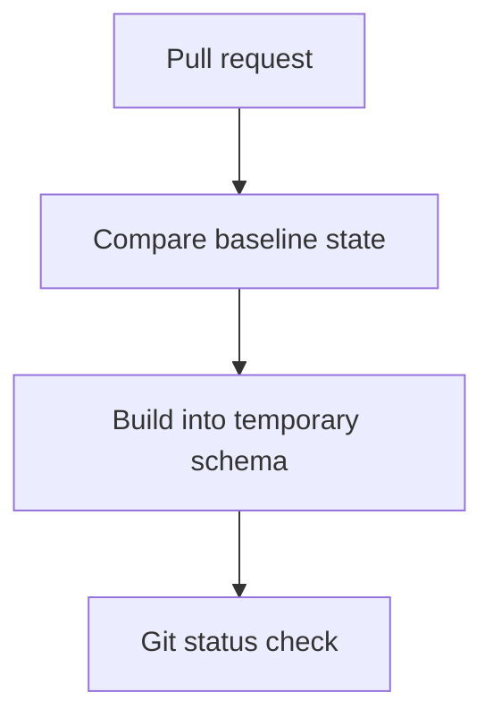

# CI jobs, temporary schemas and slim CI

A CI job evaluates proposed changes before merge. A typical slim CI run selects changed resources and downstream dependents and uses deferral to resolve eligible unchanged upstream references. Temporary schemas isolate concurrent PR writes. The Git integration can report the job status and, where supported, clean up temporary schemas.

Bootstrap the baseline with a successful run and confirm the CI role can read the relations it defers to. Use branch protection to require the desired check. Large downstream graphs, multi-parent tests, and data that differs across environments can widen the run or distort a test result.

## Practice

Modify a staging model in a PR or simulate the state comparison locally. Predict which models build, which are deferred, and how a failing test blocks promotion. Verify the selection against the manifest.

## Recall

Why might a test involving both CI and production relations fail even when both environments contain valid data separately?

[Continuous integration](https://docs.getdbt.com/docs/deploy/continuous-integration) · [CI jobs](https://docs.getdbt.com/docs/deploy/ci-jobs)

| Previous | Curriculum | Next |
| --- | --- | --- |
| [← Previous lesson](0022-deploy-jobs-triggers-and-scheduling.md) | [All lessons](index.md) | [Next lesson →](0024-merge-jobs-and-continuous-deployment.md) |
