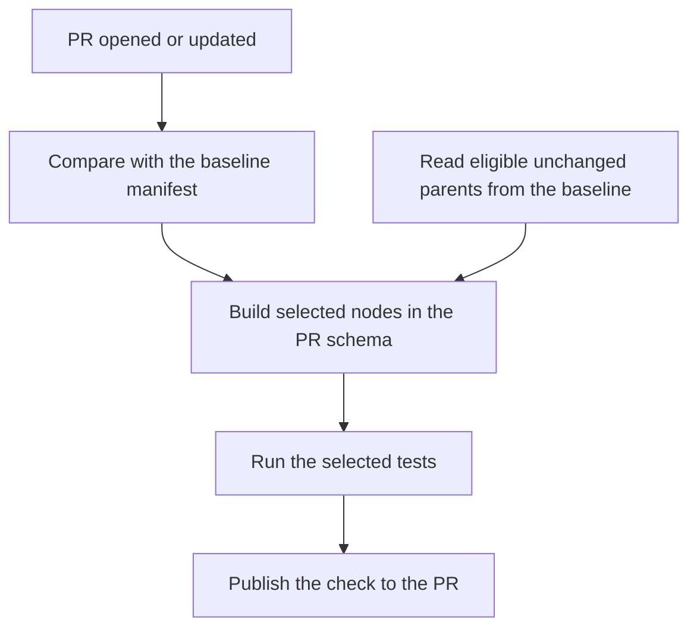

# CI jobs, temporary schemas and slim CI

A **continuous integration (CI) job** automatically tests every pull request commit in an isolated schema before code merges to `main`. With native Git webhooks, dbt posts the pass/fail check back to the PR so branch protection can block merges on broken SQL or failed tests. [Continuous integration](https://docs.getdbt.com/docs/deploy/continuous-integration) · [CI jobs](https://docs.getdbt.com/docs/deploy/ci-jobs)

## Temporary PR schemas and Slim CI

dbt isolates each pull request in a temporary schema named `dbt_cloud_pr_<job_id>_<pr_id>` and drops that schema automatically when the PR merges or closes. Avoid overriding schema naming in `generate_schema_name` in ways that remove the PR prefix, because custom schema macros can break isolation or auto-cleanup. API-triggered CI jobs without native Git webhooks also require explicit cleanup.



**Slim CI** avoids rebuilding thousands of untouched models on every PR by combining two features:

| Mechanism | Role in Slim CI |
| --- | --- |
| **`state:modified+`** | Compares the PR code against the baseline environment's manifest (**Compare changes against**) and builds only modified/new nodes and their descendants. |
| **Deferral** | Resolves unselected upstream `ref()` calls to production/staging tables recorded in that baseline manifest. On the CLI, pass `--favor-state` so subsequent commits pushed to the same PR never read stale leftovers from an earlier PR schema build! |

## Practical CI design caveats

- **Bootstrapping a fresh baseline.** **Compare changes against** reads artifacts from the latest successful run in the target baseline environment. A brand-new environment has no manifest yet, so trigger one full production deploy run before relying on Slim CI. Always confirm the baseline run's Git SHA if unrelated models suddenly appear modified.
- **Controlling CI cost and blast radius.** Editing a foundational staging model can cause `state:modified+` to select half the warehouse. Teams manage PR cost by sampling inputs when `target.name == 'ci'`, running `--empty` schema dry runs, excluding slow historical backfills, or carefully scoping downstream depth (`state:modified+1`).
- **Concurrency and cross-schema tests.** PR CI runs execute concurrently across separate PR schemas without consuming deployment run slots (though they still use warehouse compute). Remember that a multi-parent `relationships` test might compare a modified PR child against a deferred production parent whose data timestamps differ! [Defer reference](https://docs.getdbt.com/reference/node-selection/defer)

## Practice

### What you need

Use a disposable copy of [shop_lab](0004-adapters-profiles-and-the-local-shop-lab.md) with [`fct_orders`](0006-models-refs-and-project-configuration.md) and `tests/paid_orders_have_positive_total.sql` from [lesson 0012](0012-generic-and-singular-data-tests.md).

### Steps

- **With platform access.** Run a full build in a sandbox baseline environment first. Create a CI job in a separate CI deployment environment running `dbt build --select state:modified+`, setting **Compare changes against** to the baseline environment. Open a PR changing `total_cents` to `0 as total_cents` in `models/fct_orders.sql`. Confirm the PR fails on `paid_orders_have_positive_total`, inspect the temporary `dbt_cloud_pr_*` schema, then fix or close the PR and verify schema cleanup.
- **Without an account (local DuckDB CI simulation).** Treat `dev` (schema `main`) as production and add a `ci` output to `profiles.yml` sharing `./shop.duckdb`:

```yaml
    ci:
      type: duckdb
      path: ./shop.duckdb
      schema: ci_pr_1
      threads: 2
```

1. Build the production baseline first and save its `manifest.json` outside `target/`:

```bash
dbt build --profiles-dir . --target dev --select +fct_orders
mkdir -p baseline
cp target/manifest.json baseline/manifest.json
```

2. Now break the business rule in `models/fct_orders.sql` by replacing `total_cents` with `0 as total_cents` (valid SQL that fails the revenue rule), then run Slim CI:

```bash
dbt ls --profiles-dir . --target ci --state baseline --select 'state:modified+'
dbt build --profiles-dir . --target ci --state baseline --defer --favor-state --select 'state:modified+'
```

**Expected result.** `dbt ls` selects `fct_orders` and its tests without selecting `stg_orders`. The compiled fact reads `main.stg_orders` via deferral, builds `ci_pr_1.fct_orders`, and fails `paid_orders_have_positive_total` on orders 1 and 3 (blocking a merge).

3. **Restore.** Change `0 as total_cents` back to `total_cents` in `models/fct_orders.sql`. Note that `state:modified+` against the original `baseline` now yields an empty selection (because code matches baseline again), so test explicitly with `dbt build --profiles-dir . --target ci --state baseline --defer --favor-state --select fct_orders` to confirm a clean pass. Discard the disposable copy when finished.

## Recall

1. Why does a Slim CI environment need both a saved production `manifest.json` **and** warehouse `SELECT` grants on production tables?
2. Your PR only touched `fct_orders.sql`, yet the CI job unexpectedly rebuilds `dim_customers` modified by someone else earlier today. What should you inspect?
3. Why should a CLI-based Slim CI command include `--favor-state` alongside `--defer` when developers push multiple commits to the same PR?

??? note "Answer guidance"
    1. `manifest.json` tells dbt which nodes changed and which schema/table names exist in production, while warehouse `SELECT` grants let the CI identity read actual rows from deferred parents during builds and tests.
    2. Compare your PR branch's base commit against the Git SHA of the latest successful run in the **Compare changes against** environment. Merge/rebase the latest base branch into your PR (or verify the baseline job built the latest main commit) and rerun CI.
    3. If commit 1 modified and built an upstream model inside `ci_pr_1` and commit 2 reverted that change, `--defer` without `--favor-state` would prefer the stale copy sitting in `ci_pr_1` instead of production's fresh relation.

| Previous | Curriculum | Next |
| --- | --- | --- |
| [Previous lesson](0022-deploy-jobs-triggers-and-scheduling.md) | [All lessons](index.md) | [Next lesson](0024-merge-jobs-and-continuous-deployment.md) |
