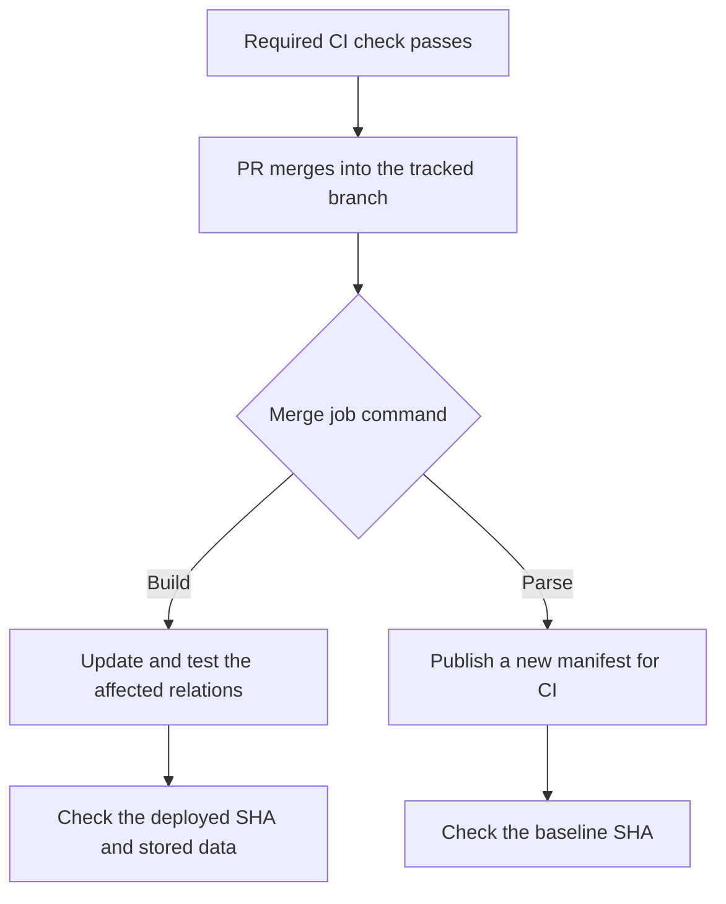

# Merge jobs and continuous deployment

While a CI job tests code in a temporary schema before merge, a **merge job** runs immediately after a pull request merges into your deployment branch (such as `main`). Enable **Run on merge** on a job in the target deployment environment and verify your Git integration delivers push webhooks. Always match the merge run's checked-out Git SHA to the merged commit when verifying a rollout. [Continuous deployment](https://docs.getdbt.com/docs/deploy/continuous-deployment) · [Merge jobs](https://docs.getdbt.com/docs/deploy/merge-jobs)

## Choosing between CD builds and manifest-refresh merges

Teams configure merge jobs in one of two ways depending on release cadence:

| Goal | Command and baseline design | Watch out for |
| --- | --- | --- |
| **Continuous deployment (publish immediately)** | `dbt build --select state:modified+` against a baseline representing the last deployed production build. Bootstrap the environment with a full build first. | Serialize with scheduled deploy jobs writing the same tables so runs do not collide. |
| **Keep Slim CI baseline fresh without heavy builds** | `dbt parse` (or `dbt parse --no-partial-parse` where supported) in the CI comparison environment to refresh `manifest.json` immediately on merge. | **Never** let a parse-only manifest become the baseline for a `state:modified+` production build, or that build will treat unbuilt code as already deployed and skip updating tables! |

If your CI environment compares code changes against a parse-only job while reading relations from production, separate the code baseline (`--state`) from the relation baseline (`--defer-state`). [Defer reference](https://docs.getdbt.com/reference/node-selection/defer)



## Concurrency, incremental schemas, and rollbacks

- **Queue superseding.** Merge jobs consume deployment run slots, and when multiple PRs merge rapidly, the scheduler can cancel older queued merge runs in favor of the newest commit. Ensure your baseline comes from the latest *built* release rather than assuming every single merge ran individually. [dbt scheduler](https://docs.getdbt.com/docs/deploy/job-scheduler)
- **The incremental schema trap (CI passes, merge fails).** CI builds in an empty temporary schema (`is_incremental()` is `false`), so adding a column to an incremental model builds cleanly in CI. When the merge job runs against the live production table (`is_incremental()` is `true`), default `on_schema_change: ignore` drops your new column unless you configured `on_schema_change` or planned a backfill!
- **Git revert vs data rollback.** Reverting a bad PR updates Git immediately, yet bad rows remain in the warehouse until a build or backfill repairs the affected tables.

## Practice

### What you need

Use a disposable sandbox or a local copy of [shop_lab](0004-adapters-profiles-and-the-local-shop-lab.md) with [`fct_orders`](0006-models-refs-and-project-configuration.md) materialized as a `table`. Build the original 3-row fact first. Simulate a merged PR that filters `models/fct_orders.sql` by appending `where status = 'paid'`.

### Steps

- **With platform access.** Verify CI passes, merge the filter PR into your sandbox deployment branch, and run a merge job executing `dbt build --select fct_orders` (reusing an already-built `stg_orders`). Confirm the commit SHA, trigger event, and 2-row table result, and schedule around the next data refresh.
- **Without an account (local merge simulation).** Run these commands in order, applying `where status = 'paid'` to `models/fct_orders.sql` only **after** the first count:

```bash
dbt build --profiles-dir . --select +fct_orders
dbt show --profiles-dir . --inline "select count(*) as order_count from {{ ref('fct_orders') }}"
# Apply 'where status = '\''paid'\''' to models/fct_orders.sql here
dbt parse --profiles-dir .
# Inspect target/manifest.json (contains the new SQL, while the table is unchanged!)
dbt show --profiles-dir . --inline "select count(*) as order_count from {{ ref('fct_orders') }}"
dbt build --profiles-dir . --select fct_orders
# Inspect target/run_results.json
dbt show --profiles-dir . --inline "select count(*) as order_count from {{ ref('fct_orders') }}"
```

**Expected result.** Notice why parsing alone does not deploy data: the counts print **3**, **3** (even after `dbt parse` updates `manifest.json` with the new filter), and finally **2** after `dbt build`. Note that `dbt show --inline` queries the persisted warehouse table directly, whereas `dbt show --select fct_orders` previews compiled SQL. Remove the filter and rebuild if testing a rollback back to 3 rows, then discard the disposable copy. [dbt parse](https://docs.getdbt.com/reference/commands/parse)

## Recall

1. A merge job finishes green after running `dbt parse`, yet dashboards still reflect old logic. What must you verify to confirm a deployment actually updated the warehouse?
2. Why is it unsafe to assume every merged PR triggers its own isolated merge build or to let a `dbt parse` job serve as the `state:modified+` baseline for production builds?
3. A PR adds a `discount_cents` column to an incremental model and passes Slim CI completely, yet after merging into `main`, `discount_cents` is missing in production. How did that happen?

??? note "Answer guidance"
    1. Verify a successful `dbt build` or `dbt run` at the merged Git SHA and inspect `run_results.json` plus the actual warehouse relation. `dbt parse` updates project metadata without executing SQL against tables.
    2. The scheduler can supersede older queued merge runs when multiple PRs land together, and a `dbt parse` manifest marks new code as the baseline without updating tables, causing a subsequent `state:modified+` deploy job to skip building those models.
    3. Slim CI ran in a fresh empty PR schema (`is_incremental()` was `false`), creating the table with the new column. Production had an existing table (`is_incremental()` was `true`), so without `on_schema_change` or a targeted rebuild, the incremental run ignored the new column.

| Previous | Curriculum | Next |
| --- | --- | --- |
| [Previous lesson](0023-ci-jobs-temporary-schemas-and-slim-ci.md) | [All lessons](index.md) | [Next lesson](0025-dbt-canvas-and-visual-model-development.md) |
