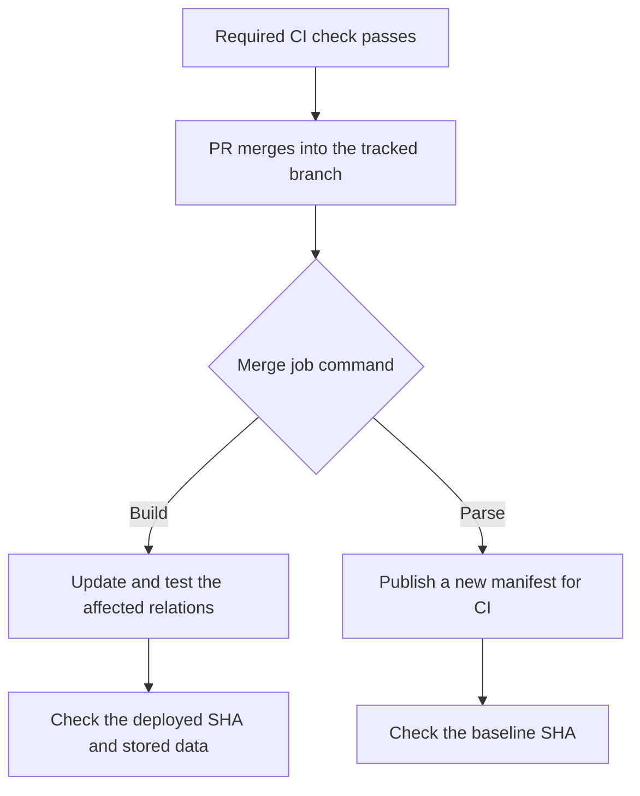

# Merge jobs and continuous deployment

A merge job responds when a PR lands on the base branch tracked by its deployment environment. Create a **Merge job** with **Run on merge** enabled and verify that the Git integration delivers push events. The pre-merge CI job validates the proposed revision in a temporary schema. The merge job runs the merged code with its deployment environment's credentials. Match the run's Git SHA to the merged revision when verifying a release. [Continuous deployment](https://docs.getdbt.com/docs/deploy/continuous-deployment) · [Merge jobs](https://docs.getdbt.com/docs/deploy/merge-jobs)

Choose commands based on what the merge should publish.

| Goal | Command and baseline |
| --- | --- |
| Publish model changes promptly | The default `dbt build --select state:modified+` builds modified nodes and their downstream dependents. Give it a successful baseline that represents the code built in production. Use an explicit full or scoped build to bootstrap the environment. |
| Refresh the CI comparison manifest promptly | Use `dbt parse` in the environment configured under the CI job's **Compare changes against** setting. The docs show `dbt parse --no-partial-parse` for a full parse where supported. Parsing produces project metadata without a warehouse build. |

Keep a parse-only manifest out of the baseline for a state-selected production build. Otherwise that build can treat code as already applied and skip a relation that still needs updating. If CI uses a separate manifest-only environment, make sure the deferred relation names still point to real, readable relations. Where you manage artifacts yourself, `--defer-state` can provide an applied baseline separately from the comparison manifest. [Merge jobs](https://docs.getdbt.com/docs/deploy/merge-jobs) · [CI jobs](https://docs.getdbt.com/docs/deploy/ci-jobs) · [Defer reference](https://docs.getdbt.com/reference/node-selection/defer)

Merge jobs use run slots and the scheduler can cancel older queued runs of the same merge job in favor of the newest one. Design for the latest merged code and coordinate with scheduled writers to avoid overlapping updates. For example, route merge and ingestion events through one orchestrator that serializes writes to the orders fact. Keep the recurring refresh tied to incoming data. A revert changes Git immediately, and restoring data can require another build or a backfill. [dbt scheduler](https://docs.getdbt.com/docs/deploy/job-scheduler)



## Practice

Use a disposable sandbox or a local copy of the [shop lab](0004-adapters-profiles-and-the-local-shop-lab.md) with the [order fact](0006-models-refs-and-project-configuration.md) materialized as a table. Build the original version and record its three rows. Simulate a merged change by adding `where status = 'paid'` to the fact. This is a sandbox release exercise that deliberately changes which orders the fact contains.

**With platform access.** On a training repository, confirm CI passes before merging into the sandbox environment's base branch. Use a merge job with `dbt build --select fct_orders` and a previously built `stg_orders`. Check the trigger, SHA, and stored result in the sandbox. Record when the next data-driven refresh can run without overlapping the release.

**Without an account.** Treat the original build as the last deployed revision and the edited file as the merged revision. Run these steps in order, with the edit between the first count and `dbt parse`.

```bash
dbt build --profiles-dir . --select +fct_orders
dbt show --profiles-dir . --inline "select count(*) as order_count from {{ ref('fct_orders') }}"
# Apply the merged edit here.
dbt parse --profiles-dir .
# Inspect target/manifest.json.
dbt show --profiles-dir . --inline "select count(*) as order_count from {{ ref('fct_orders') }}"
dbt build --profiles-dir . --select fct_orders
# Inspect target/run_results.json.
dbt show --profiles-dir . --inline "select count(*) as order_count from {{ ref('fct_orders') }}"
```

Expect counts of 3, 3 and 2. The parsed manifest should contain the new filter and the later build result should show a successful fact build. Inspect each artifact at the indicated step because later commands can overwrite it. The inline count queries the stored table. Previewing the fact's SQL would instead run its current definition. Restore the file and rebuild the fact if you want to verify the rollback to three rows. [dbt parse](https://docs.getdbt.com/reference/commands/parse) · [dbt show](https://docs.getdbt.com/reference/commands/show)

## Recall

1. A merge job turns green after `dbt parse`. What evidence would prove the fact was deployed?
2. Why is it risky to assume the scheduler runs a separate release for every merge?

??? question "Answer guidance"

    1. Look for a successful build of the fact at the merged SHA, then verify the relation contents in the intended schema. A manifest can describe the new code while the table still contains the previous result.
    2. The scheduler can retain only the latest queued run. Build from the latest merged state and use a baseline tied to the last applied release.

| Previous | Curriculum | Next |
| --- | --- | --- |
| [Previous lesson](0023-ci-jobs-temporary-schemas-and-slim-ci.md) | [All lessons](index.md) | [Next lesson](0025-dbt-canvas-and-visual-model-development.md) |
