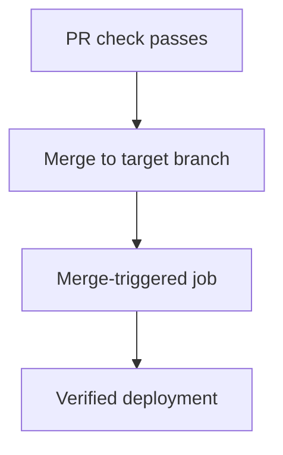

# Merge jobs and continuous deployment

A merge job runs after changes land on the monitored branch. Its environment and commands determine which relations it updates. Use it to publish changed code promptly or to refresh the manifest that subsequent CI runs compare against. A long-running production build and a quick manifest refresh can serve different operational needs.

Consider ordering and concurrency with scheduled runs, especially when both write the same relations. A code rollback may require a follow-up build or backfill to restore data.

## Practice

Write a timeline for a PR from open through merge, production build and the next scheduled refresh. Mark which checks run before the merge and which update production afterward.

## Recall

If a merge job only runs `dbt parse`, what production state can change, and what stays at its previous data version?

[Merge jobs](https://docs.getdbt.com/docs/deploy/merge-jobs)

| Previous | Curriculum | Next |
| --- | --- | --- |
| [← Previous lesson](0023-ci-jobs-temporary-schemas-and-slim-ci.md) | [All lessons](index.md) | [Next lesson →](0025-dbt-canvas-and-visual-model-development.md) |
