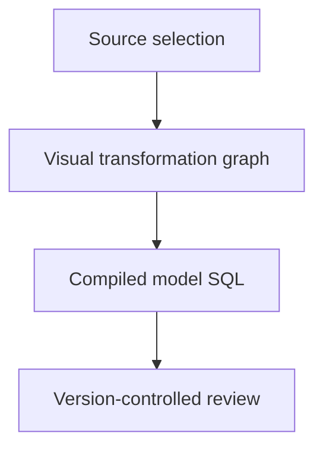

# dbt Canvas and visual model development

Canvas is the platform's visual editor for joining, filtering and reshaping data. Canvas-authored models compile to SQL and participate in Git, lineage and deployment. Review both the visual intent and the compiled query for join keys, filter placement, grain, and selected columns.

dbt Labs archived Canvas documentation and stopped enabling it for new accounts on November 12, 2026. Existing customers can continue using it. The exact capabilities depend on the existing account and adapter.

## Practice

Sketch a Canvas workflow that joins order status metadata and keeps reportable orders. If you have access, build it visually and compare the compiled SQL with a Studio version. Otherwise implement the sketch in SQL and review the same joins and filters.

## Recall

Which tests would reveal if a visually correct join duplicated order rows?

[Canvas documentation](https://docs.getdbt.com/docs/platform/canvas)

| Previous | Curriculum | Next |
| --- | --- | --- |
| [← Previous lesson](0024-merge-jobs-and-continuous-deployment.md) | [All lessons](index.md) | [Next lesson →](0026-metricflow-semantic-models-and-entities.md) |
