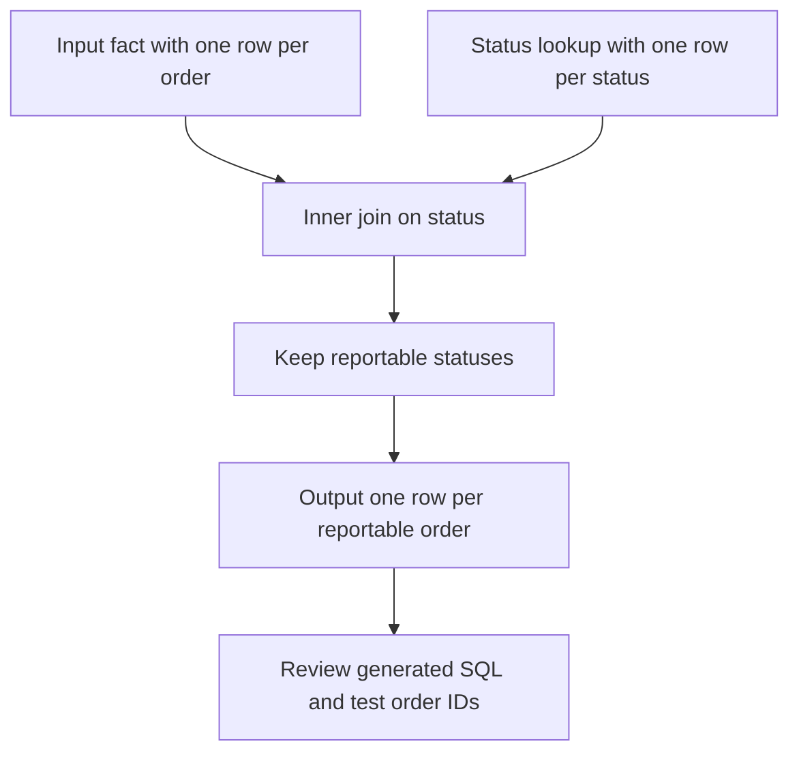

# dbt Canvas and visual model development

Canvas is a visual editor for dbt models. Input operators choose relations, transform operators define operations such as joins and filters, and an output operator names the model and its path. The graph generates model SQL. In an enabled workspace, preview intermediate operators, inspect their SQL, run the model in your development schema, and commit for review in Git. The committed model participates in dbt lineage and deployment. [Canvas interface](https://docs.getdbt.com/docs/platform/canvas-interface) · [Canvas quickstart](https://docs.getdbt.com/guides/canvas)

!!! note "Legacy availability"

    On November 12, 2026, dbt Labs stopped selling Canvas or enabling it for new platform accounts and archived its docs. Existing customers can continue to use it. The archived prerequisites list Enterprise or Enterprise+, developer credentials, a compatible adapter and release track, a supported HTTPS Git integration, and a completed Staging or Production run. Use the SQL walkthrough in Studio or locally if Canvas is unavailable. [Canvas availability and prerequisites](https://docs.getdbt.com/docs/platform/canvas)

Review the graph and generated SQL for join direction, key uniqueness, filter placement, and output grain. A preview can show plausible values while missing duplicate keys elsewhere in the data.



## Practice

Use the original three rows in the [shop lab](0004-adapters-profiles-and-the-local-shop-lab.md), the [order fact](0006-models-refs-and-project-configuration.md), and the [status lookup seed](0008-seeds-and-lookup-data.md) with `paid,true` and `pending,false`. The new model, `int_reportable_orders`, should contain one row per reportable order.

**With Canvas access** — Use a sandbox where both inputs have been built. If the model explorer doesn't show the seed, publish a sandbox model using `select status, is_reportable from {{ ref('order_statuses') }}` and select that model as the lookup input. Wire `fct_orders` to the left and the lookup to the right. Configure an inner join on `status` and retain the fact's order ID, customer ID, status and amount along with the lookup's `is_reportable` flag. Filter for true, then drop the flag from the output. Name the output `int_reportable_orders`. Preview the join and filter, inspect the SQL, and run the model in development. Add the properties below in Studio and review the resulting files together.

**Without Canvas** — Create `models/int_reportable_orders.sql` in Studio or in a local copy of the lab. The refs supply the two inputs and the SQL encodes the same join, filter and projection.

```sql
select
    orders.order_id,
    orders.customer_id,
    orders.status,
    orders.total_cents
from {{ ref('fct_orders') }} as orders
inner join {{ ref('order_statuses') }} as statuses
    on orders.status = statuses.status
where statuses.is_reportable = true
```

In either path, add `models/int_reportable_orders.yml` and run a build with tests.

```yaml
models:
  - name: int_reportable_orders
    description: One row per reportable order.
    columns:
      - name: order_id
        data_tests: [unique, not_null]
```

```bash
dbt build --profiles-dir . --select +int_reportable_orders
dbt show --profiles-dir . --inline "select * from {{ ref('int_reportable_orders') }} order by order_id"
```

Use the command bar without `--profiles-dir .` in Studio. Expect order IDs 1 and 3 with totals of 1250 and 1750 cents, and both tests passing. In a disposable local copy, add a second `paid,true` row to the status seed and rebuild. The output uniqueness test should flag IDs 1 and 3. If you already test lookup uniqueness, that test can fail first and block the downstream build. Remove the duplicate and rebuild to recover.

## Recall

1. Why can a duplicate lookup row inflate revenue after this join?
2. What happens to an order with a status absent from the lookup? Which test could surface that case?

??? question "Answer guidance"

    1. Each matching lookup row produces a result row for the order, so summing the amounts counts the order twice. A unique test on lookup status catches the input defect. A unique test on output order ID detects the changed grain.
    2. The inner join drops it. A relationship test from `fct_orders.status` to `order_statuses.status` can flag unmapped values. Add a separate `not_null` test if status is required.

| Previous | Curriculum | Next |
| --- | --- | --- |
| [← Previous lesson](0024-merge-jobs-and-continuous-deployment.md) | [All lessons](index.md) | [Next lesson →](0026-metricflow-semantic-models-and-entities.md) |
