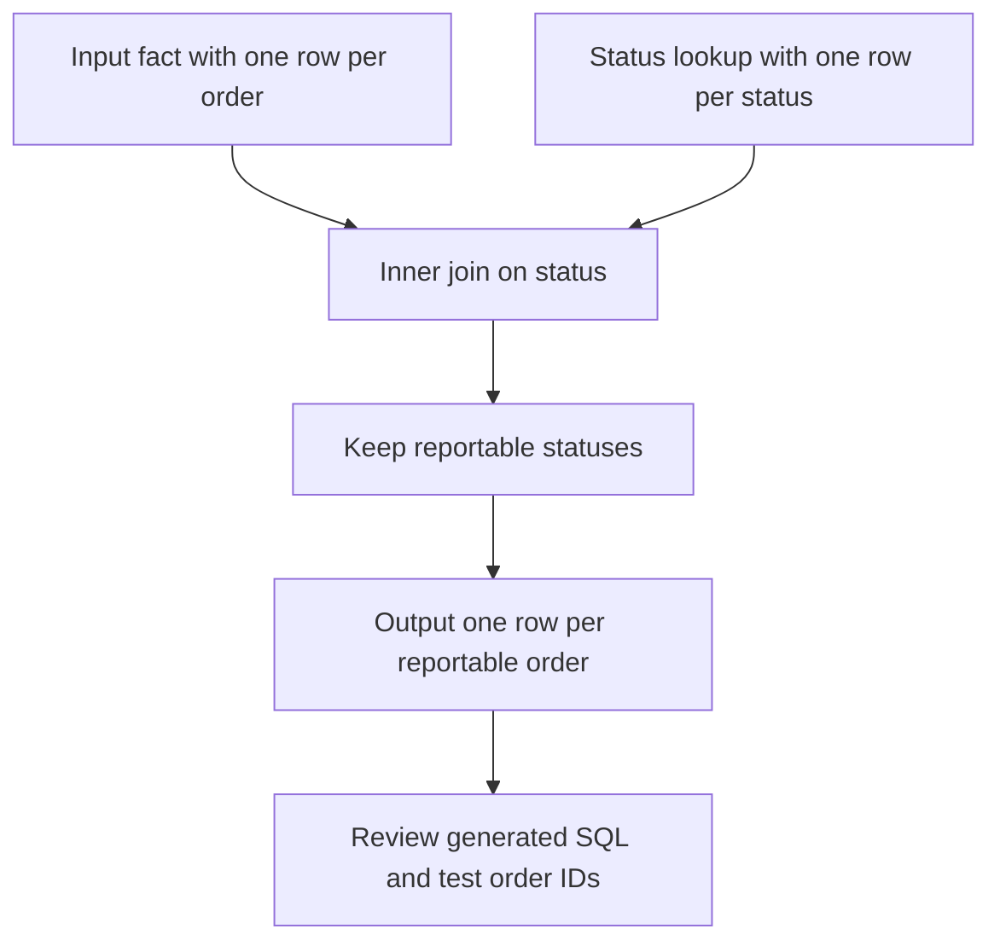

# dbt Canvas and visual model development

**dbt Canvas** is a drag-and-drop visual model builder inside the dbt platform. Instead of writing boilerplate joins and CTEs from scratch, you wire operators together on a canvas: **Input** nodes choose relations, transform operators (**Select**, **Filter**, **Formula**, **Join**, **Aggregate**, **Union**) reshape rows, and an **Output** node sets the model name and folder path. Under the hood, Canvas generates standard `.sql` and `.yml` files in your Git branch so the model participates in normal PR code reviews, CI checks, and dbt deployment jobs. [Canvas interface](https://docs.getdbt.com/docs/platform/canvas-interface) · [Canvas quickstart](https://docs.getdbt.com/guides/canvas)

!!! note "Legacy availability"
    On November 12, 2026, dbt Labs stopped selling Canvas or enabling it for new platform accounts and archived its docs. Existing customers can continue to use it. The archived prerequisites list Enterprise or Enterprise+, developer credentials, a compatible adapter and release track, a supported HTTPS Git integration, and a completed Staging or Production run. Use the SQL walkthrough in Studio or locally if Canvas is unavailable. [Canvas availability and prerequisites](https://docs.getdbt.com/docs/platform/canvas)

## Reviewing visual SQL before shipping

Whether a model is authored visually in Canvas or written by hand, treat the generated SQL like any production PR: inspect **join direction** (`INNER` vs `LEFT`), verify **key uniqueness** on the joined lookup table, check **filter placement** (`WHERE` vs conditional aggregation), and confirm the **output grain**. A 100-row preview inside a visual node can look reasonable while hiding duplicate keys elsewhere in the table.



Predict the preview after each Canvas operator. With the original lookup, the inner join yields three orders, filtering reportable statuses leaves two, and removing the helper column still leaves two. If the preview already has four or more rows immediately after the join, inspect the lookup keys before changing the filter.

## Practice

### What you need

Use [shop_lab](0004-adapters-profiles-and-the-local-shop-lab.md) with the original three rows, [`fct_orders`](0006-models-refs-and-project-configuration.md), and [`order_statuses`](0008-seeds-and-lookup-data.md) (`paid,true` and `pending,false`). We will build `int_reportable_orders` at a grain of one row per reportable order.

### Steps

- **With Canvas access.** Start in a sandbox where both inputs exist. If the explorer hides seeds, expose `order_statuses` via a thin staging view (`select status, is_reportable from {{ ref('order_statuses') }}`). Add `fct_orders` (left) and `order_statuses` (right), configure an inner join on `status`, keep `order_id`, `customer_id`, `status`, `total_cents`, and `is_reportable`, filter `is_reportable = true`, drop `is_reportable` from the output, and name the output `int_reportable_orders`. Preview intermediate operators, inspect the generated SQL, run in dev, and add the YAML tests below in Studio.
- **Without Canvas (Studio or local DuckDB).** Create `models/int_reportable_orders.sql` encoding the exact same join, filter, and projection:

```sql
select
    orders.order_id,
    orders.customer_id,
    orders.status,
    orders.total_cents
from {{ ref('fct_orders') }} as orders
inner join {{ ref('order_statuses') }} as statuses
    on orders.status = statuses.status
where statuses.is_reportable = true
```

2. Add `models/int_reportable_orders.yml` to enforce the output grain:

```yaml
models:
  - name: int_reportable_orders
    description: One row per reportable order.
    columns:
      - name: order_id
        data_tests: [unique, not_null]
```

3. Build and inspect the output (omit `--profiles-dir .` inside Studio):

```bash
dbt build --profiles-dir . --select +int_reportable_orders
dbt show --profiles-dir . --inline "select * from {{ ref('int_reportable_orders') }} order by order_id"
```

**Expected result.** Both `unique` and `not_null` pass, and `dbt show` prints orders **1** (`1250` cents) and **3** (`1750` cents).

4. **Test the fanout failure mode (in a disposable copy).** Add a second `paid,true` row to `seeds/order_statuses.csv` and rebuild `+int_reportable_orders`. Confirm `unique` fails on `order_id` for orders 1 and 3 (or lookup `unique` halts upstream first if defined). Remove the duplicate row and rebuild to recover.

## Recall

1. Why does a duplicate row in `order_statuses` inflate reported revenue after this join?
2. What happens to an order whose `status` is missing from `order_statuses`, and which test detects unmapped statuses before rows disappear?
3. When a teammate leaves or Canvas is retired on a project, can another engineer maintain a Canvas-built model without opening the visual editor?

??? note "Answer guidance"
    1. Each matching lookup row duplicates every matching order row, causing downstream `sum(total_cents)` queries to count those orders twice. Test `unique` on the lookup key and `unique` on the output `order_id`.
    2. The inner join silently drops the unmapped order. Add a `relationships` test from `fct_orders.status` to `order_statuses.status` (paired with `not_null`) to catch unmapped values.
    3. Yes. Canvas outputs standard `.sql` and `.yml` files committed to Git, so engineers can edit, review, and test the generated SQL directly in Studio, VS Code, or the CLI.

| Previous | Curriculum | Next |
| --- | --- | --- |
| [Previous lesson](0024-merge-jobs-and-continuous-deployment.md) | [All lessons](index.md) | [Next lesson](0026-metricflow-semantic-models-and-entities.md) |
