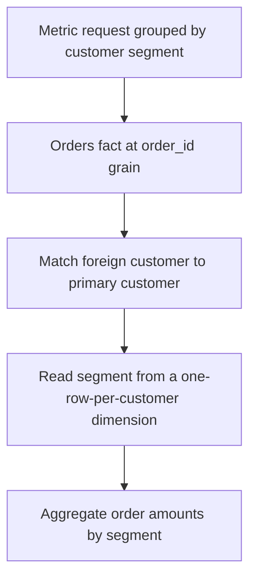

# MetricFlow, semantic models and entities

A semantic model exposes a dbt model's grain, join keys, and dimensions to MetricFlow. For a request such as "paid revenue by customer segment," MetricFlow locates the metric's fact model, finds a compatible path to the segment dimension, and generates SQL for the data platform. The warehouse executes the aggregation.

| Concept | Meaning in the orders example |
| --- | --- |
| Primary entity | `order_id` identifies the row at the fact's grain of one row per order. |
| Foreign entity | `customer_id` identifies a customer and can repeat on the fact. |
| Unique entity | An alternate key that must also identify at most one row per value on that relation, such as an external customer key on a customer dimension. |
| Natural entity | A business key, such as a customer ID shared by successive records in a customer history model. |
| Categorical dimension | `status` lets a consumer group or filter orders by business state. |
| Time dimension | `updated_at` lets a consumer group by update period. `agg_time_dimension` supplies the default time axis for metrics in the model. |

Two semantic models join through a shared **entity name**, even when their SQL columns have different names. A foreign-to-primary join from orders to a one-row-per-customer dimension preserves order grain. MetricFlow restricts paths that would fan out, using the declared entity types. If the customer key contains duplicates, a permitted join can still multiply revenue. Test the join target for uniqueness and non-null keys, and test relationships where a matching customer is required. [MetricFlow joins](https://docs.getdbt.com/docs/build/join-logic)



!!! note "Choose the YAML spec for your engine"
    The embedded example uses dbt v2 or dbt v1.12, including the platform v1 Latest release track. On v1.11, use top-level `semantic_models` with a `model: ref('fct_orders')` binding, separate `entities` and `dimensions` lists, `defaults.agg_time_dimension`, and standalone metric definitions. Use the version picker in the reference. [Semantic Layer YAML reference](https://docs.getdbt.com/reference/semantic-layer-reference) · [YAML spec migration](https://docs.getdbt.com/docs/build/latest-metrics-spec)

## Practice

Use the [shop_lab setup](0004-adapters-profiles-and-the-local-shop-lab.md) and its [order fact](0006-models-refs-and-project-configuration.md). Merge the following into the existing `fct_orders` entry in `models/fct_orders.yml`, matching columns by name so their descriptions and tests stay in place.

```yaml
models:
  - name: fct_orders
    semantic_model:
      enabled: true
    agg_time_dimension: updated_at
    columns:
      - name: order_id
        entity:
          type: primary
      - name: customer_id
        entity:
          type: foreign
          name: customer
      - name: status
        dimension:
          type: categorical
      - name: updated_at
        granularity: day
        dimension:
          type: time
```

```bash
dbt parse --profiles-dir .
dbt build --profiles-dir . --select +fct_orders
dbt show --profiles-dir . --inline "
select customer_id, count(*) as orders
from {{ ref('fct_orders') }}
group by customer_id
order by customer_id"
```

Check that parsing accepts the annotations and that the existing `unique` and `not_null` tests on `order_id` pass. Add those tests if you started with a fresh lab. The grouped query should return customer 101 with two orders and customer 102 with one. Explain why declaring `customer_id` as primary on this fact would misrepresent the data.

!!! tip "Pick the timestamp that matches the question"
    `updated_at` suits an exercise about update dates. A correction can move an order to another period. A production metric for revenue by payment date needs a stable payment timestamp and a documented timezone.

## Recall

1. What entity types let an order metric use a customer's segment, and which test checks the main assumption?
2. What changes if the default aggregation time switches from order date to update date?

??? success "Answer guidance"
    1. Declare the same customer entity as foreign on orders and primary on the customer dimension. A uniqueness test on the dimension key checks that each order can match at most one customer row.
    2. The dates used to group and filter the metric change. An order edited later can move between periods even when its amount stays the same.

[Semantic models](https://docs.getdbt.com/docs/build/semantic-models)

| Previous | Curriculum | Next |
| --- | --- | --- |
| [Previous lesson](0025-dbt-canvas-and-visual-model-development.md) | [All lessons](index.md) | [Next lesson](0027-metrics-time-spine-and-downstream-integrations.md) |
