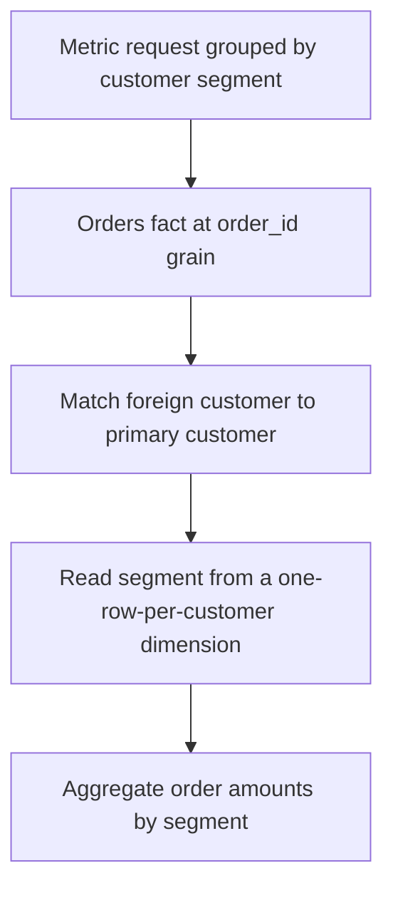

# MetricFlow, semantic models and entities

Hand-coding `GROUP BY` revenue queries across BI dashboards leads to subtle drift: one report sums all orders, another excludes pending rows, and a third joins a fanout table. **MetricFlow** solves this by letting you define semantic metadata on top of dbt models. Given a request such as "paid revenue by customer segment," MetricFlow finds the right fact table, follows safe join paths to requested dimensions, and generates dialect-specific SQL for the warehouse to execute.

## Entities, dimensions, and YAML specs

| Concept | Role in the orders semantic model |
| --- | --- |
| **Primary entity** | `order_id` uniquely identifies one row at the fact's grain (`unique` + `not_null`). |
| **Foreign entity** | `customer_id` links each order to a customer and can repeat across multiple orders on the fact. |
| **Unique entity** | An alternate unique key on a dimension (such as an external customer key) that identifies at most one row. |
| **Natural entity** | A business key that repeats across validity intervals in an SCD Type 2 snapshot table (paired with `validity_params` on start/end timestamps). |
| **Categorical dimension** | Discrete attributes for grouping or filtering, such as `status` (can also use a SQL `expr:` to bucket values). |
| **Time dimension** | Timestamps (`updated_at`) configured with a base `granularity` (`day`, `week`, `month`, `quarter`, `year`). `agg_time_dimension` sets the default time axis for the model's metrics. |



- **How MetricFlow prevents fanout.** Two semantic models join on a shared **entity name** (for example `customer`), even when their SQL column names differ. MetricFlow allows many-to-one (`foreign` to `primary`) joins from facts to dimensions and blocks many-to-many paths that would double-count sums. Because MetricFlow trusts your entity declarations, test `primary` and `unique` keys with `unique` and `not_null` data tests so duplicate dimension rows never slip through! [MetricFlow joins](https://docs.getdbt.com/docs/build/join-logic)

!!! note "Embedded YAML spec (v1.12+ / v2) vs standalone spec (v1.11)"
    The practice YAML below uses the modern **embedded spec** for dbt v2 and dbt v1.12 (including platform Latest), where `semantic_model:`, `entity:`, `dimension:`, and `metrics:` attach directly to a model under `models:`. Older v1.11 docs use a separate top-level `semantic_models:` block (`model: ref('fct_orders')`) with separate `entities:`, `dimensions:`, and `measures:` sections. Use the version picker in the official docs. [Semantic Layer YAML reference](https://docs.getdbt.com/reference/semantic-layer-reference) · [YAML spec migration](https://docs.getdbt.com/docs/build/latest-metrics-spec)

## Practice

### What you need

Use [shop_lab](0004-adapters-profiles-and-the-local-shop-lab.md) with [`fct_orders`](0006-models-refs-and-project-configuration.md).

### Steps

1. Merge the semantic annotations below into the existing `fct_orders` entry in `models/fct_orders.yml` (matching columns by name so your descriptions and data tests stay intact):

```yaml
models:
  - name: fct_orders
    semantic_model:
      enabled: true
    agg_time_dimension: updated_at
    columns:
      - name: order_id
        entity:
          type: primary
      - name: customer_id
        entity:
          type: foreign
          name: customer
      - name: status
        dimension:
          type: categorical
      - name: updated_at
        granularity: day
        dimension:
          type: time
```

2. Parse, build, and inspect order counts per customer:

```bash
dbt parse --profiles-dir .
dbt build --profiles-dir . --select +fct_orders
dbt show --profiles-dir . --inline "
select customer_id, count(*) as orders
from {{ ref('fct_orders') }}
group by customer_id
order by customer_id"
```

**Expected result.** `dbt parse` accepts the semantic config, `unique` and `not_null` tests on `order_id` pass, and the grouped query shows customer `101` with **2** orders and customer `102` with **1** order. Explain why declaring `customer_id` as `primary` on `fct_orders` would misrepresent the grain.

!!! tip "Pick the timestamp that matches the business question"
    `updated_at` works for this lab, yet a late update shifts an order into a new month. Production revenue reporting needs an immutable `ordered_at` or `paid_at` timestamp with a documented timezone.

## Recall

1. What entity types let an `order_total_cents` metric slice by customer `segment`, and which data test checks the critical assumption on the customer dimension?
2. Why would declaring `customer_id` as `type: primary` on `fct_orders` corrupt downstream metric joins, and which entity type fits an SCD Type 2 snapshot table like `order_history`?
3. What breaks if a semantic model uses `updated_at` instead of `paid_at` as `agg_time_dimension` for monthly revenue reports?

??? note "Answer guidance"
    1. Declare `customer` as `type: foreign` on `fct_orders` and `type: primary` on `dim_customers`. Add `unique` and `not_null` data tests on `dim_customers.customer_id` so each order matches at most one customer row.
    2. Customer 101 has two rows in `fct_orders`, so marking `customer_id` as primary violates grain uniqueness and permits invalid fanout joins. For an SCD Type 2 snapshot table where business keys repeat across validity intervals, use `type: natural` paired with `validity_params`.
    3. Backdated updates or status edits move an order's revenue from its original payment month into whichever month the row was touched.

[Semantic models](https://docs.getdbt.com/docs/build/semantic-models)

| Previous | Curriculum | Next |
| --- | --- | --- |
| [Previous lesson](0025-dbt-canvas-and-visual-model-development.md) | [All lessons](index.md) | [Next lesson](0027-metrics-time-spine-and-downstream-integrations.md) |
