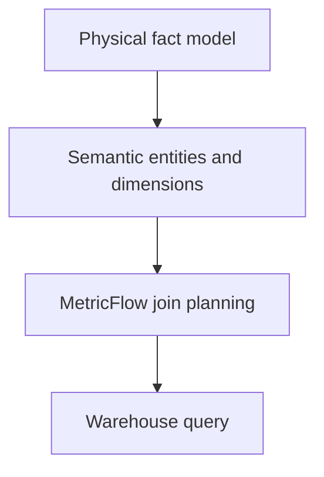

# MetricFlow, semantic models and entities

MetricFlow powers the dbt Semantic Layer. A semantic model describes the grain, entity keys, time and categorical dimensions, and aggregations available on a relation. Primary, unique and foreign entities help determine valid join paths. A time dimension provides the basis for aggregation by period. The current YAML spec embeds semantic configuration in model properties. Older projects can have top-level semantic models and measures.

Semantic definitions describe the data. Tests must still verify key uniqueness and other assumptions that prevent joins from inflating totals.



## Practice

Merge these fields into the existing `fct_orders` YAML entry. Add `entity` to the existing `order_id` column so its tests stay in place, then add `updated_at` as another column.

```yaml
semantic_model:
  enabled: true
agg_time_dimension: updated_at
columns:
  - name: order_id
    entity:
      type: primary
  - name: updated_at
    granularity: day
    dimension:
      type: time
```

Before making this a real revenue model, add an immutable order or payment date. An update timestamp can move historical totals between periods after a correction.

## Recall

Why must the join key type and the actual relationship cardinality agree?

[Semantic models](https://docs.getdbt.com/docs/build/semantic-models) · [YAML spec migration](https://docs.getdbt.com/docs/build/latest-metrics-spec)

| Previous | Curriculum | Next |
| --- | --- | --- |
| [← Previous lesson](0025-dbt-canvas-and-visual-model-development.md) | [All lessons](index.md) | [Next lesson →](0027-metrics-time-spine-and-downstream-integrations.md) |
