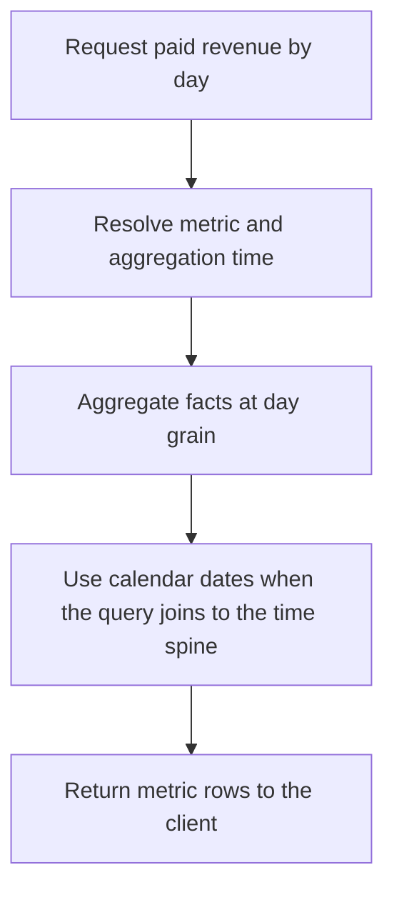

# Metrics, time spine and downstream integrations

Once a model exposes its entities and dimensions, **metrics** define governed calculations that every BI tool, API, and spreadsheet shares. MetricFlow translates metric requests (`paid_revenue_cents` by `metric_time__day` or `metric_time__month`) into SQL so teams never average pre-aggregated percentages or invent conflicting filters.

## Five MetricFlow metric types and time spines

| Metric type | Calculation and use case |
| --- | --- |
| **`simple`** | Direct aggregation (`sum`, `count`, `count_distinct`, `avg`, `min`, `max`) over a column or `expr`, optionally scoped with a `filter:` (such as filtering on a dimension). |
| **`ratio`** | Divides a `numerator` metric by a `denominator` metric **after** aggregating each at the requested grain (preventing the "average of daily ratios" bug). |
| **`derived`** | Evaluates an arithmetic SQL `expr` across multiple metrics (such as `order_total_cents - refund_cents`). |
| **`cumulative`** | Accumulates a simple metric over a trailing `window` (for example `7 days`) or `grain_to_date` (month-to-date). |
| **`conversion`** | Measures entities that perform a base event and then a conversion event within a defined time window (such as signup to first paid order). |

For example, in the embedded spec, a ratio metric over two simple metrics looks like:

```yaml
metrics:
  - name: paid_order_share
    type: ratio
    numerator: paid_revenue_cents
    denominator: order_total_cents
```



A **time spine** is a calendar table with one continuous row per period (`date_day`) covering your reporting window. MetricFlow needs a time spine to fill missing calendar dates (`join_to_timespine: true` + `fill_nulls_with: 0`) and compute cumulative windows.

## Practice

### What you need

Use [shop_lab](0004-adapters-profiles-and-the-local-shop-lab.md) with [`fct_orders`](0006-models-refs-and-project-configuration.md) and the original three rows. Merge this block into `models/fct_orders.yml` (preserving existing tests and descriptions; this embedded syntax targets dbt v2 or v1.12).

### Steps

1. Add the semantic config and metrics to `models/fct_orders.yml`:

```yaml
models:
  - name: fct_orders
    semantic_model:
      enabled: true
    agg_time_dimension: updated_at
    columns:
      - name: order_id
        entity:
          type: primary
      - name: updated_at
        granularity: day
        dimension:
          type: time
    metrics:
      - name: order_total_cents
        label: Order total (cents)
        type: simple
        agg: sum
        expr: total_cents
        join_to_timespine: true
        fill_nulls_with: 0
      - name: paid_revenue_cents
        label: Paid revenue (cents)
        type: simple
        agg: sum
        expr: "case when status = 'paid' then total_cents else 0 end"
        join_to_timespine: true
        fill_nulls_with: 0
```

2. Create `models/time_spine_daily.sql` covering four days, including January 4 which has zero orders:

```sql
{{ config(materialized='table') }}

select cast(day_start as date) as date_day
from generate_series(
    date '2026-01-01', date '2026-01-04', interval '1 day'
) as days(day_start)
```

3. Register the time spine in `models/time_spine_daily.yml`:

```yaml
models:
  - name: time_spine_daily
    time_spine:
      standard_granularity_column: date_day
    columns:
      - name: date_day
        granularity: day
        data_tests: [unique, not_null]
```

4. Parse, build, and verify the calendar-joined daily totals in SQL:

```bash
dbt parse --profiles-dir .
dbt build --profiles-dir . --select +fct_orders time_spine_daily
dbt show --profiles-dir . --inline "
with daily as (
    select
        cast(updated_at as date) as date_day,
        sum(total_cents) as order_total_cents,
        sum(case when status = 'paid' then total_cents else 0 end) as paid_revenue_cents
    from {{ ref('fct_orders') }}
    group by 1
)
select
    spine.date_day,
    coalesce(daily.order_total_cents, 0) as order_total_cents,
    coalesce(daily.paid_revenue_cents, 0) as paid_revenue_cents
from {{ ref('time_spine_daily') }} as spine
left join daily on spine.date_day = daily.date_day
order by spine.date_day"
```

**Expected result.** Spine tests pass and the query prints all four dates (January 4 appears with `0` because of the left join and `coalesce`):

| Date | Order total cents | Paid revenue cents |
| --- | ---: | ---: |
| 2026-01-01 | 1,250 | 1,250 |
| 2026-01-02 | 500 | 0 |
| 2026-01-03 | 1,750 | 1,750 |
| 2026-01-04 | 0 | 0 |
| **Sum** | **3,500** | **3,000** |

### Validate and serve with `saved_queries`

5. Create `models/orders_daily.yml` to declare a reusable saved query (managed deployments can also add `exports:` with `export_as: table | view` to materialize saved queries in the warehouse for tools without live Semantic Layer connectors):

```yaml
saved_queries:
  - name: orders_daily
    query_params:
      metrics: [order_total_cents, paid_revenue_cents]
      group_by:
        - "TimeDimension('metric_time', 'day')"
```

6. `dbt parse` updates `target/semantic_manifest.json` (a standalone v2 parse without `dbt_cloud.yml` may warn that connected validation was skipped). The lab was checked with dbt 2.0.12 plus a separate Python 3.12 environment containing `dbt-metricflow[dbt-duckdb]==0.16.0`, `dbt-core==1.11.17`, and `dbt-duckdb==1.11.1`. Run `dbt` from v2 to emit the manifest, and run `mf` from that Python environment:

```bash
dbt parse --profiles-dir .
export DBT_PROFILES_DIR=.
mf validate-configs
mf query --saved-query orders_daily --start-time 2026-01-01 --end-time 2026-01-04
```

**Expected result.** `mf query` matches the 4-row table above. Pass `--explain` to inspect how MetricFlow generates the time-spine join (`join_to_timespine`) and zero fill (`fill_nulls_with`). In a connected dbt platform project, use `dbt sl validate` and `dbt sl query --saved-query orders_daily --compile`. Interactive BI and Semantic Layer API queries require Semantic Layer credentials, a supported warehouse, and a successful deployment. [MetricFlow commands](https://docs.getdbt.com/docs/build/metricflow-commands) · [Saved queries](https://docs.getdbt.com/docs/build/saved-queries) · [Administer the Semantic Layer](https://docs.getdbt.com/docs/use-dbt-semantic-layer/setup-sl)

## Recall

1. Why does averaging daily paid-order ratios give a different answer from asking MetricFlow for a `ratio` metric at `metric_time__month`?
2. A BI chart backed by MetricFlow omits January 4 when zero orders occurred that day. What four things do you inspect?
3. When should a team configure `exports:` on a `saved_query` instead of relying purely on live Semantic Layer API queries?

??? note "Answer guidance"
    1. Averaging daily ratios weights each day equally regardless of order volume. A `ratio` metric aggregates total monthly `paid_revenue_cents` and total monthly `order_total_cents` first, then divides once at the requested monthly grain.
    2. Confirm `time_spine_daily` covers January 4, verify `join_to_timespine: true` and `fill_nulls_with: 0` on the metric, inspect the generated SQL (`--explain` or `--compile`), and check whether the BI client hides zero/null rows.
    3. Use `exports:` when downstream SQL consumers or legacy BI tools lack a Semantic Layer connector and need a pre-materialized warehouse table or view built on a schedule.

[Time spine quickstart](https://docs.getdbt.com/guides/mf-time-spine) · [Semantic Layer YAML reference](https://docs.getdbt.com/reference/semantic-layer-reference)

| Previous | Curriculum | Next |
| --- | --- | --- |
| [Previous lesson](0026-metricflow-semantic-models-and-entities.md) | [All lessons](index.md) | [Next lesson](0028-dbt-explorer-catalog-and-column-level-lineage.md) |
