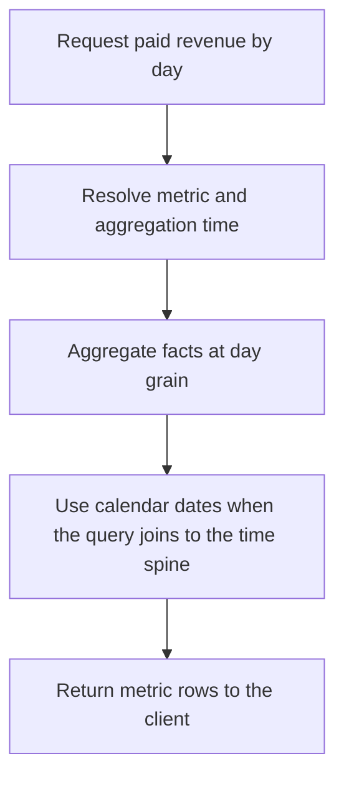

# Metrics, time spine and downstream integrations

MetricFlow turns a request for named metrics, dimensions, and filters into SQL. Defining metrics centrally keeps the aggregation and units consistent across clients. Use `metric_time__day` or `metric_time__month` to choose the output grain of the shared time dimension.

| Metric type | Calculation |
| --- | --- |
| Simple | Aggregate an expression, such as summing order amounts. |
| Ratio | Divide two metrics aggregated at the requested grain, such as paid amount divided by all order amount. |
| Derived | Evaluate an expression over metrics, such as revenue minus refunds. |
| Cumulative | Accumulate a metric over time, such as a trailing 7-day sum. |
| Conversion | Match a base event to a later conversion event by entity within a window, such as signup to first payment. |

A **time spine** is a modeled calendar with one row per base period. It gives MetricFlow dates for time joins and windows. Cover the whole reporting range and decide whether a missing fact should produce a null or a zero. The query must use the spine to return dates absent from the fact. The example shows that explicitly with a left join.



## Practice

Use the [shop_lab setup](0004-adapters-profiles-and-the-local-shop-lab.md) and its [order fact](0006-models-refs-and-project-configuration.md), with the original three orders. Merge the example into the existing `fct_orders` entry in `models/fct_orders.yml`, preserving any other column properties and tests. This embedded syntax targets dbt v2 or v1.12.

```yaml
models:
  - name: fct_orders
    semantic_model:
      enabled: true
    agg_time_dimension: updated_at
    columns:
      - name: order_id
        entity:
          type: primary
      - name: updated_at
        granularity: day
        dimension:
          type: time
    metrics:
      - name: order_total_cents
        label: Order total (cents)
        type: simple
        agg: sum
        expr: total_cents
        join_to_timespine: true
        fill_nulls_with: 0
      - name: paid_revenue_cents
        label: Paid revenue (cents)
        type: simple
        agg: sum
        expr: "case when status = 'paid' then total_cents else 0 end"
        join_to_timespine: true
        fill_nulls_with: 0
```

Create `models/time_spine_daily.sql` with four dates, including a day with no orders.

```sql
{{ config(materialized='table') }}

select cast(day_start as date) as date_day
from generate_series(
    date '2026-01-01', date '2026-01-04', interval '1 day'
) as days(day_start)
```

Register it in `models/time_spine_daily.yml`.

```yaml
models:
  - name: time_spine_daily
    time_spine:
      standard_granularity_column: date_day
    columns:
      - name: date_day
        granularity: day
        data_tests: [unique, not_null]
```

```bash
dbt parse --profiles-dir .
dbt build --profiles-dir . --select +fct_orders time_spine_daily
dbt show --profiles-dir . --inline "
with daily as (
    select
        cast(updated_at as date) as date_day,
        sum(total_cents) as order_total_cents,
        sum(case when status = 'paid' then total_cents else 0 end) as paid_revenue_cents
    from {{ ref('fct_orders') }}
    group by 1
)
select
    spine.date_day,
    coalesce(daily.order_total_cents, 0) as order_total_cents,
    coalesce(daily.paid_revenue_cents, 0) as paid_revenue_cents
from {{ ref('time_spine_daily') }} as spine
left join daily on spine.date_day = daily.date_day
order by spine.date_day"
```

Expect the spine tests to pass and the SQL check to return the following amounts. January 2 has a pending order. January 4 has zeroes because the calendar join keeps that date and `coalesce` fills the missing sums.

| Date | Order total cents | Paid revenue cents |
| --- | ---: | ---: |
| 2026-01-01 | 1,250 | 1,250 |
| 2026-01-02 | 500 | 0 |
| 2026-01-03 | 1,750 | 1,750 |
| 2026-01-04 | 0 | 0 |
| **Sum** | **3,500** | **3,000** |

### Validate and serve the metrics

Save a reusable request in `models/orders_daily.yml`.

```yaml
saved_queries:
  - name: orders_daily
    query_params:
      metrics: [order_total_cents, paid_revenue_cents]
      group_by:
        - "TimeDimension('metric_time', 'day')"
```

`dbt parse` refreshes `target/semantic_manifest.json`. A standalone v2 parse may warn about skipping connected validation without `dbt_cloud.yml`. The lab was checked with dbt 2.0.12 and a separate Python 3.12 environment containing `dbt-metricflow[dbt-duckdb]==0.16.0`, `dbt-core==1.11.17`, and `dbt-duckdb==1.11.1`. Run `dbt` from the v2 installation to parse the embedded YAML, and run `mf` from the Python environment to read the resulting manifest.

```bash
dbt parse --profiles-dir .
export DBT_PROFILES_DIR=.
mf validate-configs
mf query --saved-query orders_daily --start-time 2026-01-01 --end-time 2026-01-04
```

Expect the same four rows as the SQL check. Add `--explain` to see how `join_to_timespine` keeps the calendar dates and `fill_nulls_with` supplies the zeroes. A connected platform project can validate with `dbt sl validate` and submit a query with `dbt sl query --saved-query orders_daily`. Use `--compile` there to inspect the generated SQL. [MetricFlow commands](https://docs.getdbt.com/docs/build/metricflow-commands)

Managed exports can write a saved query as a table or view on a schedule for warehouse consumers. Interactive BI and API queries require Semantic Layer credentials, a supported warehouse connection, and a successful deployment in the configured environment. DuckDB is the local lab adapter. [Saved queries](https://docs.getdbt.com/docs/build/saved-queries) · [Administer the Semantic Layer](https://docs.getdbt.com/docs/use-dbt-semantic-layer/setup-sl)

## Recall

1. Why can averaging daily paid shares give a different result from calculating the paid share for the whole month?
2. What evidence would you collect when a BI chart skips January 4?

??? success "Answer guidance"
    1. Daily averaging gives each day equal weight. The month-level ratio divides total paid cents by total order cents, weighting by the day's order amount.
    2. Check that the calendar includes January 4, inspect the generated SQL for the spine join, and verify the metric's fill settings and the client's treatment of nulls.

[Time spine quickstart](https://docs.getdbt.com/guides/mf-time-spine) · [Semantic Layer YAML reference](https://docs.getdbt.com/reference/semantic-layer-reference)

| Previous | Curriculum | Next |
| --- | --- | --- |
| [Previous lesson](0026-metricflow-semantic-models-and-entities.md) | [All lessons](index.md) | [Next lesson](0028-dbt-explorer-catalog-and-column-level-lineage.md) |
