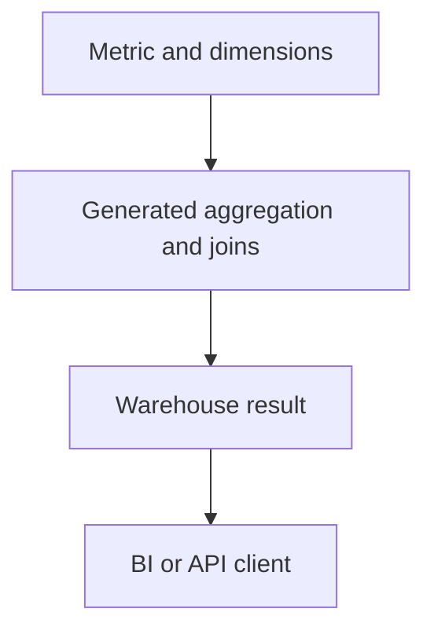

# Metrics, time spine and downstream integrations

The Semantic Layer centralizes metric definitions so downstream clients can request metrics with consistent dimensions and filters. Simple metrics perform a direct aggregation. Derived metrics calculate across metrics, ratio metrics divide measures at compatible grains, cumulative metrics use temporal windows, and conversion metrics use ordered events tied to an entity. A time spine supplies a regular calendar for period logic.

Saved queries record reusable metric requests. Supported exports can materialize their outputs for warehouse consumers. For interactive queries, use an integration or API supported by your plan and adapter. Use the validation and query commands appropriate to the local or connected MetricFlow runtime.



## Practice

Add these simple metrics to the `fct_orders` YAML entry, alongside `semantic_model` and `columns`.

```yaml
metrics:
  - name: order_total_cents
    type: simple
    agg: sum
    expr: total_cents
  - name: paid_revenue_cents
    type: simple
    agg: sum
    expr: "case when status = 'paid' then total_cents else 0 end"
```

Run `dbt parse` to generate the semantic manifest. A standalone v2 run can warn that managed validation requires `dbt_cloud.yml`. Query through a compatible MetricFlow setup, or pass this SQL as a quoted argument to `dbt show --inline` to verify the underlying aggregations in DuckDB.

```sql
select
    sum(total_cents) as order_total_cents,
    sum(case when status = 'paid' then total_cents else 0 end) as paid_revenue_cents
from {{ ref('fct_orders') }}
```

Expect 3,500 total cents and 3,000 paid cents using the original fixture. For a time-based metric query, add a time spine using the quickstart and verify that dates with no orders are handled as intended.

## Recall

Why can averaging daily conversion rates produce a different answer from a single monthly conversion rate?

[Semantic Layer](https://docs.getdbt.com/docs/use-dbt-semantic-layer/dbt-sl) · [Semantic Layer quickstart](https://docs.getdbt.com/guides/sl-qs) · [MetricFlow commands](https://docs.getdbt.com/docs/build/metricflow-commands)

| Previous | Curriculum | Next |
| --- | --- | --- |
| [← Previous lesson](0026-metricflow-semantic-models-and-entities.md) | [All lessons](index.md) | [Next lesson →](0028-dbt-explorer-catalog-and-column-level-lineage.md) |
