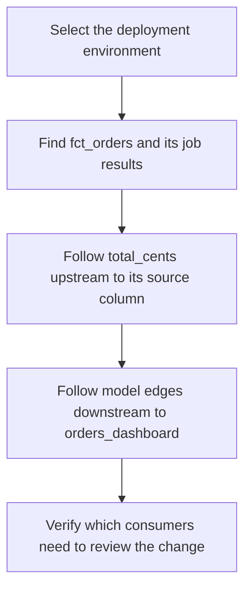

# dbt Explorer, Catalog and column-level lineage

dbt Catalog, formerly dbt Explorer, lets you search deployed dbt resources, inspect their definitions and health, and assess the impact of changes. It's available on Starter, Enterprise, and Enterprise+. Start with the project and deployment environment. A CI build in a temporary schema does not update Catalog. [Catalog](https://docs.getdbt.com/docs/explore/explore-projects)

| Evidence | Question it answers |
| --- | --- |
| Manifest and model lineage | Which resources depend on this model or feed it? |
| Column metadata and lineage | What is the column's type, and where does its selected value come from? |
| Run and test results | When did the job build or test this model, and what happened? |
| Source freshness results | When was a configured source last loaded and checked? |

A production or staging job supplies the metadata for its environment. `dbt build` supplies model and test results for selected resources. Source freshness needs a configured source and `dbt source freshness`. Platform jobs on v2 refresh catalog metadata automatically. For a local comparison, v2 `dbt build --write-catalog` writes warehouse relation and column metadata to `target/catalog.json`. In v1, `dbt docs generate` writes that artifact. [Catalog metadata generation](https://docs.getdbt.com/docs/explore/explore-projects#generate-metadata) · [Documentation commands](https://docs.getdbt.com/reference/commands/cmd-docs)



## Practice

Use the [shop_lab setup](0004-adapters-profiles-and-the-local-shop-lab.md) and its [order fact](0006-models-refs-and-project-configuration.md). You are reviewing a proposed rename of `fct_orders.total_cents`. Trace the field upstream and find the downstream owner. If the dashboard exposure from lesson 0019 is missing, add `models/exposures.yml`.

```yaml
exposures:
  - name: orders_dashboard
    type: dashboard
    description: Tracks paid orders and revenue.
    depends_on:
      - ref('fct_orders')
    owner:
      name: Analytics
      email: analytics@example.org
```

Run the local v2 checks from the lab directory.

```bash
dbt build --profiles-dir . --select +fct_orders --write-catalog
dbt compile --profiles-dir . --select +fct_orders --generate-info-schema --static-analysis strict
dbt show --profiles-dir . --info column_lineage
```

- Find both `total_cents` edges in the column output. The value passes through `raw_orders` → `stg_orders` → `fct_orders`. If strict analysis is unavailable on your setup, trace the select lists in the staging and fact SQL.
- In `target/manifest.json`, look up `exposure.shop_lab.orders_dashboard` in `parent_map` and find its owner under `exposures`. The parent is `model.shop_lab.fct_orders`, and the owner is Analytics. Consult the actual dashboard query to confirm which fields it uses.
- If you have Catalog access, repeat the model trace in the correct production or staging environment. Record the job run time and status for the fact. On Enterprise or Enterprise+, open the column card for `total_cents` to compare its lineage. Local v2 column lineage requires strict static analysis. SQL parsing limits can create gaps, and column lineage primarily tracks selected values. Inspect joins and filters in the compiled SQL when diagnosing row changes. [Column-level lineage](https://docs.getdbt.com/docs/explore/column-level-lineage)

## Recall

1. A model is queryable in the warehouse but missing from Catalog. What would you check first?
2. If `total_cents` has a direct copy edge, can a change to a join still alter revenue?

??? success "Answer guidance"
    1. Check the project, deployment environment, and artifact-producing command and confirm that the model was selected. Then compare the job time and outcome with the actual warehouse relation and its data.
    2. Yes. A new join can remove or repeat rows while leaving the selected column expression intact. Check the SQL and reconcile the row count and sum.

| Previous | Curriculum | Next |
| --- | --- | --- |
| [Previous lesson](0027-metrics-time-spine-and-downstream-integrations.md) | [All lessons](index.md) | [Next lesson](0029-contracts-model-versions-and-groups.md) |
