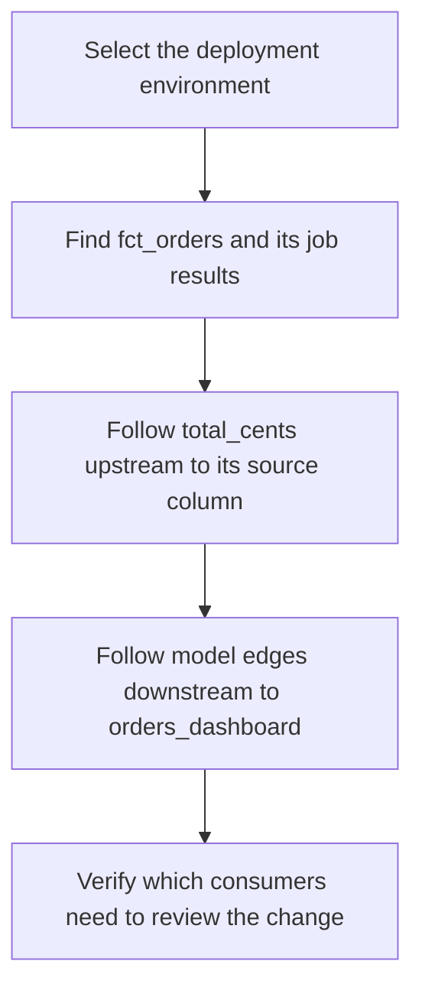

# dbt Explorer, Catalog and column-level lineage

Before renaming `fct_orders.total_cents`, you need to see every upstream source feeding it, every downstream dashboard reading it, and whether yesterday's job actually built it cleanly. **dbt Catalog** (formerly **dbt Explorer**) aggregates deployment metadata across projects (available on Starter, Enterprise, and Enterprise+) so engineers can inspect lineage, column origins, run health, and project recommendations. Always filter Catalog to the intended deployment environment; temporary PR CI schemas do not overwrite Catalog metadata. [Catalog](https://docs.getdbt.com/docs/explore/explore-projects)

## Metadata signals and column-level lineage

| Evidence | Question it answers |
| --- | --- |
| **Manifest and DAG search** | Which resources depend on this model (`+fct_orders+`, `access:public`, `tag:`)? |
| **Column metadata and lineage** | What is the warehouse type, and where does each column expression originate? |
| **Run and test health** | When did the job last build or test this model, and did execution timing regress? |
| **Source freshness** | When was the upstream source table last loaded compared with its threshold? |



- **How catalog metadata updates.** Platform jobs on dbt v2 update Catalog automatically. Locally, run `dbt build --write-catalog` on v2 (or `dbt docs generate` on v1) to populate `target/catalog.json` with warehouse relation and column types. [Catalog metadata generation](https://docs.getdbt.com/docs/explore/explore-projects#generate-metadata) · [Documentation commands](https://docs.getdbt.com/reference/commands/cmd-docs)
- **Column-level lineage limits.** Static SQL analysis distinguishes direct **passthrough** edges (column copied as-is), **transformation** edges (arithmetic, casts, `case` logic), and **opaque** edges (complex macros, UDFs, or `SELECT *` patterns that obscure column dependencies). Avoid `SELECT *` in staging and marts so column lineage stays complete. Also remember column lineage tracks selected column expressions, not `WHERE` filters or `JOIN` cardinality changes! [Column-level lineage](https://docs.getdbt.com/docs/explore/column-level-lineage)

## Practice

### What you need

Use [shop_lab](0004-adapters-profiles-and-the-local-shop-lab.md) with [`fct_orders`](0006-models-refs-and-project-configuration.md) and [`models/exposures.yml`](0019-model-documentation-exposures-and-ownership.md) (create `exposures.yml` below if missing):

```yaml
exposures:
  - name: orders_dashboard
    type: dashboard
    description: Tracks paid orders and revenue.
    depends_on:
      - ref('fct_orders')
    owner:
      name: Analytics
      email: analytics@example.org
```

### Steps

1. You plan to rename `fct_orders.total_cents`. Run the local dbt v2 catalog and column-lineage checks:

```bash
dbt build --profiles-dir . --select +fct_orders --write-catalog
dbt compile --profiles-dir . --select +fct_orders --generate-info-schema --static-analysis strict
dbt show --profiles-dir . --info column_lineage
```

2. Trace `total_cents` from `raw_orders` through `stg_orders` to `fct_orders` in the column lineage output (if strict analysis is unavailable on your setup, inspect the `SELECT` lists in `stg_orders.sql` and `fct_orders.sql`).
3. Find downstream exposure ownership in `target/manifest.json` (confirm `parent_map` links `exposure.shop_lab.orders_dashboard` to `model.shop_lab.fct_orders`, owned by `Analytics`).
4. **With Catalog access.** Open the same model in your Staging or Production environment, record the latest job timestamp and status, and (on Enterprise/Enterprise+) view the `total_cents` column lineage card. Check the actual BI query on `orders_dashboard` to verify whether it reads `total_cents`.

## Recall

1. A table exists and is queryable in BigQuery or Snowflake, yet it is missing from dbt Catalog. What should you inspect first?
2. Column lineage shows `fct_orders.total_cents` is a direct passthrough from `stg_orders.total_cents`. Can an edit to `fct_orders.sql` still double reported revenue?
3. Why does writing `select * from {{ ref('stg_orders') }}` in downstream marts degrade both Catalog column lineage and dbt v2 static analysis?

??? note "Answer guidance"
    1. Confirm you selected the right project and deployment environment (not a CI job), verify the latest deploy job succeeded with that model in its `--select` scope, and confirm metadata generation completed.
    2. Yes. Adding a `JOIN` or changing a `WHERE` filter alters row cardinality (fanout) without modifying the `total_cents` expression itself. Always review the compiled SQL and check row counts and sums.
    3. `SELECT *` hides explicit column projections unless full schema metadata is available and forces downstream models to re-resolve schemas dynamically, breaking column-level impact visibility when upstream columns change.

| Previous | Curriculum | Next |
| --- | --- | --- |
| [Previous lesson](0027-metrics-time-spine-and-downstream-integrations.md) | [All lessons](index.md) | [Next lesson](0029-contracts-model-versions-and-groups.md) |
