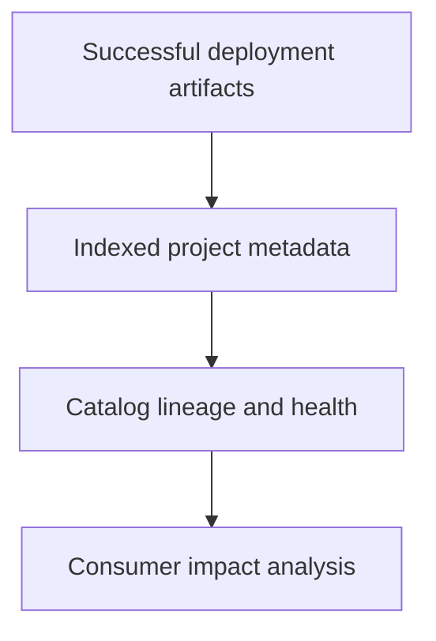

# dbt Explorer, Catalog and column-level lineage

dbt Catalog was previously named dbt Explorer. It exposes searchable metadata, resource details, job and test outcomes, freshness signals, and model lineage across projects. Column-level lineage availability depends on the configured environment, engine and query. Follow metadata provenance and the time of the last successful job when interpreting stale or missing details.

An asset may exist in the warehouse before Catalog has indexed the relevant environment's metadata. Contrast managed Catalog with the local artifacts generated by `dbt docs generate`.

## Practice

Trace the fact's `total_cents` column from its upstream source or seed to the dashboard exposure. In a supported Catalog environment, compare the column path with model-level lineage and find the latest run. In the lab, reconstruct the lineage from the manifest and SQL.

## Recall

Which checks distinguish stale Catalog metadata from stale warehouse data?

[Catalog documentation](https://docs.getdbt.com/docs/explore/explore-projects)

| Previous | Curriculum | Next |
| --- | --- | --- |
| [← Previous lesson](0027-metrics-time-spine-and-downstream-integrations.md) | [All lessons](index.md) | [Next lesson →](0029-contracts-model-versions-and-groups.md) |
