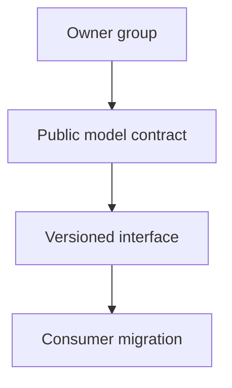

# Contracts, model versions and groups

A model contract defines an explicit shape such as column names and data types. The adapter and materialization determine which constraints can be enforced. Keep data tests for uniqueness and domain rules. Groups help define ownership and private, protected and public access settings describe which consumers can reference a model.

Version a public model when changing its interface would break consumers. Publish a migration window and let consumers pin a version while they update. Contracts do not capture grain or metric meaning by themselves.

## Practice

Write a contract for `fct_orders` specifying names and actual warehouse types. Propose a v2 taking monetary amounts in dollars. Identify which consumers could request `ref('fct_orders', version=1)` while migrating and choose tests that detect a unit change.

## Recall

Why might a contract continue passing after a breaking business logic change?

[Model contracts](https://docs.getdbt.com/docs/mesh/govern/model-contracts) · [Model versions](https://docs.getdbt.com/docs/mesh/govern/model-versions)

| Previous | Curriculum | Next |
| --- | --- | --- |
| [← Previous lesson](0028-dbt-explorer-catalog-and-column-level-lineage.md) | [All lessons](index.md) | [Next lesson →](0030-dbt-mesh-and-cross-project-references.md) |
