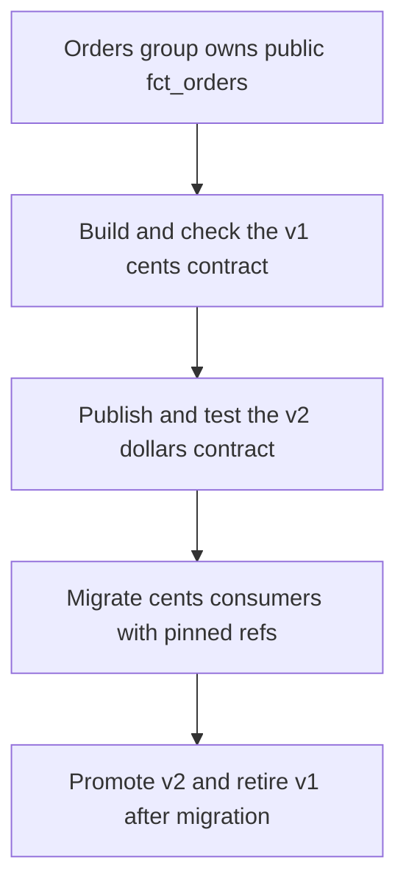

# Contracts, model versions and groups

A model contract makes the output shape explicit. With `contract.enforced: true`, declare every output column and its data type. dbt checks the query's shape against the declaration before materializing the relation. Tables and supported incremental models can also use warehouse constraints, whose enforcement varies by adapter. Views support shape checks. Supported incremental contracts require `on_schema_change: append_new_columns` or `fail`. Keep data tests for row-level rules such as one row per order. [Model contracts](https://docs.getdbt.com/docs/mesh/govern/model-contracts)

A group records a model's owner and defines the boundary for private refs. For model refs within a project and across Mesh projects, the access levels are:

| Access | Who can reference it |
| --- | --- |
| `private` | Models in the same group |
| `protected` (default) | Models in the same project |
| `public` | Models in the same project and eligible downstream projects |

Warehouse permissions are managed separately. Packages have their own rules, including the producer's optional `restrict-access` setting. Use `config.access` on current releases (v1.10+ and v2). [Model access](https://docs.getdbt.com/docs/mesh/govern/model-access) · [Access config](https://docs.getdbt.com/reference/resource-configs/access)

Use versions when a published interface changes incompatibly. Pinning `version=1` keeps a consumer on v1 even after an unqualified `ref('fct_orders')` starts resolving to v2. Keep both relations available during the migration window, announce a `deprecation_date`, and track remaining consumers before removing v1. [Model versions](https://docs.getdbt.com/docs/mesh/govern/model-versions)



## Practice

Use a scratch copy of the [shop_lab setup](0004-adapters-profiles-and-the-local-shop-lab.md) with the [original order fact](0006-models-refs-and-project-configuration.md). Start with the unversioned fact so you can compare its shape with the released versions. Set `models/fct_orders.yml` as follows. Keep this experiment separate from the semantic metrics lab because the currency column will change in v2.

```yaml
groups:
  - name: orders
    owner:
      name: Orders
      email: orders@example.org

models:
  - name: fct_orders
    description: One row per order, with amounts in cents in v1.
    config:
      group: orders
      access: public
      contract:
        enforced: true
    columns:
      - name: order_id
        data_type: bigint
        data_tests: [unique, not_null]
      - name: customer_id
        data_type: bigint
      - name: status
        data_type: varchar
        data_tests:
          - accepted_values:
              arguments:
                values: [paid, pending]
      - name: total_cents
        data_type: bigint
      - name: updated_at
        data_type: timestamp
```

Run `dbt build --profiles-dir . --select +fct_orders`. In the fact SQL, temporarily rename `total_cents` to `amount_cents` and run `dbt run --profiles-dir . --select fct_orders`. Expect the contract check to reject the changed shape. Restore the original SQL.

To rehearse a compatible rollout, rename the restored file to `models/fct_orders_v1.sql`. Add `models/fct_orders_v2.sql` with the new output shape.

```sql
{{ config(materialized='table') }}

select
    order_id,
    customer_id,
    status,
    cast(total_cents * 0.01 as decimal(12, 2)) as total_dollars,
    updated_at
from {{ ref('stg_orders') }}
```

Add these fields under the existing `fct_orders` YAML entry, alongside `config` and `columns`.

```yaml
    latest_version: 1
    versions:
      - v: 1
      - v: 2
        columns:
          - include: all
            exclude: [total_cents]
          - name: total_dollars
            description: Order amount in dollars.
            data_type: decimal(12,2)
```

Build both versions and check the default and pinned refs.

```bash
dbt build --profiles-dir . --select +fct_orders
dbt show --profiles-dir . --inline "
select sum(total_cents) as cents from {{ ref('fct_orders') }}"
dbt show --profiles-dir . --inline "
select sum(total_dollars) as dollars from {{ ref('fct_orders', version=2) }}"
```

Expect 3,500 cents from the default ref and 35.00 dollars from the pinned v2 ref. Pin any existing cents consumers to `version=1`, including `tests/paid_orders_have_positive_total.sql` if you added it. Set `latest_version: 2` and build again. Change the default-ref query to sum `total_dollars` and pin the cents query to `version=1`. Both totals should still reconcile at a factor of 100. For a real release, also review consumers that query relation names directly. Moving from an unversioned model to versioned files can change physical names.

## Recall

1. Why can a contract pass after a change that breaks financial reporting?
2. A Finance model pins v1. What happens to that reference when Orders sets `latest_version: 2`?

??? success "Answer guidance"
    1. The same names and types can contain different values or have a different grain. Test the units, order key, and paid totals against known data.
    2. The pin continues to resolve to v1 while it exists. Only unpinned refs follow the new latest version.

| Previous | Curriculum | Next |
| --- | --- | --- |
| [← Previous lesson](0028-dbt-explorer-catalog-and-column-level-lineage.md) | [All lessons](index.md) | [Next lesson →](0030-dbt-mesh-and-cross-project-references.md) |
