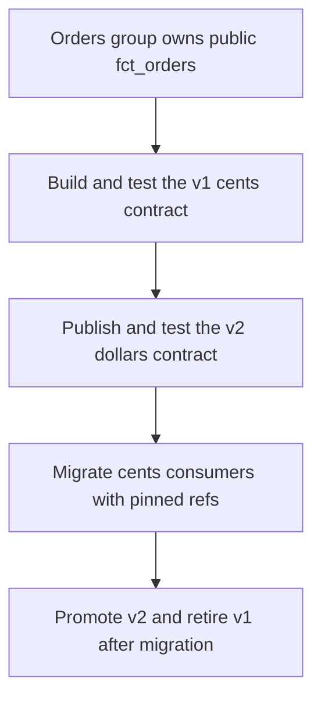

# Contracts, model versions and groups

When multiple teams read `fct_orders`, an unannounced column rename or type change breaks downstream dashboards silently. **Model contracts**, **groups**, and **model versions** turn shared tables into stable, versioned APIs with explicit ownership.

## Model contracts and constraints

Setting `contract: {enforced: true}` requires declaring every output column name and `data_type` in YAML. dbt verifies that your `SELECT` columns and types match the contract **before** materializing the relation, failing fast if they diverge. For tables and supported incremental models, you can also attach DDL **constraints** (whose database enforcement varies by adapter; incremental contracts require `on_schema_change: append_new_columns` or `fail`):

```yaml
    columns:
      - name: order_id
        data_type: bigint
        constraints:
          - type: not_null
          - type: primary_key
```

Remember the division of responsibility: **contracts** enforce *schema shape* (names, types, order, DDL constraints), whereas **data tests** enforce *data semantics* (row uniqueness, valid status strings, positive paid sums). [Model contracts](https://docs.getdbt.com/docs/mesh/govern/model-contracts)

## Groups and access levels

A **group** assigns team ownership to a set of models and restricts cross-group references via `config.access` (v1.10+ and v2):

| Access level | Who can `ref()` the model |
| --- | --- |
| **`private`** | Only models belonging to the **same group** (external refs fail at parse/compile time). |
| **`protected`** (default) | Any model inside the **same project**. |
| **`public`** | Models in the same project and eligible downstream dbt Mesh projects. |

Note that `config.access` governs dbt `ref()` compilation, whereas warehouse `SELECT` permissions must still be granted separately. Packages also provide an optional `restrict-access` control. [Model access](https://docs.getdbt.com/docs/mesh/govern/model-access) · [Access config](https://docs.getdbt.com/reference/resource-configs/access)

## Model versions and safe rollouts



When introducing a breaking interface change (such as replacing `total_cents` with `total_dollars`), publish multiple **versions** concurrently (`models/fct_orders_v1.sql` and `models/fct_orders_v2.sql`):

- Consumers pinning `{{ ref('fct_orders', version=1) }}` stay safely on v1 even after you switch `latest_version: 2`.
- By default, versioned files build as `fct_orders_v1` and `fct_orders_v2`. If legacy BI queries read `fct_orders` directly without `ref()`, set `alias: fct_orders` (or `defined_in: fct_orders`) on the active compatibility version so physical table names do not break SQL clients.
- Add `deprecation_date: 2027-01-01` on retiring versions so dbt emits compiler warnings to remaining consumers before you delete v1. [Model versions](https://docs.getdbt.com/docs/mesh/govern/model-versions)

## Practice

### What you need

Use a **scratch copy** of [shop_lab](0004-adapters-profiles-and-the-local-shop-lab.md) with [`fct_orders`](0006-models-refs-and-project-configuration.md) (keep this separate from the semantic metrics lab in lessons 0026 and 0027 because v2 changes `total_cents` to `total_dollars`).

### Steps

1. Configure ownership, `public` access, and an enforced contract on `models/fct_orders.yml`:

```yaml
groups:
  - name: orders
    owner:
      name: Orders
      email: orders@example.org

models:
  - name: fct_orders
    description: One row per order, with amounts in cents in v1.
    config:
      group: orders
      access: public
      contract:
        enforced: true
    columns:
      - name: order_id
        data_type: bigint
        data_tests: [unique, not_null]
      - name: customer_id
        data_type: bigint
      - name: status
        data_type: varchar
        data_tests:
          - accepted_values:
              arguments:
                values: [paid, pending]
      - name: total_cents
        data_type: bigint
      - name: updated_at
        data_type: timestamp
```

2. Build `+fct_orders`, then temporarily rename `total_cents` to `amount_cents` in `models/fct_orders.sql` and run `dbt run --profiles-dir . --select fct_orders`. Confirm the contract check rejects the mismatched column before materializing. Restore `total_cents` afterward.
3. Rehearse a versioned rollout: rename `models/fct_orders.sql` to `models/fct_orders_v1.sql`, and create `models/fct_orders_v2.sql`:

```sql
{{ config(materialized='table') }}

select
    order_id,
    customer_id,
    status,
    cast(total_cents * 0.01 as decimal(12, 2)) as total_dollars,
    updated_at
from {{ ref('stg_orders') }}
```

4. Add `latest_version` and `versions` under the `fct_orders` entry in `models/fct_orders.yml`:

```yaml
    latest_version: 1
    versions:
      - v: 1
      - v: 2
        columns:
          - include: all
            exclude: [total_cents]
          - name: total_dollars
            description: Order amount in dollars.
            data_type: decimal(12,2)
```

5. Build both versions and query the default (`v1`) and explicit `v2` refs:

```bash
dbt build --profiles-dir . --select +fct_orders
dbt show --profiles-dir . --inline "
select sum(total_cents) as cents from {{ ref('fct_orders') }}"
dbt show --profiles-dir . --inline "
select sum(total_dollars) as dollars from {{ ref('fct_orders', version=2) }}"
```

**Expected result.** The unpinned `ref('fct_orders')` returns **3,500** cents and `version=2` returns **35.00** dollars. Pin any existing cents consumers (such as `tests/paid_orders_have_positive_total.sql`) to `version=1`, switch `latest_version: 2`, rebuild `+fct_orders`, and verify `ref('fct_orders')` now returns `total_dollars` (`35.00`) while `ref('fct_orders', version=1)` continues returning `total_cents` (`3500`). Remember external SQL tools referencing `fct_orders` directly need `alias` review before switching unversioned models to versioned names.

## Recall

1. Why can an enforced model contract pass completely after a code change that breaks financial revenue reports?
2. A Finance downstream model declares `{{ ref('fct_orders', version=1) }}`. What happens when the Orders team updates `latest_version: 2`?
3. When you move a model into `group: orders` with `access: private`, what happens when a model in `group: finance` runs `ref()`, and does that prevent a Finance user from querying the warehouse table directly?

??? note "Answer guidance"
    1. Contracts validate column names, ordering, and data types, not values or business grain. Changing cents to dollars inside a numeric column or duplicating rows passes the contract unless data tests verify units and key uniqueness.
    2. Pinned references continue resolving to `v1` as long as `v1` remains deployed. Only unpinned `ref('fct_orders')` calls switch to `v2`.
    3. dbt fails compilation for the `finance` model because `private` blocks cross-group `ref()` dependencies. However, warehouse SQL permissions are separate, so you must also restrict warehouse `SELECT` grants on private schemas.

| Previous | Curriculum | Next |
| --- | --- | --- |
| [Previous lesson](0028-dbt-explorer-catalog-and-column-level-lineage.md) | [All lessons](index.md) | [Next lesson](0030-dbt-mesh-and-cross-project-references.md) |
