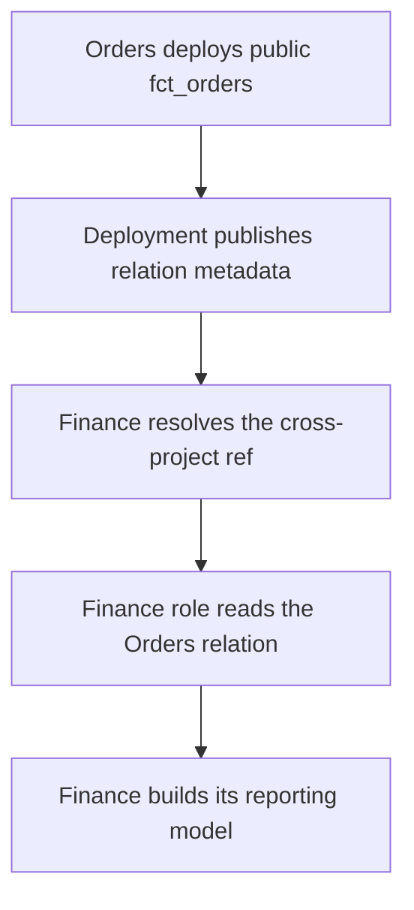

# dbt Mesh and cross-project references

dbt Mesh lets domain teams deploy independently and publish a small set of models for other projects to consume. Orders owns the definition, availability, and change policy for the order fact. Finance builds reporting on top of that interface and owns the reporting logic. Keep staging models internal so Orders can change implementation without scheduling a Finance release.

A **project dependency** lets dbt resolve a public model using the upstream deployment's metadata. The downstream run reads the upstream warehouse relation under its own credentials. A **package dependency** installs source code into the consumer's project to reuse resources such as macros or models. Two-argument `ref()` names the dependency in either setup, so inspect the dependency declaration to tell how a reference resolves. [Project dependencies](https://docs.getdbt.com/docs/mesh/govern/project-dependencies)



!!! note "Check environment routing"
    Cross-project refs require dbt platform Enterprise or Enterprise+. By default, a downstream production ref resolves to upstream production. A downstream development or staging ref uses upstream staging if configured, otherwise upstream production. Once upstream staging is configured, a missing staging deployment can break those refs. Seed the environment with a successful deployment before designating it as staging. Check any explicit routing overrides. [Project dependencies and routing](https://docs.getdbt.com/docs/mesh/govern/project-dependencies)

## Practice

Plan an Orders producer named `orders_domain` and a separate Finance project using the original five-column [shop_lab order fact](0006-models-refs-and-project-configuration.md). If Orders already publishes multiple versions, pin the cents interface with `ref('orders_domain', 'fct_orders', version=1)`.

1. Set `access: public` under the producer model's `config`. On a supported platform, run a successful Orders production deployment that builds `fct_orders` and publishes the manifest. Record the run ID and the published relation. For the local walkthrough, start in the [shop_lab directory](0004-adapters-profiles-and-the-local-shop-lab.md) and run `dbt build --profiles-dir . --select +fct_orders`. Use the resulting `target/manifest.json` and the `relation_name` for `model.shop_lab.fct_orders` as the simulated deployment evidence.
2. Put this in Finance's root `dependencies.yml`. Project names must be unique in the account. The dependency name is case-sensitive and must match the producer's `name` in `dbt_project.yml`.

    ```yaml
    projects:
      - name: orders_domain
    ```

3. Add `models/finance_order_amounts.sql` in Finance. Check the warehouse permissions of the Finance execution role, including access to the producer namespace and `SELECT` on its fact. Compile the consumer and compare the referenced relation with the one you recorded, then build and preview it in Finance.

    ```sql
    select order_id, total_cents
    from {{ ref('orders_domain', 'fct_orders') }}
    ```

    For the local walkthrough, run `dbt show --profiles-dir . --inline "select order_id, total_cents from {{ ref('fct_orders') }} order by order_id"`. Write down which environment would supply the relation and which role would execute the query in the managed setup.

Success means the consumer reads the published Orders relation, returns three rows totaling 3,500 cents with the original fixture, and builds only the Finance model when selected. For the walkthrough, record the three-row result and explain these two failures:

| Failure | Evidence to check |
| --- | --- |
| dbt cannot resolve the ref | Producer name, access setting, requested version, environment routing, and the manifest from the latest successful upstream deployment |
| dbt resolves the ref but the query receives a permission error | Consumer execution role and its warehouse grants on the resolved namespace and relation |

If Orders moves to dollars, publish the cents and dollars versions together, keep Finance pinned to cents while it migrates, and have Finance reconcile the totals before Orders retires v1. Agree on who owns freshness incidents and when each version will be supported.

!!! note "Semantic Layer across projects"
    Model refs in Finance SQL and refs inside semantic YAML have separate support. The legacy standalone semantic spec can bind a semantic model to a public model in another project through a cross-project ref. The embedded spec currently has no cross-project semantic binding. Plan where the semantic definitions live before migrating the spec. [YAML spec migration](https://docs.getdbt.com/docs/build/latest-metrics-spec)

## Recall

1. Orders merged a new public model to Git. Why might Finance still fail to resolve it?
2. What is the difference between a central package of macros and a public model in a Mesh project?

??? success "Answer guidance"
    1. Finance resolves against published metadata for the routed upstream environment. Orders must deploy successfully there with the public model in the manifest. Finance also needs access to the resulting warehouse relation when it queries.
    2. A package supplies code for Finance to execute in its own project. A project dependency supplies metadata for a relation that Orders deploys and maintains.

[Mesh best practices](https://docs.getdbt.com/best-practices/how-we-mesh/mesh-1-intro) · [Mesh FAQs](https://docs.getdbt.com/best-practices/how-we-mesh/mesh-5-faqs)

| Previous | Curriculum | Next |
| --- | --- | --- |
| [← Previous lesson](0029-contracts-model-versions-and-groups.md) | [All lessons](index.md) | [Next lesson →](0031-package-hub-dbt-deps-and-dbt-utils.md) |
