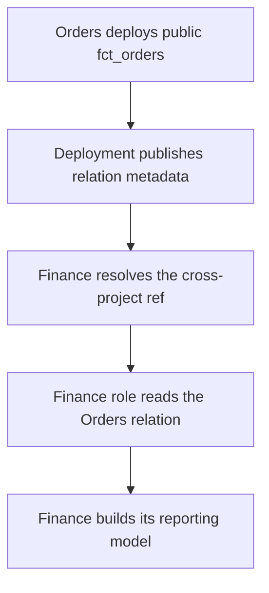

# dbt Mesh and cross-project references

As a single monolithic dbt project grows to thousands of models, every team shares one CI queue, release cadence, and permission model. **dbt Mesh** lets independent domains (such as Orders and Finance) live in separate dbt projects with their own Git repos and CI pipelines while linking cleanly through governed `public` interfaces.

## Project dependencies vs packages, and when to split

Split a monolith into Mesh projects along **real organizational ownership, security, and release boundaries** (not merely staging vs marts), because multi-project setups require cross-team deprecation and warehouse grant coordination. Keep the cross-project graph strictly acyclic: if Orders reads a public Finance model while Finance reads an Orders model, you introduce a cross-project cycle.

| Mechanism | How code or data is shared | When to use it |
| --- | --- | --- |
| **Project dependency** (`dependencies.yml`) | Resolves a two-argument `ref('orders_domain', 'fct_orders')` to metadata from an upstream deployment. The consumer queries the upstream warehouse relation using its own role. | Cross-domain data handoffs (`public` models owned, tested, and built on Orders' cadence). Requires dbt platform Enterprise/Enterprise+ (or community plugins like `dbt-loom` in self-hosted Core v1). |
| **Package dependency** (`packages.yml`) | Downloads source files into `dbt_packages/` so the consumer compiles and executes that SQL inside its own project. | Reusable Jinja macros, generic tests, or small shared utilities. |



!!! note "Environment routing and Slim CI across Mesh"
    By default in dbt platform Mesh, a downstream **Production** ref resolves to upstream **Production**, whereas downstream **Development** or **Staging** resolves to upstream **Staging** (if configured) and otherwise falls back to upstream **Production**. Before designating an upstream Staging environment, execute at least one successful Staging deploy so metadata exists. During Finance Slim CI, dbt resolves `ref('orders_domain', 'fct_orders')` directly to the routed upstream table without rebuilding Orders! [Project dependencies](https://docs.getdbt.com/docs/mesh/govern/project-dependencies)

## Practice

### Scenario

Connect an Orders producer project (`orders_domain`) to a separate Finance consumer project using the original five-column [`fct_orders`](0006-models-refs-and-project-configuration.md) (pin `version=1` if you already versioned `fct_orders`).

### Steps

1. **Producer (`orders_domain`).** Set `access: public` under `fct_orders` `config:`. On a supported platform, run a successful production deploy and record the run ID and `relation_name`. For the local DuckDB walkthrough in [shop_lab](0004-adapters-profiles-and-the-local-shop-lab.md), build `fct_orders`:

```bash
dbt build --profiles-dir . --select +fct_orders
jq -r '.nodes["model.shop_lab.fct_orders"].relation_name' target/manifest.json
```

2. **Consumer (`finance_domain`) `dependencies.yml`.** Register the producer using the exact case-sensitive `name:` from Orders' `dbt_project.yml` (project names must be unique across the account):

```yaml
projects:
  - name: orders_domain
```

3. **Consumer SQL (`models/finance_order_amounts.sql`).** Reference the public model and verify the Finance warehouse role holds usage/read grants on the Orders schema and table:

```sql
select order_id, total_cents
from {{ ref('orders_domain', 'fct_orders') }}
```

If you are following the local walkthrough, leave the consumer YAML and SQL out of `shop_lab`. Simulate the cross-project query directly against `shop_lab` and document which platform environment and warehouse role would execute it in production:

```bash
dbt show --profiles-dir . --inline "select order_id, total_cents from {{ ref('fct_orders') }} order by order_id"
```

**Check each route.** In the local walkthrough the preview reads the existing shop fact and shows amounts of 1,250, 500, and 1,750 cents. In the connected Finance project, run `dbt build --select finance_order_amounts`. Inspect its compiled SQL for the deployed Orders relation and verify the same three amounts. Cross-project name resolution and Finance grants require the connected route.

Diagnose the two common Mesh failure modes:

| Failure | Evidence to inspect |
| --- | --- |
| **dbt fails to resolve the cross-project `ref()`** | Exact producer project `name`, `access: public` config, requested `version`, environment routing (`Staging` vs `Production`), and the latest successful upstream deployment manifest. |
| **Ref compiles cleanly, yet SQL fails on permissions** | Consumer warehouse execution role and its `USAGE` / `SELECT` grants on the resolved producer database, schema, and table. |

When migrating Orders from cents to dollars, keep `v1` and `v2` deployed together, pin Finance to `version=1` until Finance migrates and reconciles totals, and agree on SLA ownership before retiring `v1`.

!!! note "Semantic Layer across Mesh projects"
    Model `ref()` in SQL and semantic YAML behave differently across projects: the legacy standalone semantic spec can reference a cross-project public model, whereas the embedded semantic spec does not yet bind across projects. Keep semantic definitions in the same project as their underlying fact when using the embedded spec. [YAML spec migration](https://docs.getdbt.com/docs/build/latest-metrics-spec)

## Recall

1. Orders merged a brand-new `access: public` model to Git. Why might Finance CI still fail with an unresolved `ref()`?
2. How does sharing logic via `packages.yml` differ from sharing data via `dependencies.yml`?
3. When should a team *avoid* splitting one dbt repository into separate Mesh projects?

??? note "Answer guidance"
    1. Cross-project resolution reads published metadata from a successful deployment in the routed upstream environment (Staging or Production). Until Orders successfully deploys that model there (and grants Finance `SELECT` access on the table), Finance cannot resolve or query it.
    2. `packages.yml` installs source code (`dbt_packages/`) that runs inside the consumer's own project and schema. `dependencies.yml` resolves metadata pointing to relations deployed and maintained independently by the producer team.
    3. Avoid splitting when one small team owns both layers, when models tightly co-evolve on every PR, or before clear domain boundaries exist, because Mesh adds cross-repo deployment, versioning, and warehouse grant overhead.

[Mesh best practices](https://docs.getdbt.com/best-practices/how-we-mesh/mesh-1-intro) · [Mesh FAQs](https://docs.getdbt.com/best-practices/how-we-mesh/mesh-5-faqs)

| Previous | Curriculum | Next |
| --- | --- | --- |
| [Previous lesson](0029-contracts-model-versions-and-groups.md) | [All lessons](index.md) | [Next lesson](0031-package-hub-dbt-deps-and-dbt-utils.md) |
