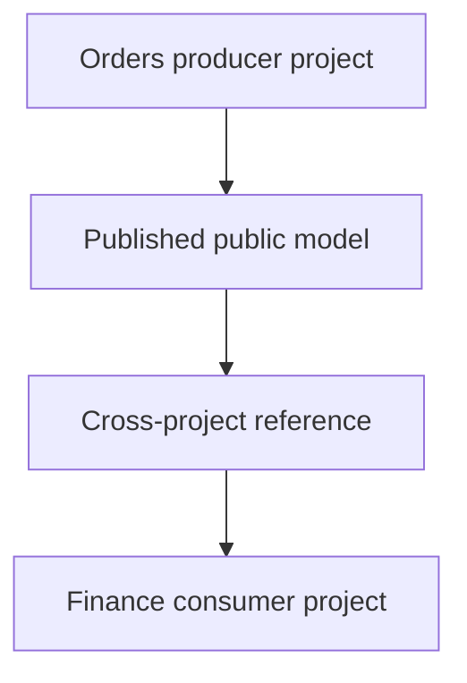

# dbt Mesh and cross-project references

dbt Mesh organizes work into independently deployed domain projects with owned public interfaces. A consumer declares project dependencies and references a model using `ref('orders_domain', 'fct_orders')`. Project dependencies consume the producer's published metadata and relations. Package dependencies bring code into the consumer project. Verify the supported setup and publish the producer before testing the consumer.

Agree on access grants, ownership, release cadence, version support, and communication during incidents. Before centralizing a semantic layer across Mesh domains, check the semantic YAML spec. Cross-project refs are supported in the legacy spec and have documented limitations in the newer embedded spec.



## Practice

Split the architecture into Orders and Finance. In a supported platform setup, configure `fct_orders` with `access: public` and deploy it successfully in the Orders production environment. In Finance, add this project dependency and build a model that uses the two-argument ref.

```yaml
# dependencies.yml in Finance
projects:
  - name: orders_domain
```

```sql
select order_id, total_cents
from {{ ref('orders_domain', 'fct_orders') }}
```

Identify which Finance role needs warehouse reads. Write the steps for changing a public column without breaking Finance. Without platform access, draw where the manifest and relation come from.

## Recall

What happens to a consumer when the producer code has merged but its public model has yet to deploy?

[Project dependencies](https://docs.getdbt.com/docs/mesh/govern/project-dependencies) · [Mesh FAQs](https://docs.getdbt.com/best-practices/how-we-mesh/mesh-5-faqs)

| Previous | Curriculum | Next |
| --- | --- | --- |
| [← Previous lesson](0029-contracts-model-versions-and-groups.md) | [All lessons](index.md) | [Next lesson →](0031-package-hub-dbt-deps-and-dbt-utils.md) |
