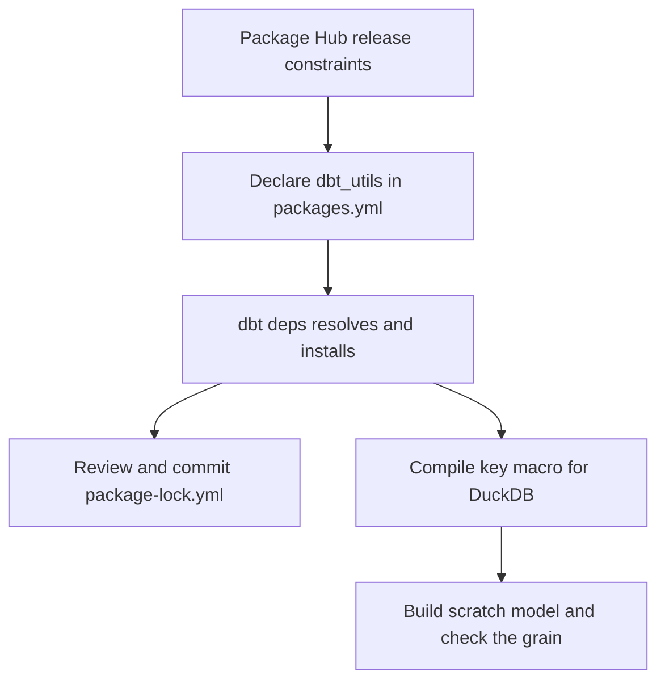

# Package Hub, dbt deps and dbt-utils

A dbt package brings project code into your project. Its macros can generate adapter-specific SQL, and its models, seeds, tests and hooks can run as part of your job. Review the release diff and transitive dependencies before running new package code.

On [Package Hub](https://hub.getdbt.com/), open the exact release and check its `require-dbt-version` against `dbt --version`. For v2, check what the compatibility badge covers. Confirm adapter support in the package docs and run a small build on your target. Version constraints and parse checks leave SQL execution to be verified.

`packages.yml` declares the dependencies. `dbt deps` installs their resolved versions into `dbt_packages/` by default. Commit `packages.yml` and `package-lock.yml` so CI can run `dbt deps` in a clean checkout with the same resolutions. When intentionally changing a pin or refreshing a range with `dbt deps --upgrade`, review the lock diff for indirect changes and run the affected builds. [dbt deps reference](https://docs.getdbt.com/reference/commands/deps)

`dbt-utils` supplies helpers such as `date_spine`, `generate_surrogate_key` and `unique_combination_of_columns`. The key macro casts the inputs to strings, uses a sentinel for nulls by default, and hashes the joined values. Test the input grain separately. Adding `customer_id` to an order key could hide repeated order IDs with different customers. When replacing the older `surrogate_key` macro, compare persisted IDs before upgrading. The legacy option `surrogate_key_treat_nulls_as_empty_strings` changes how nulls hash. [dbt-utils](https://github.com/dbt-labs/dbt-utils)



## Practice with dbt v2 and DuckDB

Use the [shop_lab setup](0004-adapters-profiles-and-the-local-shop-lab.md) and run from its project root. Merge this entry into `packages.yml`. The example pins [dbt-utils 1.3.3](https://hub.getdbt.com/dbt-labs/dbt_utils/1.3.3/).

```yaml
packages:
  - package: dbt-labs/dbt_utils
    version: 1.3.3
```

Save as `models/orders_package_keys.sql`. The two hashes probe null and empty string behavior while the seed stays intact.

```sql
with orders as (
    select
        order_id,
        customer_id,
        cast(null as varchar) as null_marker,
        cast('' as varchar) as empty_marker
    from {{ ref('stg_orders') }}
)
select
    order_id,
    customer_id,
    {{ dbt_utils.generate_surrogate_key(['order_id', 'customer_id']) }} as order_key,
    {{ dbt_utils.generate_surrogate_key(['order_id', 'null_marker']) }}
        <> {{ dbt_utils.generate_surrogate_key(['order_id', 'empty_marker']) }}
        as null_and_empty_differ
from orders
```

Save as `models/orders_package_keys.yml`.

```yaml
models:
  - name: orders_package_keys
    data_tests:
      - dbt_utils.unique_combination_of_columns:
          arguments:
            combination_of_columns: [order_id, customer_id]
    columns:
      - name: order_id
        data_tests: [unique, not_null]
```

```bash
dbt --version
dbt deps --profiles-dir .
dbt build --profiles-dir . --select +orders_package_keys
dbt show --profiles-dir . --select orders_package_keys
```

Expect three rows, three distinct key values, three passing tests and `null_and_empty_differ` true in every row with the default null behavior. Run `dbt deps` a second time and confirm the lock still resolves the same release. For Core v1, check the generic-test syntax in your release. Versions before 1.10.5 use test arguments directly under the test name. [Data test properties](https://docs.getdbt.com/reference/resource-properties/data-tests)

## Recall

1. Which files would you review in a package upgrade, and what does a clean build verify?
2. Can two rows with the same `order_id` pass the combination test?

??? success "Answer guidance"
    1. Review the requested versions, resolved lock entries and package source changes. A clean build verifies installation and execution against the selected engine, adapter and data.
    2. Yes, if their `customer_id` differs. The separate `unique` test on `order_id` enforces the lab's order grain.

| Previous | Curriculum | Next |
| --- | --- | --- |
| [Previous lesson](0030-dbt-mesh-and-cross-project-references.md) | [All lessons](index.md) | [Next lesson](0032-dbt-expectations-for-richer-data-assertions.md) |
