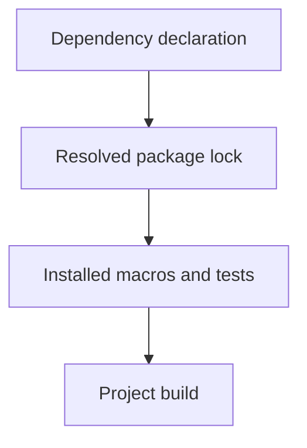

# Package Hub, dbt deps and dbt-utils

Declare package code dependencies in `packages.yml` and install them using `dbt deps`. Commit the resolved `package-lock.yml` when generated so CI and developers use the same versions. Verify support for the engine, adapter and project constraints before upgrading. Packages can contain executable macros, hooks, seeds and models, so review the code you install.

Maintained by dbt Labs, `dbt-utils` provides cross-platform helpers such as `generate_surrogate_key`, date macros and data tests such as `unique_combination_of_columns`. A surrogate key works only when its input columns describe the intended grain. Check null handling before migrating from an older key macro.

## Practice

Install a compatible version of `dbt-labs/dbt_utils` from the Package Hub. Add a `dbt_utils.generate_surrogate_key(['order_id', 'customer_id'])` expression to a scratch model. Test that null and empty string inputs behave as expected. Explain whether the compound key improves the existing order grain.

## Recall

Why should a package version upgrade be reviewed like a code change?

[Package Hub](https://hub.getdbt.com/) · [dbt-utils](https://github.com/dbt-labs/dbt-utils)

| Previous | Curriculum | Next |
| --- | --- | --- |
| [← Previous lesson](0030-dbt-mesh-and-cross-project-references.md) | [All lessons](index.md) | [Next lesson →](0032-dbt-expectations-for-richer-data-assertions.md) |
