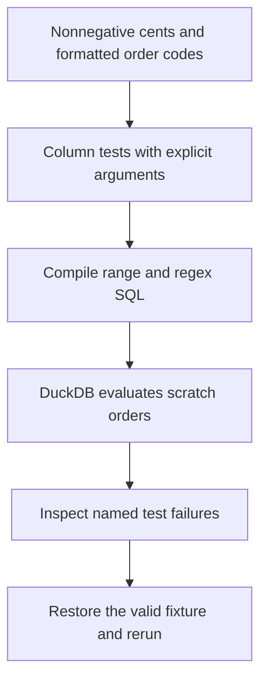

# dbt-expectations for richer data assertions

Built-in dbt tests check uniqueness, nulls, enums, and foreign keys, yet real data defects often violate ranges, string formats, table shapes, or historical distributions. **`dbt-expectations`** brings Great Expectations-style assertions into dbt as YAML generic tests that compile to SQL and query built relations.

## Choosing the right package fork and test category

Many older tutorials cite `calogica/dbt_expectations`, which is now unmaintained. Use the actively maintained **Metaplane fork** (`metaplane/dbt_expectations`, namespace `dbt_expectations`). Release `0.10.10` targets dbt `>=1.7.0, <3.0.0`, supports DuckDB, and installs `dbt-date` as a transitive dependency (which expects a timezone variable). Always verify regex dialect compatibility on your warehouse. [Package Hub release](https://hub.getdbt.com/metaplane/dbt_expectations/0.10.10/) · [dbt-expectations](https://github.com/metaplane/dbt-expectations)

`dbt-expectations` tests fall into three practical categories:

| Category | Example tests | Watch out for |
| --- | --- | --- |
| **Row-level value rules** | `expect_column_values_to_be_between`, `expect_column_values_to_match_regex`, `expect_column_values_to_be_of_type`. | Pair with `not_null` because SQL comparisons treat `NULL` as unknown and pass silently. |
| **Table shape assertions** | `expect_table_column_count_to_equal`, `expect_table_columns_to_match_ordered_list`. | Shape checks do not catch bad units (dollars vs cents) or duplicated rows. |
| **Distributional and recency checks** | `expect_table_row_count_to_be_between`, `expect_column_mean_to_be_between`, `expect_row_values_to_have_recent_data`. | Seasonal swings can trip tight thresholds; start with `severity: warn` before blocking pipelines. |



On large tables, scope checks with **`row_condition`** (for example `row_condition: "status = 'paid'"`) or `where` configs so assertions scan only relevant records.

## Practice with dbt v2 and DuckDB

### What you need

Start in [shop_lab](0004-adapters-profiles-and-the-local-shop-lab.md) with [`stg_orders`](0004-adapters-profiles-and-the-local-shop-lab.md).

### Steps

1. Merge `metaplane/dbt_expectations` into `packages.yml` and merge the timezone variable into `dbt_project.yml`:

```yaml
# packages.yml
packages:
  - package: metaplane/dbt_expectations
    version: 0.10.10
```

```yaml
# dbt_project.yml
vars:
  'dbt_date:time_zone': UTC
```

2. Create `models/orders_expectations_probe.sql`:

```sql
select
    order_id,
    total_cents,
    'ORD-' || cast(order_id as varchar) as order_code
from {{ ref('stg_orders') }}
```

3. Create `models/orders_expectations_probe.yml` (the 100,000-cent ceiling is a sandbox rule; validate real caps with the domain owner):

```yaml
models:
  - name: orders_expectations_probe
    columns:
      - name: total_cents
        data_tests:
          - not_null
          - dbt_expectations.expect_column_values_to_be_between:
              name: order_amount_in_range
              arguments:
                min_value: 0
                max_value: 100000
      - name: order_code
        data_tests:
          - dbt_expectations.expect_column_values_to_match_regex:
              name: order_code_has_format
              arguments:
                regex: '^ORD-[0-9]+$'
```

4. Install and build:

```bash
dbt deps --profiles-dir .
dbt build --profiles-dir . --select +orders_expectations_probe
```

**Expected result.** All 3 tests pass (`not_null`, `order_amount_in_range`, `order_code_has_format`).

5. **Simulate failures.** In `models/orders_expectations_probe.sql`, temporarily change `total_cents` to `case when order_id = 1 then -1 else total_cents end as total_cents` and change `'ORD-'` to `'BAD-'`. Rerun `dbt build --profiles-dir . --select +orders_expectations_probe`. Confirm `order_amount_in_range` flags **1** row, `order_code_has_format` flags **3** rows, and `not_null` passes.
6. **Restore.** Revert the two expressions in `models/orders_expectations_probe.sql` and rerun the build to confirm 3 passes. (On Core v1 earlier than 1.10.5, place `min_value`, `max_value`, and `regex` directly under the test name without `arguments:`). [Data test properties](https://docs.getdbt.com/reference/resource-properties/data-tests)

## Recall

1. How can `expect_table_column_count_to_equal` pass while an orders revenue dashboard is completely wrong?
2. Why pair `expect_column_values_to_be_between` with a separate `not_null` test?
3. When should you configure `severity: warn` and `row_condition` on a `dbt-expectations` check?

??? note "Answer guidance"
    1. Column count validates table shape only; values can switch units (dollars vs cents) or a join can double rows without changing the number of columns.
    2. SQL range comparisons evaluate `NULL >= 0` as unknown, so rows with missing amounts pass range checks silently unless `not_null` catches them.
    3. Use `severity: warn` on noisy statistical/distribution bounds while tuning thresholds so valid seasonal shifts alert without halting production. Use `row_condition` to limit expensive checks to active subsets or recent partitions.

| Previous | Curriculum | Next |
| --- | --- | --- |
| [Previous lesson](0031-package-hub-dbt-deps-and-dbt-utils.md) | [All lessons](index.md) | [Next lesson](0033-dbt-project-evaluator-and-architecture-rules.md) |
