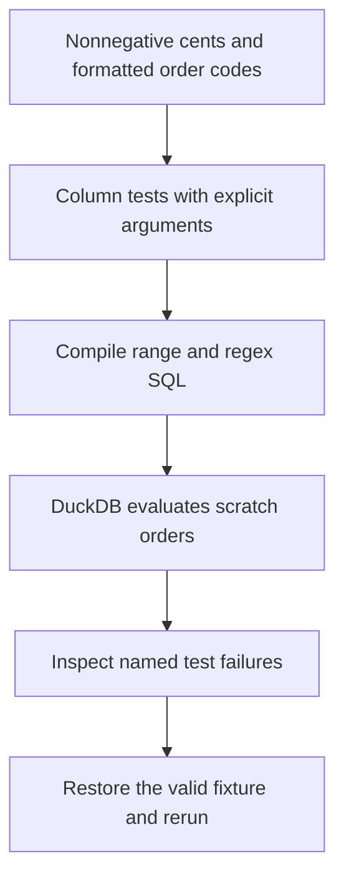

# dbt-expectations for richer data assertions

`dbt-expectations` turns Great Expectations-style assertions into dbt generic data tests. dbt compiles the test to SQL and runs it against the selected relation. A test can check row values, table shape or an aggregate. Choose the check that expresses the business rule and inspect what the compiled SQL counts as a failure.

The maintained Metaplane fork installs as `metaplane/dbt_expectations` and uses the `dbt_expectations` macro namespace. Release 0.10.10 declares dbt `>=1.7.0, <3.0.0` and DuckDB is on the adapter list. The package brings in `dbt-date` as a dependency. Check the lock, named test and adapter-specific behavior before adopting any release, especially for regex and date checks. [Package Hub release](https://hub.getdbt.com/metaplane/dbt_expectations/0.10.10/) · [dbt-expectations](https://github.com/metaplane/dbt-expectations)

A range can encode an invariant such as nonnegative order totals. A distribution bound can flag a seasonal shift even when the data is valid. Use `severity: warn` when you want investigation before imposing a release gate. Use a separate `not_null` test for required values, and estimate scan cost before running broad checks on a large relation. A scoped test covers only the rows in its filter.



## Practice with dbt v2 and DuckDB

Start from the [shop_lab setup](0004-adapters-profiles-and-the-local-shop-lab.md). Add this package entry and merge the timezone variable into `dbt_project.yml`.

```yaml
# packages.yml
packages:
  - package: metaplane/dbt_expectations
    version: 0.10.10
```

```yaml
# dbt_project.yml
vars:
  'dbt_date:time_zone': UTC
```

Save as `models/orders_expectations_probe.sql`.

```sql
select
    order_id,
    total_cents,
    'ORD-' || cast(order_id as varchar) as order_code
from {{ ref('stg_orders') }}
```

Save as `models/orders_expectations_probe.yml`. The upper bound is a sandbox policy of 100,000 cents per order. Pick a production cap with the order owner.

```yaml
models:
  - name: orders_expectations_probe
    columns:
      - name: total_cents
        data_tests:
          - not_null
          - dbt_expectations.expect_column_values_to_be_between:
              name: order_amount_in_range
              arguments:
                min_value: 0
                max_value: 100000
      - name: order_code
        data_tests:
          - dbt_expectations.expect_column_values_to_match_regex:
              name: order_code_has_format
              arguments:
                regex: '^ORD-[0-9]+$'
```

```bash
dbt deps --profiles-dir .
dbt build --profiles-dir . --select +orders_expectations_probe
```

Expect three passing tests. In the scratch SQL only, replace the amount expression with `case when order_id = 1 then -1 else total_cents end as total_cents` and the code prefix with `'BAD-'`. Rerun the same build. Expect `order_amount_in_range` to report one failing row, `order_code_has_format` to report three and `not_null` to pass. Restore the two expressions and rerun to recover three passes. For Core v1, confirm whether your version uses nested `arguments:` before copying the YAML. [Data test properties](https://docs.getdbt.com/reference/resource-properties/data-tests)

## Recall

1. How could a table column-count test pass while an orders report is wrong?
2. Why test the bounds and nullability separately?

??? success "Answer guidance"
    1. Column count checks table shape. An amount might be in dollars where downstream SQL expects cents, or a join could multiply orders without adding columns.
    2. Comparisons with null evaluate to unknown in SQL. The range test checks observed amounts against the bounds, while `not_null` detects missing amounts.

| Previous | Curriculum | Next |
| --- | --- | --- |
| [Previous lesson](0031-package-hub-dbt-deps-and-dbt-utils.md) | [All lessons](index.md) | [Next lesson](0033-dbt-project-evaluator-and-architecture-rules.md) |
