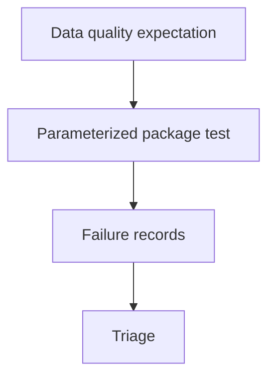

# dbt-expectations for richer data assertions

`dbt-expectations` adapts Great Expectations-style checks into dbt generic tests. It covers ranges, distributions, string patterns and relation shape. The Package Hub lists the Metaplane fork of the original Calogica package. Check test names and argument syntax against your specific installed release.

Start with a business rule and use a package test when it expresses that rule clearly. Distribution thresholds can flag legitimate seasonal shifts. Choose scope, severity and scan volume deliberately.

## Practice

Select a compatible release of `metaplane/dbt_expectations`. Find a bounded-range test for `total_cents` and a regex test for a formatted identifier. Add a negative fixture value and verify the range test fails for the chosen model. Record the test configuration and the business reason for the limit.

## Recall

Why might a shape test pass while an orders report is substantively wrong?

[dbt-expectations on Package Hub](https://hub.getdbt.com/metaplane/dbt_expectations/latest/)

| Previous | Curriculum | Next |
| --- | --- | --- |
| [← Previous lesson](0031-package-hub-dbt-deps-and-dbt-utils.md) | [All lessons](index.md) | [Next lesson →](0033-dbt-project-evaluator-and-architecture-rules.md) |
